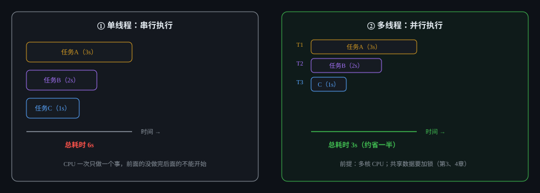
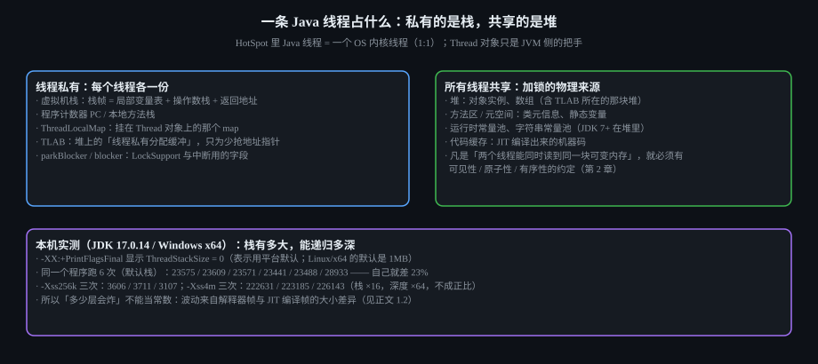
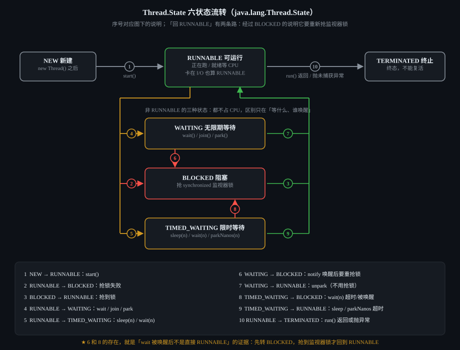
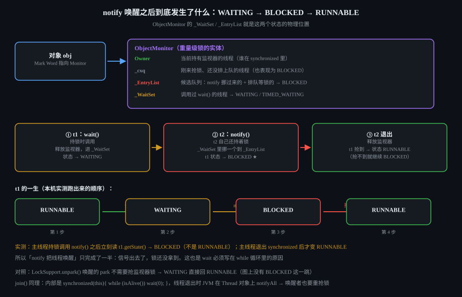
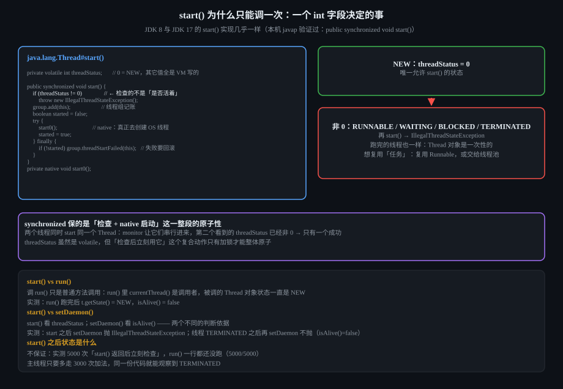

# 第1章 多线程基础：线程状态、启动与生命周期

> 一句话讲清：**线程 = 操作系统里一条能独立执行的指令流；JVM 把 OS 线程包装成 `Thread` 对象，
> 每个线程有自己的栈、程序计数器、局部变量表，但共享堆和方法区。**
> 本章目标：讲清线程六状态流转（**包括 WAITING 被唤醒后为什么要多走一跳 BLOCKED**）、
> `start()` 为什么只能调一次（**源码级**）、四种启动方式、生命周期方法、守护线程。

> **本文所有 ★实测 结论都在本机真跑过**：JDK 17.0.14 / Windows x64 / HotSpot。
> 源码以 **JDK 8** 为基准（企业主流），JDK 8 与 JDK 17 的差异逐处标注。

> **实测代码在哪、怎么跑**（重要，本文的规矩）：
> 1. 每个 ★实测 输出块都会**标明出处**；产生它的完整代码**就近贴在正文**（核心结论处），或收在 [附录 B](#appendix-b)；
> 2. 这些片段同一份源码也放在仓库根目录 `java-thread-demos/snippets/`（`Snippet01_…` ~ `Snippet12_…`，与正文顺序对应），完整实验程序在 `java-thread-demos/`（`S1Start.java` 等），原始输出在各自的 `out/` 里；
> 3. 编译运行：`javac -encoding UTF-8 -d . *.java` + `java -Dsun.stdout.encoding=UTF-8 -cp . 类名`（需要反射读内部字段的两段还加了 `--add-opens / --add-exports`，见 1.3.4 与附录 A.1）；
> 4. 输出里出现的每一个线程名、变量名，都能**在同一页或附录 B 的代码里**找到定义 —— 没有"天上掉下来的 `t2`"。
> 全部出处索引见 [附录 A](#appendix-a)。

## 1.1 为什么要多线程（以及为什么不是越多越好）

**单线程一次只能做一件事；CPU 有核，能同时干，为什么要闲置？**


*图 1-1：同样是 3 个任务，单线程串行 6s，多线程并行约 3s*

三个真实收益：

1. **提升吞吐**：多核 CPU 充分利用（IoT 平台同时消费 Kafka + 处理入库 + 响应查询）
2. **异步解耦**：主线程不用等慢操作（HTTP 调外部 API 时，主线程可继续干别的）
3. **响应性**：Web 服务器一个连接一线程，互不阻塞

**核心前提（面试必答）：多线程只有在"多核 CPU"上才真正并行；单核上是分时调度（快速切换，看起来像并行，实际是伪并行）。**

### 追问：那线程是不是越多越好？

不是。**线程是"有资源成本"的调度单位**，成本有四项：

| 成本项 | 量级 | 说明 |
|--------|------|------|
| 栈（地址空间） | 默认约 1MB/线程 | 1 万个线程就是 10GB 虚拟地址空间（见 1.2 实测） |
| 创建/销毁 | 几十 µs ~ 几百 µs | 走 native `pthread_create`/`CreateThread` |
| 上下文切换 | 微秒级 | 换 PC、寄存器、刷新 TLB/缓存局部性 |
| 间接成本 | —— | TLAB 变多、GC 扫描更多根、锁竞争变激烈、CPU 缓存命中率下降 |

所以：**CPU 密集任务，线程数 ≈ 核数 + 1；IO 密集任务可以放大到 2N 甚至更多，但真正的答案永远是压测出来的**（第 6 章线程池参数怎么定）。

## 1.2 线程到底是什么：`Thread` 对象只是 OS 线程的"把手"

HotSpot 里 Java 线程与内核线程是 **1:1** 的：`new Thread()` 只是一个 Java 对象，`start()` 之后 JVM 才会去创建一个 OS 线程（`pthread_create` / `CreateThread`），并把两者绑定。所以：

- **`Thread` 对象 ≠ 线程**：`new` 出来的东西在 `start()` 之前只是个"说明书"，没占用任何内核资源；
- **JVM 侧还有一份 C++ 对象**（`JavaThread`）：栈、状态机、监视器记录都在那边，`threadStatus` 这个 Java 字段只是给工具看的投影（1.3 会细讲）；
- 想真的看到"线程"这个 OS 实体，要用 `jstack`（Java 视角）或任务管理器/`top -H`（OS 视角）交叉验证。


*图 1-2：线程私有的是栈/PC，共享的是堆与方法区——这就是"多线程要加锁"的物理来源*

### 追问：一个线程的栈有多大？能递归多深？（★实测）

先看程序（`java-thread-demos/snippets/Snippet08_StackDepth.java`）：

```java
public class Snippet08_StackDepth {
    static int depth = 0;

    static void recurse() {
        depth++;
        recurse();
    }

    public static void main(String[] args) {
        try {
            recurse();
        } catch (StackOverflowError e) {
            System.out.println("递归深度 = " + depth);
        }
    }
}
```

```bash
java -XX:+PrintFlagsFinal -version | grep ThreadStackSize
#     intx ThreadStackSize = 0 {pd product} {default}   ← 0 = 用平台默认
#     （Linux/x64 上 HotSpot 的默认是 1MB）
java -Xss512k -XX:+PrintFlagsFinal -version | grep ThreadStackSize
#     intx ThreadStackSize = 512 {pd product} {command line}

java -cp . Snippet08_StackDepth              # 默认栈
java -Xss256k -cp . Snippet08_StackDepth
java -Xss4m -cp . Snippet08_StackDepth
```

**同一个程序，默认栈连跑 6 次的实测结果（注意它不是一个常数）**：

```text
递归深度 = 23575
递归深度 = 23609
递归深度 = 23571
递归深度 = 23441
递归深度 = 23488
递归深度 = 28933      ← 比前几次高 23%
```

```text
-Xss256k 三次：3606 / 3711 / 3107
-Xss4m   三次：222631 / 223185 / 226143
```

**三点结论（比一个"35508 层"有用得多）**：

1. **波动是正常的，不是测量误差**：同一份代码在 2.3 万 ~ 2.9 万之间跳（我在别的程序形态上还见到过 35508）。原因是"一层栈帧多大"取决于这层是**解释器帧**还是 **JIT 编译后的帧**（两者大小差好几倍），而 JIT 何时编译、编译成 C1 还是 C2 每次运行都不同。**所以凡"多少层会炸"的数字，都要带上程序 + 多次运行**；
2. **深度和 `-Xss` 不成正比**：栈从 256k → 默认(1M) → 4m 是 **16 倍**（256:1024:4096），深度从约 3.5 千 → 2.35 万 → 22.4 万是约 **64 倍** —— 单调增长但远快于栈的增长，原因还是"帧的大小不统一"；
3. **方向是可靠的**：`-Xss` 增大 → 能递归得更深；`-Xss` 太小 → 更早 `StackOverflowError`。生产里"栈溢出"和"线程创建失败"要用这两个方向分别排查。
> 出处：`snippets/Snippet08_StackDepth.java`，原始输出 `snippets/out/Snippet08_default_6runs.txt`、`Snippet08_256k_3runs.txt`、`Snippet08_4m_3runs.txt`。

结论与坑：

- **`-Xss` 是"每个线程"的栈**，不是全局；开线程数 × 1MB 就是虚拟地址空间的下限；
- 栈是**按需提交**的（真的用到才映射物理页），但地址空间要先占住 —— 所以"开 1 万个线程"最先炸的往往不是堆，而是 `OutOfMemoryError: unable to create native thread`；
- `StackOverflowError`（栈太深/递归没出口）和 `OutOfMemoryError`（线程创建失败/堆不足）是两个完全不同的诊断方向。

### 追问：`main` 线程结束后，JVM 为什么不退出？

因为**退出条件是"所有非守护线程都结束"**，不是"`main` 结束"：

> JVM continues to execute threads until ... **All threads that are not daemon threads have died**
> —— `java.lang.Thread` 类注释（JDK 8 原文）

所以 `main` 里 `new Thread(...).start()` 起来的是**非守护线程**时，`main` 返回了 JVM 也还在跑；反过来，把子线程 `setDaemon(true)` 之后，`main` 一结束 JVM 立刻退，子线程被"腰斩"。

### 追问：JDK 21 的虚拟线程呢？

虚拟线程（`Thread.ofVirtual()`）复用同一套 `Thread` API 和同一个 `Thread.State` 枚举，但 park/阻塞时会 **un-mount**，把载体线程（carrier）让给别人 —— 所以 `jstack` 里看不到几万个 `WAITING` 的虚拟线程，要用 `jcmd <pid> Thread.dump_to_file`。原理与坑见 [Spring 系列：虚拟线程原理](../spring/10-虚拟线程原理.html)。

## 1.3 Thread.State：六状态模型（★ 面试必考）

JVM 的 `java.lang.Thread.State` 枚举只有 6 个值，**比"操作系统线程状态"少一个"就绪"**（这是高频追问）。先看图，图下每条箭头都在下一节的表里有出处：


*图 1-3：从 NEW 到 TERMINATED 的完整流转。注意 6、8 两条箭头——它们就是"wait 被唤醒后不是直接 RUNNABLE"的证据*

### 1.3.1 六状态逐个：进入条件 / 离开条件 / jstack 长什么样

| 状态 | 进入条件（谁触发的） | 离开条件 | `jstack` 里的样子 |
|------|---------------------|----------|------------------|
| `NEW` | `new Thread(...)` 之后 | 只有 `start()` | `nid=...` 还没出现，线程列表里没有它 |
| `RUNNABLE` | `start()`；以及任何等待被唤醒之后 | `run()` 返回 / 抛未捕获异常 | `runnable` + `Thread.State: RUNNABLE` |
| `BLOCKED` | **抢 `synchronized` 监视器锁失败** | 抢到锁 | `waiting for monitor entry` + `BLOCKED (on object monitor)` |
| `WAITING` | `Object.wait()`、`Thread.join()`、`LockSupport.park()`（都无超时） | `notify/notifyAll`、目标线程结束、`unpark` | `in Object.wait()` + `WAITING (on object monitor)` 或 `WAITING (parking)` |
| `TIMED_WAITING` | `Thread.sleep(n)`、`wait(n)`、`join(n)`、`parkNanos/parkUntil` | 时间到 / 被唤醒 / 中断 | `waiting on condition` + `TIMED_WAITING (sleeping)` 等 |
| `TERMINATED` | `run()` 正常返回或抛未捕获异常 | **终态，不能复活** | 线程列表里没有它了，`isAlive()` 变 false |

上面这张表的"进入条件"来自 `Thread.State` 每个枚举常量的 **javadoc 原文**（这段措辞从 JDK 8 到 JDK 23 几乎没动过），这就是为什么"`WAITING` 只有三种进法"这句话是能背的。

### 1.3.1.1 四层对齐：JVM 状态 ↔ OS 状态 ↔ JVMTI 位 ↔ jstack 原文

"JVM 状态和 OS 状态差在哪"是必被追问的一句，一次把四层对齐（**OS 那一列是 Linux 内核态，属于原理说明**：本机是 Windows，没法实测 `TASK_*` 的取值，所以这一列我标"原理"，其余三列都有本机实测）：

| JVM `Thread.State` | Linux 内核态（原理） | JVMTI `threadStatus` 的位 | `jstack` 原文 | 为什么两者不能划等号 |
|---|---|---|---|---|
| `NEW` | **无对应**：内核线程还不存在 | `0` | 不出现在线程列表里 | `new Thread()` 只是个 Java 对象，没占内核资源 |
| `RUNNABLE` | `TASK_RUNNING`（正在跑**或**就绪排队）；卡 I/O 时是 `TASK_INTERRUPTIBLE` / `TASK_UNINTERRUPTIBLE` | `0x0004`（+ `ALIVE 0x0001`） | `runnable` + `Thread.State: RUNNABLE` | 一个 JVM 状态吞掉了 OS 的"运行中 + 就绪"两个，还吞掉了"等 I/O" |
| `BLOCKED` | 等 monitor 时落到 futex 等待（`TASK_INTERRUPTIBLE`） | `0x0400`（+ ALIVE） | `waiting for monitor entry` + `- waiting to lock <0x…>` | OS 的"阻塞"是泛称（等 I/O、等信号量、睡觉都算），JVM 只把"等监视器锁"叫 `BLOCKED` |
| `WAITING` | futex 等待（`TASK_INTERRUPTIBLE`） | `0x0010` + `IN_OBJECT_WAIT 0x0100` 或 `PARKED 0x0200` | `in Object.wait()` / `waiting on condition`，括号写 `(on object monitor)` 或 `(parking)` | JVM 把"等通知"和"等锁"分开，OS 只看"睡没睡" |
| `TIMED_WAITING` | `nanosleep` / 带超时的 futex 等待（`TASK_INTERRUPTIBLE`） | `0x0020` + `SLEEPING 0x0040` / IN_OBJECT_WAIT / PARKED | `TIMED_WAITING (sleeping)` 等 | 同上 |
| `TERMINATED` | 内核线程已退出（`top -H` 里消失） | `0x0002` | 从线程列表消失，`isAlive()==false` | `Thread` 对象还在堆里，线程实体已经没了 |

三句话记住差异的来源：

1. **数量差在"就绪"**：OS 有 READY（Linux 用 `TASK_RUNNING` 一并表示 running + ready），JVM 把它并进了 `RUNNABLE`；
2. **语义差在"阻塞"**：JVM 把 OS 的"阻塞/睡眠"这一类拆成 `BLOCKED`（等监视器锁）/ `WAITING`（无限期等通知）/ `TIMED_WAITING`（限时等）；
3. **方向差在"看不看得见 I/O"**：OS 能报"卡在 I/O"，JVM 报不出来（只能说 `RUNNABLE`）—— 所以 **`RUNNABLE` 的线程不一定在烧 CPU**，这正是判断"线程池开够没开够"的关键（第 6 章）。

### 1.3.2 RUNNABLE 的三重含义（★ 最反直觉的一处）

`RUNNABLE` 里其实塞了三种完全不同的处境：

1. **正在 CPU 上执行**；
2. **已就绪，在等 CPU 时间片**（OS 里的 READY —— JVM 不单独给它一个状态）；
3. **卡在 I/O 上**（socket read、`accept()`、文件读写）—— **在 JVM 眼里它也是 RUNNABLE**。

第 3 条实测（程序：`snippets/Snippet09_IoRunnable.java`）：

```java
import java.net.ServerSocket;
import java.net.Socket;

public class Snippet09_IoRunnable {
    public static void main(String[] args) throws Exception {
        ServerSocket server = new ServerSocket(0);                 // 随机端口
        int port = server.getLocalPort();

        Thread acceptor = new Thread(() -> {                       // 阻塞在内核里等连接
            try (ServerSocket ss = server) { ss.accept(); }
            catch (Exception e) { System.out.println("  [acceptor] accept 退出：" + e); }
        }, "acceptor");
        acceptor.start();
        Thread.sleep(300);
        System.out.println("  acceptor 卡在 accept() 上，getState() = " + acceptor.getState()
                + "  ★（不是 WAITING，也不是 BLOCKED，而是 RUNNABLE）");

        Thread reader = new Thread(() -> {                          // 连上但一直不发数据
            try (Socket s = new Socket("127.0.0.1", port)) {
                s.getInputStream().read();
            } catch (Exception e) { System.out.println("  [reader] read 退出：" + e); }
        }, "reader");
        reader.setDaemon(true);
        reader.start();
        Thread.sleep(400);
        System.out.println("  reader 卡在 socket read() 上，getState() = " + reader.getState()
                + "  ★");
    }
}
```

真实输出：

```text
  acceptor 卡在 accept() 上，getState() = RUNNABLE   ★
  reader   卡在 socket read() 上，getState() = RUNNABLE   ★
```

> 出处：`snippets/Snippet09_IoRunnable.java` → `snippets/out/Snippet09_IoRunnable.txt`（`acceptor`、`reader` 就是上面代码里的两个线程）。

原因：`Thread.State` 描述的是"线程在 JVM 里干什么"，而 I/O 阻塞发生在 native 层，JVM 这边只看到"这条线程进了 native 方法"。

> **面试点**：所以"线程数 + CPU 使用率"这两张图要一起看。一个 `RUNNABLE` 但 CPU 不高的线程，八成是卡在 I/O；要定位就得看 `jstack` 的**栈顶帧**（`socketRead0`、`accept`、`readBytes`……）。

### 1.3.3 BLOCKED 只有一种来源（★ 高频追问的陷阱）

```java
synchronized (lock) { }     // 抢不到 lock → BLOCKED
```

BLOCKED 的定义是**"等监视器（monitor）锁"**，包括两种情形：
① 进 `synchronized` 块/方法抢不到锁；② `Object.wait()` 被唤醒后**重新进入** `synchronized` 时抢不到锁（`Thread.State.BLOCKED` 的 javadoc 原文就写了这一条，见 1.4）。

而下面这些**都不会**让线程变 BLOCKED：

| 你以为会 | 实际状态 | 原因 |
|---------|---------|------|
| `ReentrantLock.lock()` 抢不到 | `WAITING` | AQS 用的是 `LockSupport.park()`，不是监视器 |
| `Semaphore.acquire()` 抢不到 | `WAITING` | 同上 |
| 任务提交后躺在阻塞队列里 | **没有状态可言** | 任务只是个对象，还没有线程替它跑；真要等队列的是空闲 worker（`getTask` 里 `take`/`poll` → `WAITING`/`TIMED_WAITING`） |
| socket 读不到数据 | `RUNNABLE` | native I/O 阻塞 |

> **一句话**：`BLOCKED` 是 `synchronized` 专属；JUC 里那些"锁"卡住都是 `WAITING`。

### 1.3.4 状态是怎么存的：`threadStatus` 与 JVMTI 位掩码（★ 深挖）

`Thread.getState()` 本身没有任何魔法，它读的是一个 int 字段：

```java
// JDK 8 / JDK 17 都一样（本机 javap -p java.lang.Thread 输出）
private volatile int threadStatus;

public State getState() {
    return sun.misc.VM.toThreadState(threadStatus);   // JDK 9+ 变成 jdk.internal.misc.VM
}
```

而 `toThreadState` 做的是**位判断**（JDK 17 字节码反汇编，顺序就是这个顺序）：

| 位 | 掩码 | 判出来是 |
|----|------|---------|
| `JVMTI_THREAD_STATE_RUNNABLE` | `0x0004` | `RUNNABLE` |
| `JVMTI_THREAD_STATE_BLOCKED_ON_MONITOR_ENTER` | `0x0400` | `BLOCKED` |
| `JVMTI_THREAD_STATE_WAITING_INDEFINITELY` | `0x0010` | `WAITING` |
| `JVMTI_THREAD_STATE_WAITING_WITH_TIMEOUT` | `0x0020` | `TIMED_WAITING` |
| `JVMTI_THREAD_STATE_TERMINATED` | `0x0002` | `TERMINATED` |
| 都不是（`0`） | —— | `NEW` |

★实测（反射读 `threadStatus` + 调用 JDK 自己的 `VM.toThreadState`）：

> 程序：`snippets/Snippet12_StatusBits.java`（完整源码见 [附录 B.3](#appendix-b)）。运行参数缺一不可：
> `--add-opens java.base/java.lang=ALL-UNNAMED --add-exports java.base/jdk.internal.misc=ALL-UNNAMED`。
> 输出原文：`java-thread-demos/snippets/out/Snippet12_StatusBits.txt`。

| 状态 | threadStatus（十进制） | 十六进制 | 位分解 |
|------|----------------------|---------|--------|
| NEW | 0 | 0x0000 | 0 |
| RUNNABLE | 5 | 0x0005 | ALIVE(0x1) \| RUNNABLE(0x4) |
| BLOCKED | 1025 | 0x0401 | ALIVE(0x1) \| BLOCKED_ON_MONITOR_ENTER(0x400) |
| WAITING（`wait()`） | 401 | 0x0191 | ALIVE \| IN_OBJECT_WAIT(0x100) \| WAITING(0x80) \| WAITING_INDEFINITELY(0x10) |
| WAITING（`join()`） | 401 | 0x0191 | 同上（join 内部就是 `wait(0)`） |
| WAITING（`park()`） | 673 | 0x02A1 | ALIVE \| PARKED(0x200) \| WAITING(0x80) \| WAITING_WITH_TIMEOUT(0x20) |
| TIMED_WAITING（`sleep(n)`） | 225 | 0x00E1 | ALIVE \| SLEEPING(0x40) \| WAITING(0x80) \| WAITING_WITH_TIMEOUT(0x20) |
| TIMED_WAITING（`wait(n)`） | 417 | 0x01A1 | ALIVE \| IN_OBJECT_WAIT \| WAITING \| WAITING_WITH_TIMEOUT |
| TERMINATED | 2 | 0x0002 | TERMINATED |

**这张表的用处**：它解释了 `jstack` 为什么能在同一个 `WAITING` 后面写出不同的括号 —— 因为"子类型位"不一样：

```text
"obj-wait"  ... in Object.wait()      → java.lang.Thread.State: WAITING (on object monitor)
"parking"   ... waiting on condition  → java.lang.Thread.State: WAITING (parking)
"sleeping"  ... waiting on condition  → java.lang.Thread.State: TIMED_WAITING (sleeping)
"mon-blocked" ... waiting for monitor entry → java.lang.Thread.State: BLOCKED (on object monitor)
```

`wait` 与 `join` 的十进制值**完全一样（401）**，也说明"join 就是 `wait(0)`"这件事不是比喻，是同一套实现。

### 1.3.5 一次 jstack 实测：把状态和输出对上（★ 面试加分）

程序：`snippets/Snippet10_JstackDump.java`（把 6 种状态各造一个线程摆好并打印 `PID`；完整源码见 [附录 B.4](#appendix-b)）。两步：

```bash
java -Dsun.stdout.encoding=UTF-8 -cp . Snippet10_JstackDump   # 打印 PID 后停住等待
jstack <PID>                                                  # 另开一个窗口打快照
```

输出已裁剪（只留线程头 + `State` 行 + 关键栈帧）。**两次独立运行的原始快照**：
`snippets/out/Snippet10_jstack.txt`（本次用 `Snippet10_JstackDump` 跑的）与 `java-thread-demos/out/S7-jstack.txt`（同一实验的完整 dump）。

```text
"mon-blocked" #16 daemon prio=5 ... waiting for monitor entry
   java.lang.Thread.State: BLOCKED (on object monitor)
	at S7Dump.lambda$main$1(S7Dump.java:22)
	- waiting to lock <0x0000000713339160> (a java.lang.Object)

"obj-wait" #17 daemon prio=5 ... in Object.wait()
   java.lang.Thread.State: WAITING (on object monitor)
	at java.lang.Object.wait(Native Method)
	- waiting on <0x0000000713339170> (a java.lang.Object)
	at java.lang.Object.wait(Object.java:338)
	- locked <0x0000000713339170> (a java.lang.Object)     ← wait 前是持有它的

"sleeping" #18 daemon prio=5 ... waiting on condition
   java.lang.Thread.State: TIMED_WAITING (sleeping)

"parking" #19 daemon prio=5 ... waiting on condition
   java.lang.Thread.State: WAITING (parking)
	at jdk.internal.misc.Unsafe.park(Native Method)

"io-accept" #20 daemon prio=5 ... runnable                ← 阻塞在内核，但 JVM 说它 runnable
   java.lang.Thread.State: RUNNABLE
	at sun.nio.ch.Net.accept(Native Method)
```

读 `jstack` 的三条口诀：

1. `waiting to lock` = 在等锁（BLOCKED），下面那行 `- waiting to lock <0x…>` 就是它想锁的对象；
2. `waiting on` + `locked` 同时出现 = 它在 `wait()`，**`locked` 那行说明它是"持锁进入 wait"的**；
3. `waiting on condition` 是 JVM 对 `park/sleep` 这类"条件等待"的统一说法，具体是睡觉还是停车，看括号。

### 1.3.6 状态机代码：把六个状态全部走一遍

```java
public class ThreadStateDemo {
    private static final Object LOCK = new Object();

    public static void main(String[] args) throws InterruptedException {
        Thread t = new Thread(() -> {
            synchronized (LOCK) {
                System.out.println("1. 拿到锁，状态：" + Thread.currentThread().getState()); // RUNNABLE
                try { Thread.sleep(100); } catch (InterruptedException ignored) { }
                System.out.println("2. sleep 结束：" + Thread.currentThread().getState());   // RUNNABLE
                try { LOCK.wait(); } catch (InterruptedException ignored) { }
                // 这行是本文的重点：被 notify 唤醒后，先经历 BLOCKED 才回到 RUNNABLE
                System.out.println("3. wait 被唤醒：" + Thread.currentThread().getState());  // RUNNABLE
            }
        }, "t");

        System.out.println("0. 未 start：" + t.getState());        // NEW
        t.start();
        while (t.getState() != Thread.State.WAITING) { Thread.onSpinWait(); }
        System.out.println("2.5 它在等：" + t.getState());          // WAITING
        synchronized (LOCK) {
            LOCK.notify();
            Thread.sleep(50);                                       // 主线程仍持锁
            System.out.println("3.0 notify 之后（主线程还持锁）：" + t.getState()); // BLOCKED ★
        }
        t.join();
        System.out.println("4. 结束：" + t.getState());             // TERMINATED
    }
}
```

`3.0` 那行就是这个 demo 存在的意义：**`notify()` 只是把线程从"等通知"变成"等锁"**，下一节展开。

### 1.3.7 一句话速记

> **六状态 = 新建 / 可运行（含等 CPU、含卡 I/O）/ 等监视器锁 / 无限等通知 / 限时等 / 死了；
> 就绪归 RUNNABLE，`BLOCKED` 是 `synchronized` 专属，`WAITING` 只有 wait、join、park 三个入口。**

## 1.4 ★ 深挖：`wait()` 被唤醒之后，状态怎么变

这是六状态图上**最容易被跳过的一跳**，也是面试官最爱追的一句："？那 `notify` 之后线程是不是就变 RUNNABLE 了？"

**答案：不是。先变 `BLOCKED`，抢到监视器锁之后才回到 `RUNNABLE`。**

### 1.4.1 官方文档就是这么写的（不是我的推断）

`Thread.State.BLOCKED` 的 javadoc（JDK 8 原文）：

> A thread in the blocked state is waiting for a monitor lock to enter a synchronized block/method
> **or reenter a synchronized block/method after calling `Object.wait`**.

`Object.notify()` 的 javadoc（JDK 8 原文）：

> The awakened thread **will not be able to proceed until the current thread relinquishes the lock on this object.**

`Object.wait()` 的 javadoc（JDK 8 原文）：

> ... the thread ... **relinquishes the lock on this object** ... The thread ... **must re-acquire the monitor** ...

三句话连起来就是完整链路：**wait 时把锁交出去 → 被唤醒时要重新抢回来 → 抢的过程就是 `BLOCKED`**。

### 1.4.2 物理位置：`ObjectMonitor` 的两个队列


*图 1-4：`_WaitSet` 里的是 WAITING，`_EntryList` 里的是 BLOCKED —— 状态差异是队列差异*

以重量级锁为例（`ObjectMonitor`，细节见第 3 章），一个对象的监视器里有：

| 结构 | 装的是谁 | 对应状态 |
|------|---------|---------|
| `Owner` | 当前持有锁的线程 | RUNNABLE |
| `_cxq` / `_EntryList` | 抢锁没抢到、在排队的线程 | `BLOCKED` |
| `_WaitSet` | 调用过 `wait()` 的线程 | `WAITING` / `TIMED_WAITING` |

所以 `notify()` 干的事其实是**把线程从 `_WaitSet` 挪到 `_EntryList`**：

```text
t1 持锁 → wait()          : 释放监视器，进 _WaitSet                  → WAITING
t2 拿到锁 → notify()      : 从 _WaitSet 挪一个到 _EntryList          → BLOCKED   ★ 只完成了一半
t2 退出 synchronized      : 释放监视器，t1（或别人）抢到 → 变 RUNNABLE
```

### 1.4.3 ★实测：现场把它抓出来

```java
public class WaitNotifyStateDemo {
    static final Object LOCK = new Object();

    public static void main(String[] args) throws Exception {
        Thread t1 = new Thread(() -> {
            synchronized (LOCK) {
                try { LOCK.wait(); } catch (InterruptedException ignored) { }
                System.out.println("  [t1] 从 wait 返回，此刻状态 = "
                        + Thread.currentThread().getState());      // 已经回到 RUNNABLE 了
            }
        }, "t1");
        t1.start();
        while (t1.getState() != Thread.State.WAITING) Thread.sleep(5);
        System.out.println("  [主] t1 已入等待队列，state = " + t1.getState());

        synchronized (LOCK) {                     // 主线程持锁
            LOCK.notify();
            System.out.println("  [主] notify() 已返回，主线程仍持锁 -> t1 = " + t1.getState());
            Thread.sleep(300);                    // sleep 不释放监视器（javadoc 原话）
            System.out.println("  [主] 300ms 后主线程还持锁 -> t1 = " + t1.getState());
        }
        System.out.println("  [主] 退出 synchronized，监视器已释放 -> t1 = " + t1.getState());
        t1.join();
    }
}
```

本机真实输出（不是伪代码）：

```text
  [主] t1 已入等待队列，state = WAITING
  [主] notify() 已返回，主线程仍持锁 -> t1 = BLOCKED      ★
  [主] 300ms 后主线程还持锁 -> t1 = BLOCKED             ★
  [主] 退出 synchronized，监视器已释放 -> t1 = BLOCKED
  [t1] 从 wait 返回，此刻状态 = RUNNABLE                 （已经拿到锁了）
```

> 出处：上面的 `WaitNotifyStateDemo` 就是产生这段输出的完整程序（`t1` = 等待者，`[主]` = 持有 `LOCK` 的主线程）；
> 同逻辑的完整实验版在 `java-thread-demos/S2WaitNotify.java` 场景一 → `java-thread-demos/out/S2.txt`。

**注意输出里的第 3、4 行**：notify 之后 t1 一直是 `BLOCKED`，直到主线程真正交出监视器；而"主线程退出 `synchronized` 块"与"t1 抢到锁"之间还有一段竞态，所以最后一行读到的已经是被唤醒并拿到锁的 `RUNNABLE`。**结论：`BLOCKED → RUNNABLE` 的时机是"t1 抢到锁那一刻"，不是"notify 那一刻"。**

### 1.4.4 为什么 `wait()` 必须写在 `while` 里（两个理由，不是一个）

```java
synchronized (LOCK) {
    while (!condition) {          // ★ 必须是 while，不能是 if
        LOCK.wait();
    }
    // 到这里 condition 一定为 true
    doSomething();
}
```

理由 1：**虚假唤醒（spurious wakeup）**。`Object.wait()` 的 javadoc 原文：

> A thread can also wake up **without being notified, interrupted, or timing out**, a so-called
> **spurious wakeup**. ... **waits should always occur in loops**.

理由 2：**被唤醒 ≠ 条件成立**。还是同一段 javadoc：

> ... wake up ... must **re-acquire** the monitor ... the awakened thread **may not** have the
> condition it was waiting for.

翻译成场景：`notifyAll()` 唤醒了 5 个消费者，只有一个能拿到数据（或拿到锁后又发现队列空），其余 4 个醒来必须**回到 wait 里继续等**；`if` 会让它们直接往下走，读到"空的/脏的"数据。

### 1.4.5 反向案例：丢失唤醒（lost wakeup）

`wait` 与"条件判断"必须在**同一个 `synchronized` 里**，否则会出现"`notify` 早于 `wait`"：

```java
// 反例：notify 时还没有人 wait，信号被直接丢弃
final Object L2 = new Object();
Thread victim = new Thread(() -> {
    Thread.sleep(300);                     // 故意让它晚一点才 wait
    synchronized (L2) {
        L2.wait(1000);                     // 只能靠超时醒 —— 信号早就丢了
    }
});
victim.start();
synchronized (L2) { L2.notify(); }         // 此刻没人 wait，白白发了一次通知
```

★实测输出（程序就是上面这段：`victim` 是晚 300ms 才 `wait` 的那个线程）：

```text
  [victim] 只能靠超时醒：1014ms    ★
```

> 出处：`java-thread-demos/S2WaitNotify.java` 场景三 → `java-thread-demos/out/S2.txt`。

如果 `victim` 用的是无限期 `wait()`，这条线程就**永远卡住**（生产事故的经典形态）。正确写法（等待方）是"先判条件再 wait"，且条件变量必须与 `wait/notify` 原子地配合 —— 这也解释了为什么 `wait/notify` 必须在 `synchronized` 里：**不是为了保护数据，而是为了让"判断条件 + 进入等待"不可分割**。

```java
// 错误：判断和 wait 不在同一个同步块 —— 中间被插一次 notify，就永久挂住
if (!ready) { synchronized (LOCK) { LOCK.wait(); } }        // ✗
// 正确：判断 + wait 在同一个同步块里
synchronized (LOCK) { while (!ready) { LOCK.wait(); } }     // ✓
```

### 1.4.6 不在 `synchronized` 里调 `wait/notify` 会怎样

```text
LOCK.wait()    -> java.lang.IllegalMonitorStateException: current thread is not owner
LOCK.notify()  -> java.lang.IllegalMonitorStateException: current thread is not owner
```

**是运行时异常，不是编译错误**（`wait/notify` 是 `Object` 的 final 方法，编译期管不了"你有没有持锁"；新版 JDK 还会在异常里带上 `current thread is not owner` 这样的说明）。

> 出处：`LOCK` 就是 1.3.6 / 1.4.3 里那个对象，程序见 `java-thread-demos/S2WaitNotify.java` 场景四 → `out/S2.txt`。

### 1.4.7 `join()` 走的是同一条路（★ 实测）

`Thread.join()` 的 JDK 8 源码（一字不改）：

```java
public final synchronized void join(long millis) throws InterruptedException {
    long base = System.currentTimeMillis();
    long now = 0;
    if (millis < 0) throw new IllegalArgumentException("timeout value is negative");
    if (millis == 0) {
        while (isAlive()) {
            wait(0);                      // ← 在 Thread 对象自己身上 wait
        }
    } else {
        while (isAlive()) {
            long delay = millis - now;
            if (delay <= 0) break;
            wait(delay);
            now = System.currentTimeMillis() - base;
        }
    }
}
```

`join(long)` 的 javadoc 也直接说了配套动作：

> This implementation uses a loop of `this.wait` calls conditioned on `this.isAlive`.
> **As a thread terminates the `this.notifyAll` method is invoked.**

也就是说：**线程结束时，JVM 会在"Thread 对象"这把锁上 `notifyAll`**。这句话在 HotSpot 里的实现（jdk8u，`hotspot/src/share/vm/runtime/thread.cpp` 的 `ensure_join`，原文）：

```cpp
static void ensure_join(JavaThread* thread) {
  Handle threadObj(thread, thread->threadObj());
  ObjectLocker lock(threadObj, thread);        // ← 先拿住「Thread 对象」那把监视器
  thread->clear_pending_exception();
  // Thread is exiting. So set thread_status field in java.lang.Thread class to TERMINATED.
  java_lang_Thread::set_thread_status(threadObj(), java_lang_Thread::TERMINATED);
  // Clear the native thread instance - this makes isAlive return false and allows the join()
  // to complete once we've done the notify_all below
  java_lang_Thread::set_thread(threadObj(), NULL);   // ← isAlive() 变 false 的真正原因
  lock.notify_all(thread);                            // ← 唤醒所有正在 join() 的线程
}
```

**那两行英文注释就是完整答案**：置 `TERMINATED` → 清掉 native 线程引用（`isAlive()` 从此为 false）→ 在 Thread 对象上 `notifyAll`，而且整段**持有 Thread 对象的监视器**，所以被唤醒的 `join()` 调用者必然读到 `isAlive()==false`，不会"醒了发现还活着、又睡回去"。所以：

1. `join()` 的调用者状态是 `WAITING`（因为它内部是 `wait(0)`）→ **不是 BLOCKED**；
2. 被唤醒后要**重新抢 Thread 对象的监视器** → 先 `BLOCKED` → 抢到才 `RUNNABLE`。

★实测：三个角色一起演 —— `target`（被 join 的线程）、`holder`（在 `target` 快结束时抢住它的监视器，把 `main` 卡成 `BLOCKED`）、`sampler`（不停打印 `main` 的状态变化）：

```java
import java.util.concurrent.atomic.AtomicBoolean;

public class Snippet05_JoinWakeup {
    public static void main(String[] args) throws Exception {
        Thread main = Thread.currentThread();
        AtomicBoolean stop = new AtomicBoolean(false);

        Thread sampler = new Thread(() -> {                       // 采样 main 的状态变化
            Thread.State last = null;
            long t0 = System.currentTimeMillis();
            while (!stop.get()) {
                Thread.State s = main.getState();
                if (s != last) {
                    System.out.printf("  [sampler] +%4dms  main = %-13s%s%n",
                            System.currentTimeMillis() - t0, s, tip(s));
                    last = s;
                }
                Thread.onSpinWait();
            }
        }, "sampler");
        sampler.setDaemon(true);

        Thread target = new Thread(() -> sleep(400), "target");   // main 要 join 的对象

        Thread holder = new Thread(() -> {                        // 抢 target 的监视器（join 用的就是它）
            sleep(300);
            synchronized (target) {
                System.out.println("  [holder] 我持有 target 的监视器，sleep 600ms");
                sleep(600);
            }
        }, "holder");

        target.start();
        sleep(150);                                              // 让 target 还活着时 main 就进入 join
        sampler.start();
        holder.start();

        target.join();                                           // main：WAITING -> BLOCKED -> RUNNABLE
        stop.set(true);
        sleep(50);
        System.out.println("  [主] join() 返回，main = " + main.getState());
    }

    static String tip(Thread.State s) {
        switch (s) {
            case WAITING:  return "  <- join() 进入 wait(0)";
            case BLOCKED:  return "  <- 被 notifyAll 唤醒，但要重抢 target 的监视器 ★";
            case RUNNABLE: return "  <- 拿到监视器 / 正在跑";
            default:       return "";
        }
    }

    static void sleep(long ms) {
        try { Thread.sleep(ms); } catch (InterruptedException e) { Thread.currentThread().interrupt(); }
    }
}
```

真实输出（`main` 就是 `main` 方法所在的线程）：

```text
  [sampler] +   0ms  main = WAITING        <- join() 进入 wait(0)
  [sampler] + 250ms  main = BLOCKED        <- 被 notifyAll 唤醒，但要重抢 target 的监视器 ★
  [holder] 我持有 target 的监视器，sleep 600ms
  [主] join() 返回，main = RUNNABLE
```

> 出处：`snippets/Snippet05_JoinWakeup.java`（完整源码也见 [附录 B.9](#appendix-b)）→ `snippets/out/Snippet05_JoinWakeup.txt`。
> 这个实验是**时序相关**的：`sampler` 只在状态"变化"时打印，所以偶尔会漏掉某一跳（多跑几次更稳）。

**三个推论**（面试官很吃这一套）：

- `join()` 唤醒后也可能"被插队"：谁抢到 Thread 对象的锁谁先检查 `isAlive()`，这也是"不要用 `wait/notify` 操作 Thread 对象"的原因（JDK javadoc 明确建议）；
- `Thread.join()` 是 `synchronized` 的：如果你自己 `synchronized (t) { t.join(); }` 也不会死锁（可重入）；
- `join()` 期间线程**不占 CPU**：`WAITING` 就是"让出 CPU"。

### 1.4.8 `wait` / `sleep` / `park` 三者对比（★ 必考表）

| 比较项 | `Object.wait()` | `Thread.sleep()` | `LockSupport.park()` |
|--------|----------------|-----------------|---------------------|
| 调用前提 | **必须先持有该对象监视器** | 无 | 无 |
| 等待期间释放锁 | **释放**（只释放这一把，重入计数会恢复） | **不释放**（javadoc：does not lose ownership of any monitors） | 与锁无关（park 不释放你手上的锁，但也用不着锁） |
| 进入的状态 | `WAITING` / `TIMED_WAITING` | `TIMED_WAITING` | `WAITING` / `TIMED_WAITING` |
| 唤醒方式 | `notify/notifyAll`、中断、超时 | 时间到、中断 | `unpark`、中断、超时 |
| 唤醒后 | **要重抢监视器 → 先 BLOCKED** | 直接 RUNNABLE | 直接 RUNNABLE（没有监视器） |
| `interrupt()` 行为 | 抛 `InterruptedException`，**清空中断标记** | 同左 | **直接返回，且不清标记**（★实测） |
| 信号能否先发 | **不能**，早发的通知会丢 | —— | **能**，许可机制（`unpark` 先调也有效） |
| 典型用途 | 条件变量（生产者消费者） | 定时/退避 | 实现锁、队列（AQS 底层） |

★实测（程序：`snippets/Snippet06_ParkBasics.java`，完整源码见 [附录 B.10](#appendix-b)；`t` / `p` / `t2` 就是里面的三个线程）：

```java
import java.util.concurrent.locks.LockSupport;

public class Snippet06_ParkBasics {
    public static void main(String[] args) throws Exception {

        System.out.println("① unpark 先于 park：许可机制，信号不会丢");
        Thread t = new Thread(() -> {
            sleep(300);
            long t0 = System.currentTimeMillis();
            LockSupport.park();                                  // 许可早就是 1，直接返回
            System.out.println("   [t] park 立即返回，耗时 " + (System.currentTimeMillis() - t0)
                    + "ms（许可在 300ms 前就发过了）★");
        }, "t");
        t.start();
        LockSupport.unpark(t);                                    // ★ 先发许可
        System.out.println("   主线程先 unpark，t 还在 sleep");
        t.join();

        System.out.println();
        System.out.println("② park 中状态是 WAITING；unpark 后第一个状态就是 RUNNABLE（不经过 BLOCKED）");
        Thread p = new Thread(() -> {
            LockSupport.park();
            sleep(500);                                           // 卡一会儿，好让主线程采到状态
        }, "parker");
        p.start();
        while (p.getState() != Thread.State.WAITING) sleep(5);
        System.out.println("   park 中：p.state = " + p.getState());
        LockSupport.unpark(p);
        Thread.State s = p.getState();
        long deadline = System.currentTimeMillis() + 500;
        while (s == Thread.State.WAITING && System.currentTimeMillis() < deadline) s = p.getState();
        System.out.println("   unpark 后采到的第一个状态 = " + s
                + "  ★（没有经过 BLOCKED，因为这条路上没有监视器要抢）");
        p.join();

        System.out.println();
        System.out.println("③ parkNanos 超时也是 TIMED_WAITING");
        Thread t2 = new Thread(() -> LockSupport.parkNanos(300_000_000L), "parker2");
        t2.start();
        sleep(80);
        System.out.println("   t2.state = " + t2.getState());
        t2.join();
    }

    static void sleep(long ms) {
        try { Thread.sleep(ms); } catch (InterruptedException e) { Thread.currentThread().interrupt(); }
    }
}
```

```text
① unpark 先于 park：许可机制，信号不会丢
   主线程先 unpark，t 还在 sleep
   [t] park 立即返回，耗时 0ms（许可在 300ms 前就发过了）★

② park 中状态是 WAITING；unpark 后第一个状态就是 RUNNABLE（不经过 BLOCKED）
   park 中：p.state = WAITING
   unpark 后采到的第一个状态 = RUNNABLE  ★（没有经过 BLOCKED，因为这条路上没有监视器要抢）

③ parkNanos 超时也是 TIMED_WAITING
   t2.state = TIMED_WAITING
```

**`Thread.sleep(0)` 的真相（★ 实测纠正一个流行说法）**："`sleep(0)` 等于 yield"是错的。程序（`snippets/Snippet07_SleepZeroSampling.java`）：

```java
public class Snippet07_SleepZeroSampling {
    public static void main(String[] args) throws Exception {
        for (long ms : new long[]{0, 1}) {
            final int N = 300;
            Thread work = new Thread(() -> {
                for (int i = 0; i < N; i++) sleep(ms);
            }, "work");

            work.start();
            long[] cnt = new long[Thread.State.values().length];
            long samples = 0;
            while (work.isAlive()) {                     // 空转采样：越密的循环，越容易抓到瞬时状态
                cnt[work.getState().ordinal()]++;
                samples++;
            }
            work.join();

            System.out.printf("sleep(%d)：采样 %d 次，RUNNABLE=%d，TIMED_WAITING=%d%n",
                    ms, samples,
                    cnt[Thread.State.RUNNABLE.ordinal()],
                    cnt[Thread.State.TIMED_WAITING.ordinal()]);
        }
    }

    static void sleep(long ms) {
        try { Thread.sleep(ms); } catch (InterruptedException e) { Thread.currentThread().interrupt(); }
    }
}
```

真实输出（`work` 是那个循环 sleep 的线程）：

```text
sleep(0)：采样 712 次，RUNNABLE=513，TIMED_WAITING=199
sleep(1)：采样 317555174 次，RUNNABLE=820346，TIMED_WAITING=316734827
```

即：`sleep(0)` **同样会进入 `TIMED_WAITING`**，只是时间短到采样很难命中（这次 712 次采样命中 199 次 ≈ 28%；我在另一次运行里得到的是 138/2407 ≈ 5.7% —— **命中率随采样循环的快慢和机器负载波动，但"会进去"这个结论稳定**）。Windows 的 sleep 粒度 ~15ms，所以 `sleep(1)` 实际睡了十几毫秒，采样几乎全是 `TIMED_WAITING`（99.9%）。

要让出 CPU，语义上应该用 `Thread.yield()`（它的 javadoc 说得很克制："It is rarely appropriate to use this method"）。

> 出处：`snippets/Snippet07_SleepZeroSampling.java`（完整源码见 [附录 B.11](#appendix-b)）→ `snippets/out/Snippet07_SleepZeroSampling.txt`。

### 1.4.9 `notify` vs `notifyAll`

| | `notify()` | `notifyAll()` |
|--|-----------|--------------|
| 唤醒数量 | **一个**（哪个不确定，javadoc：arbitrary and occurs at the discretion of the implementation） | 全部（都进 `_EntryList`，然后抢锁） |
| 立即释放锁吗 | **不释放**（javadoc：直到当前线程交出这把锁，被唤醒的线程才能继续） | 同左 |
| 风险 | 若唤醒的那个线程"条件不满足"，其他线程**永久等待**（信号丢失） | 全部醒来重新判条件（所以必须配 `while`） |
| 该用哪个 | 单条件、每次 notify 只有一个受益者（且自己清楚） | **默认选它**；用 `notify()` 要有把握 |

一句话：**`notify` 是"叫一个人"，`notifyAll` 是"叫醒所有人再看谁能干"；叫错人就会有人饿死。**

## 1.5 ★ 深挖：`start()` 为什么只能调一次

### 1.5.1 源码（JDK 8，与 JDK 17 逐字对照过）

```java
private volatile int threadStatus = 0;      // "0" 只代表一件事：还没 start

public synchronized void start() {
    /**
     * This method is not invoked for the main method thread or "system"
     * group threads created/set up by the VM.
     * A zero status value corresponds to state "NEW".
     */
    if (threadStatus != 0)                  // ← 就这一行判死刑
        throw new IllegalThreadStateException();

    group.add(this);                        // 线程组记账（unstarted 计数 −1）

    boolean started = false;
    try {
        start0();                           // native：真正去创建 OS 线程
        started = true;
    } finally {
        try {
            if (!started) {
                group.threadStartFailed(this);   // 启动失败要回滚记账
            }
        } catch (Throwable ignore) { }
    }
}

private native void start0();
```

本机 `javap -p -c java.lang.Thread` 验证（JDK 17 一模一样）：

```text
  public synchronized void start();          ← ACC_SYNCHRONIZED 还在
    Code:
       0: aload_0
       1: getfield      #194    // Field threadStatus:I
       4: ifeq          15
       7: new           #197    // class java/lang/IllegalThreadStateException
      11: invokespecial #199    // ..."<init>":()V
      14: athrow
      15: aload_0
      16: getfield      #109    // Field group:Ljava/lang/ThreadGroup;
      20: invokevirtual #200    // ThreadGroup.add:(Ljava/lang/Thread;)V
      26: invokevirtual #204    // start0:()V
```


*图 1-5：一个 `int` 字段决定的事，以及三组容易被记混的对照*

### 1.5.2 异常的真正含义：不是"线程还活着"，而是"状态不是 NEW"

`threadStatus` 的取值只有 **0（NEW）** 和 **非 0（其余一切）** 两种用法。所以：

| 当前状态 | `threadStatus` | 再调 `start()` |
|---------|---------------|----------------|
| `NEW` | 0 | 正常启动 |
| `RUNNABLE` / `WAITING` / `TIMED_WAITING` / `BLOCKED` | 非 0 | `IllegalThreadStateException` |
| `TERMINATED` | 非 0（= 2） | **一样抛** |

★实测（程序：`snippets/Snippet01_StartTwice.java`，完整源码见 [附录 B.5](#appendix-b)；`t1` 就是下面那个线程）：

```java
public class Snippet01_StartTwice {
    public static void main(String[] args) throws InterruptedException {
        Thread t1 = new Thread(() -> {
            try { Thread.sleep(300); } catch (InterruptedException ignored) { }
        }, "t1");

        t1.start();

        try { t1.start(); }                                   // ① 运行中再 start()
        catch (IllegalThreadStateException e) {
            System.out.println("① 运行中再 start()  -> " + e);
        }

        t1.join();
        System.out.println("   t1 已结束 state=" + t1.getState() + " isAlive=" + t1.isAlive());

        try { t1.start(); }                                   // ② 结束后再 start()
        catch (IllegalThreadStateException e) {
            System.out.println("② 结束后再 start()  -> " + e);
        }
    }
}
```

```text
① 运行中再 start()  -> java.lang.IllegalThreadStateException
   t1 已结束 state=TERMINATED isAlive=false
② 结束后再 start()  -> java.lang.IllegalThreadStateException
```

> 出处：`snippets/Snippet01_StartTwice.java` → `snippets/out/Snippet01_StartTwice.txt`。

> **面试点**：能不能 `start()` 与"线程可不可能被复活"是两件事。判断依据是 `threadStatus`（"启动过一次没有"），不是 `isAlive()`。所以"线程跑完了能不能再 start"的答案是**不能**，而且抛的还是同一个异常。

**为什么设计成"线程不能重启"？**（这是"往深里问"的那一层）

| 绑定在 `Thread` 对象上的东西 | 重启会怎样 |
|---------------------------|-----------|
| OS 线程句柄 / `tid` / `nid` | 已被回收，`Thread` 对象持有的引用失效 |
| `nativeParkEventPointer`、`eetop` | JVM 侧私有状态只在"一次生命周期"内有效 |
| `ThreadLocalMap` | 线程退出时已被 `exit()` 清空（源码里 `threadLocals = null; target = null;`） |
| `ThreadGroup` 的计数与枚举 | 退出时已 `threadTerminated` 摘除，重启要重做一遍记账 |
| `join()` 语义、`UncaughtExceptionHandler` | "一个线程一生只结束一次"是 join/异常处理能成立的前提 |

**所以 `Thread` 是"一次性对象"**：想复用就复用 **`Runnable`**（`new Thread(sameTask).start()` 完全合法，★实测 `r1`/`r2` 都跑通了），或者交给**线程池**（`ThreadPoolExecutor` 的 `Worker` 是"用一条线程反复取任务"，这才是复用线程的官方姿势）。

### 1.5.3 为什么 `start()` 是 `synchronized` 的

- **并发两次 `start()` 只能有一个成功**：`monitor` 让两个调用者串行进来，第二个进来时看到的 `threadStatus` 已经非 0；
- **`threadStatus` 的可见性**：它是 `volatile`，但"**先检查、再启动**"这个复合动作不是原子的，只有加锁才能整体原子。少写这个 `synchronized`，两次 `start()` 就可能都通过检查 —— 结果是同一份"启动流程"被执行两遍（native 侧会直接崩）。
- **HotSpot 自己在注释里承认了这个前提**（`Thread::start`，见 1.5.4 的源码）："Start is different from resume in that its safety is guaranteed by context or **being called from a Java method synchronized on the Thread object**." —— 也就是说 `synchronized` 不是锦上添花，而是 native 侧安全性的**前置条件**。
- 顺带一个冷知识：`setName()` 里也读 `threadStatus`（`if (threadStatus != 0) setNativeName(name);`）—— **start 之前改名只改 Java 侧，start 之后才同步给 OS**。

### 1.5.4 `start()` 返回时，线程处于什么状态？

**不保证。** 而且这里有一个非常有用的实测：

程序（`snippets/Snippet02_StartReturnState.java`，完整源码见 [附录 B.6](#appendix-b)；`x` 就是每一轮新建的那个线程）：

```java
import java.util.concurrent.atomic.AtomicBoolean;

public class Snippet02_StartReturnState {
    public static void main(String[] args) throws InterruptedException {
        int notYetEntered = 0, entered = 0, termAtReturn = 0, termAfterWork = 0;

        for (int i = 0; i < 5000; i++) {
            AtomicBoolean ran = new AtomicBoolean(false);
            Thread x = new Thread(() -> ran.set(true));
            x.start();
            if (ran.get()) entered++; else notYetEntered++;
            if (x.getState() == Thread.State.TERMINATED) termAtReturn++;
            x.join();
        }

        for (int i = 0; i < 5000; i++) {
            Thread x = new Thread(() -> { });
            x.start();
            long s = 0;
            for (int k = 0; k < 3000; k++) s += k;            // 主线程多做一点点事
            if (x.getState() == Thread.State.TERMINATED) termAfterWork++;
            x.join();
        }

        System.out.println("⑧ 5000 次 start() 返回后立刻检查：run() 还没开始 = " + notYetEntered
                + "，已经开始 = " + entered + "，TERMINATED = " + termAtReturn);
        System.out.println("   同一份代码，主线程多走 3000 次加法再查：TERMINATED = " + termAfterWork);
    }
}
```

```text
⑧ 5000 次 start() 返回后立刻检查：run() 还没开始 = 5000，已经开始 = 0，TERMINATED = 0
   同一份代码，主线程多走 3000 次加法再查：TERMINATED = 1
```

> 出处：`snippets/Snippet02_StartReturnState.java` → `snippets/out/Snippet02_StartReturnState.txt`。
> **最后那个数字每次跑都可能不同**（另一次运行是 `TERMINATED = 2`）——它本身就是在演示"不可预期"，不是稳定指标。

也就是说：

- `start()` 返回后，状态**通常已经是 `RUNNABLE`**（`threadStatus` 不可能是 0 了），但 `run()` 里**一行都还没执行**（5000/5000）—— 因为新线程要先等 OS 调度；
- 主线程只要多走几条指令，同一个线程就可能**已经跑完并变成 `TERMINATED`**；
- 结论：**"`start()` 之后状态是什么"永远不能靠 `getState()` 判定下一步**，它是给监控/排障用的（javadoc 原话："designed for use in monitoring of the system state, not for synchronization control"）。

**为什么 `start()` 一返回就已经是 `RUNNABLE`？** 因为状态是在"真正启动之前"就写好的（HotSpot 原文，`hotspot/src/share/vm/runtime/thread.cpp` 的 `Thread::start`）：

```cpp
void Thread::start(Thread* thread) {
  trace("start", thread);
  // Start is different from resume in that its safety is guaranteed by context or
  // being called from a Java method synchronized on the Thread object.
  if (!DisableStartThread) {
    if (thread->is_Java_thread()) {
      // Initialize the thread state to RUNNABLE before starting this thread.
      // Can not set it after the thread started because we do not know the
      // exact thread state at that time. It could be in MONITOR_WAIT or
      // in SLEEPING or some other state.
      java_lang_Thread::set_thread_status(((JavaThread*)thread)->threadObj(),
                                          java_lang_Thread::RUNNABLE);
    }
    os::start_thread(thread);        // ← 状态置好之后，才真正去创建/启动 OS 线程
  }
}
```

两行注释各答了一个问题：

- "**Initialize the thread state to RUNNABLE before starting this thread**" + "Can not set it after ... It could be in MONITOR_WAIT or in SLEEPING" → 状态必须**提前**写：等线程跑起来再写，就没人知道该写哪个状态了。这正好解释了实测里"`start()` 返回时是 `RUNNABLE`、`run()` 却一行没跑"；
- "**its safety is guaranteed by ... being called from a Java method synchronized on the Thread object**" → 这是"`start()` 为什么必须 `synchronized`"的官方注脚（见 1.5.3）。

### 1.5.5 三个"看起来像"的异常要分清（★实测）

| 方法 | 判断依据 | 什么时候抛 | 实测结论 |
|------|---------|-----------|---------|
| `start()` | `threadStatus != 0` | 第二次调用 | 运行中/结束后都抛 `IllegalThreadStateException` |
| `setDaemon(boolean)` | **`isAlive()`** | 线程"活着"的时候调用 | start 后抛 `IllegalThreadStateException`；**`TERMINATED` 之后再调反而不抛**（`isAlive()==false`，字段照样改成功） |
| `setPriority(int)` | 只查范围 `1..10` | 越界 | 抛 `IllegalArgumentException`；**start 之后照样能改**（它压根不检查状态） |

程序（`snippets/Snippet03_SetDaemonPriority.java`，完整源码见 [附录 B.7](#appendix-b)；`t3` / `t4` 是下面两个线程）：

```java
public class Snippet03_SetDaemonPriority {
    public static void main(String[] args) throws InterruptedException {
        Thread t3 = new Thread(() -> { }, "t3");
        t3.start();
        try { t3.setDaemon(true); }                            // ⑤ 线程"活着"时改 daemon
        catch (IllegalThreadStateException e) {
            System.out.println("⑤ start 后 setDaemon(true) -> " + e);
        }

        t3.join();
        try {                                                  // ⑥ 已经 TERMINATED 再改
            t3.setDaemon(true);
            System.out.println("⑥ TERMINATED 后 setDaemon(true) -> 没抛异常，isDaemon="
                    + t3.isDaemon() + "  ★（它只看 isAlive()）");
        } catch (IllegalThreadStateException e) {
            System.out.println("⑥ -> " + e);
        }

        Thread t4 = new Thread(() -> { }, "t4");
        try { t4.setPriority(11); }                             // ⑦ 越界
        catch (IllegalArgumentException e) {
            System.out.println("⑦ setPriority(11) -> " + e);
        }

        t4.start();
        t4.setPriority(Thread.MAX_PRIORITY);                    // start 之后改优先级
        System.out.println("   start 之后 setPriority(10) 没抛异常，priority=" + t4.getPriority()
                + "  ★（和 setDaemon 不是同一套检查）");
        t4.join();
    }
}
```

```text
⑤ start 后 setDaemon(true) -> java.lang.IllegalThreadStateException
⑥ TERMINATED 后 setDaemon(true) -> 没抛异常，isDaemon=true    ★
⑦ setPriority(11) -> java.lang.IllegalArgumentException
   start 之后 setPriority(10) 没抛异常，priority=10            ★
```

> 出处：`snippets/Snippet03_SetDaemonPriority.java` → `snippets/out/Snippet03_SetDaemonPriority.txt`。

**面试点**：三句 javadoc 的措辞差异才是真相 —— `setDaemon` 写的是 "This method must be invoked before the thread is started"，异常条件是 "if this thread is **alive**"，不是 `threadStatus`。这种"看着一样、机制不同"的地方，就是追问的第二层。

### 1.5.6 顺便记住：调 `run()` 不等于启动线程

**完整程序**（`snippets/Snippet04_RunIsNotStart.java`，完整源码见 [附录 B.8](#appendix-b)）—— 这里就是前一版文档里那个"天外飞来的 `t2`"的出处：

```java
public class Snippet04_RunIsNotStart {
    public static void main(String[] args) {
        // 为什么要有这个数组：lambda 里要引用"被调的那个 Thread 对象本身"，
        // 而 t2 还没赋值完就不能被 lambda 捕获，所以先用一个长度 1 的数组占位。
        final Thread[] self = new Thread[1];

        Thread t2 = new Thread(() ->
                System.out.println("run() 内部 currentThread() = " + Thread.currentThread().getName()
                        + "，而 t2 自己的状态 = " + self[0].getState() + "  ★（还是 NEW）"), "t2");

        self[0] = t2;                       // 把对象交给 lambda

        t2.run();                           // ★ 直接调 run()：没有新线程，就在 main 里跑

        System.out.println("③ 调完 run() 后 t2.getState() = " + t2.getState()
                + " isAlive=" + t2.isAlive() + "  ★");
    }
}
```

```text
run() 内部 currentThread() = main，而 t2 自己的状态 = NEW     ★（还是 NEW）
③ 调完 run() 后 t2.getState() = NEW isAlive=false             ★
```

逐项对号入座：

- **`t2`** = `new Thread(..., "t2")` 建出来的那个对象（第二行输出读的就是它自己的 `getState()`）；
- **`currentThread().getName()` 是 `main`** —— 因为 `run()` 只是普通方法调用，**在调用者线程里同步执行**，跟"新线程"没有任何关系；
- **`t2.getState()` 始终 `NEW`、`isAlive()` 是 `false`** —— 它从头到尾没被 `start()` 过（"启动过没有"这件事只有 `threadStatus` 知道，见 1.5.3）；
- 想自己验证"换成 `start()` 就不一样"：把 `t2.run()` 改成 `t2.start()`，两次输出会变成 `Thread-…`（真的新线程名）与 `TERMINATED`。

> 出处：`snippets/Snippet04_RunIsNotStart.java` → `snippets/out/Snippet04_RunIsNotStart.txt`。

## 1.6 四种启动线程的方式

### 方式 1：继承 Thread（不推荐，单继承限制）

```java
class MyThread extends Thread {
    @Override public void run() { System.out.println("线程名：" + getName()); }
}
new MyThread().start();
```

### 方式 2：实现 Runnable（推荐，主流写法）

```java
class MyTask implements Runnable {
    @Override public void run() { /* 业务逻辑 */ }
}
new Thread(new MyTask()).start();
// 优势：可被多个线程共享同一份任务；可把任务扔进线程池（第 6 章）
```

### 方式 3：实现 Callable + FutureTask（★ 需要返回值时用）

```java
Callable<Long> callable = () -> { Thread.sleep(100); return 42L; };
FutureTask<Long> task = new FutureTask<>(callable);
new Thread(task).start();
Long result = task.get();   // 阻塞直到完成；任务抛异常 → ExecutionException（cause 才是真异常）
```

**`FutureTask` 自己也是个状态机**（`NEW → COMPLETING → NORMAL / EXCEPTIONAL / CANCELLED / INTERRUPTED`）：

- 状态只允许**单向**推进（`compareAndSet` 保证），所以"任务只能完成一次/取消一次"；
- `get()` 阻塞时，调用线程处于 **`WAITING`（park）**（不是 BLOCKED，因为 `FutureTask` 用的是 `LockSupport`）——这是第 5 章的伏笔；
- `cancel(true)` 只能对**还没开始跑**的任务生效；已在跑的线程要靠 `interrupt()`，而它是否响应取决于任务自己（1.7）。

### 方式 4：线程池（生产唯一推荐，第 6 章详解）

```java
ExecutorService pool = Executors.newFixedThreadPool(4);   // ⚠ 生产禁止用（无界队列）
pool.submit(new MyTask());
```

**Runnable vs Callable（★ 必考）：**

| 维度 | Runnable | Callable |
|------|----------|----------|
| 返回值 | 无 | 有（`V call()`） |
| 异常 | 不能抛受检异常 | 可以抛 |
| 启动 | `new Thread(r).start()` | 必须包进 `FutureTask` 再交线程 |
| 使用场景 | 纯动作（发消息、刷数据） | 需要拿结果（算总和、查多表） |

## 1.7 生命周期方法：哪些能用、哪些坑

```java
// ✅ 推荐
start()        // 启动线程，最多调一次，重复调抛 IllegalThreadStateException
run()          // 业务逻辑入口（start 内部间接调它；直接调不会开新线程）
join()         // 阻塞当前线程，等目标线程结束（内部 wait(0) → WAITING）
interrupt()    // 中断请求（不等于杀线程，见下）
isAlive()      // 是否未终止（注意 setDaemon 用的就是它）
```

### `isAlive()` 的精确语义（别和 `threadStatus` 混用）

```java
// isAlive() 是 native 方法：实现就是问「Thread 对象里那个指向 native 线程的引用还在不在」
// HotSpot（jdk8u，hotspot/src/share/vm/classfile/javaClasses.cpp，函数 java_lang_Thread::is_alive）：
//   bool java_lang_Thread::is_alive(oop java_thread) {
//     JavaThread* thr = java_lang_Thread::thread(java_thread);   // ← 就是那个引用
//     return (thr != NULL);
//   }
// 逐个状态看（本机实测）：
//   NEW                                          -> false   还没 start，引用是 NULL
//   RUNNABLE / BLOCKED / WAITING / TIMED_WAITING -> true    引用指着活着的 JavaThread
//   TERMINATED                                   -> false   退出时引用被清成 NULL
boolean alive = t.isAlive();
```

⚠ **`isAlive()` 和 `threadStatus` 是两样东西**。同一件事（"这个线程什么情况"）有三种问法，这是最容易答混的一处：

| 谁在问 | 实际问的是 | 依据在哪 |
|--------|-----------|---------|
| `start()` | "**是不是还没启动过**" | Java 侧 `threadStatus == 0`（= NEW） |
| `isAlive()` | "**native 线程引用还在不在**" | C++ 侧 `java_lang_Thread::thread(obj) != NULL` |
| `getState()` | "现在算哪个状态" | Java 侧 `VM.toThreadState(threadStatus)` |

由此推出两个容易答错的点：

- `isAlive() == false` **不等于"没启动过"** —— 也可能是"早就跑完了"。判断"能不能 `start()`"要用 `threadStatus`，判断"能不能改 daemon"才用 `isAlive()`（1.5.5 的实测就是这条差异的现场）；
- `isAlive()` 和 `join()` 是一对：退出逻辑（`ensure_join`）的顺序是**先把 native 引用清成 NULL（让 `isAlive()` 变 false），再 `notify_all()`** —— 顺序反了，`join()` 醒来看见"还活着"就要再睡回去（源码见 1.4.7）。

### `stop()` / `suspend()` / `resume()` 为什么废弃（源码级理由）

`Thread.stop()` 的 javadoc 把因果写透了：

> Stopping a thread with `Thread.stop` causes it to **unlock all of the monitors** that it has locked
> (as a natural consequence of the unchecked `ThreadDeath` exception propagating up the stack).
> If any of the objects previously protected by these monitors were in an inconsistent state,
> **the damaged objects become visible to other threads, potentially resulting in arbitrary behavior.**

翻译：`stop()` 是往目标线程里**抛一个 `ThreadDeath` 错误**，它会一路穿过业务代码 —— 锁在"半中间"被释放，对象可能处于"钱扣了但货没发"的状态，而且**没人知道它停在哪一步**。`suspend()` 更糟：它**不释放锁**，被 suspend 的线程如果拿着锁，所有等这把锁的线程全部陪葬（死锁）。

**版本演进（值得单独记一句）**：

- 这三个方法**从 JDK 1.2（1998）就废弃了**；本机 JDK 17 上编译会给出 `[removal]` 警告，运行时**还是能调**（★实测：`stop()` 把目标线程干掉了、`suspend/resume()` 也都"成功"了）；
- **JDK 20 起，`Thread.stop()/suspend()/resume()` 直接抛 `UnsupportedOperationException`**（[JDK-8294320](https://bugs.openjdk.org/browse/JDK-8294320)、[inside.java 的质量通告](https://inside.java/2022/11/09/quality-heads-up/)），`ThreadGroup` 的对应方法在 Java 19 就已经这样了。

### `interrupt()` 在不同处境下到底做什么（★ 实测全覆盖）

```java
Thread worker = new Thread(() -> {
    while (!Thread.currentThread().isInterrupted()) {   // ① 循环必须自己检查
        doWork();
        try { Thread.sleep(100); }                       // ② 或者靠可中断方法抛异常
        catch (InterruptedException e) {
            Thread.currentThread().interrupt();          // ③ 规范：恢复标记后退出
            return;
        }
    }
});
```

| 线程当时的处境 | `interrupt()` 的即时效果 | 状态变化 | 中断标记 |
|---------------|------------------------|---------|---------|
| 在 `synchronized` 等锁（`BLOCKED`） | **什么都不发生**（只是置标记） | 仍是 `BLOCKED` | 留着（★实测 `isInterrupted()==true`） |
| 在 `wait()` / `join()` | 抛 `InterruptedException` | 变 `RUNNABLE`（还要再抢锁） | **被清空**（★实测 false） |
| 在 `sleep()` | 抛 `InterruptedException` | 变 `RUNNABLE` | **被清空** |
| 在 `park()` / `parkNanos()` | **立即返回**（不抛异常） | 变 `RUNNABLE` | **不清空**（★实测 true）★ |
| 在传统 `Socket` / `java.io` 的 `read()` | **不返回**（标记只是置上） | 仍 `RUNNABLE` | 留着 |
| 在 `SocketChannel` / `Selector` | 关闭通道/立即返回，抛 `ClosedByInterruptException` | 变 `RUNNABLE` | 留着 |
| 正常跑业务循环（不检查标记） | 什么都不发生 | 不变 | 留着 |

★实测输出（节选；产生它的程序是 `snippets/Snippet11_InterruptCases.java`，**完整源码见 [附录 B.12](#appendix-b)**，里面 `holder` / `blocked` / `late` / `waiter` / `sleeper` / `parker` 六个线程就是下面这几行的主角）：

```text
interrupt 后 blocked.state = BLOCKED   ★（还是 BLOCKED，不抛异常）
[blocked] 终于拿到锁，isInterrupted() = true   ★（标记一直留着）
[late] 一进入 wait 就抛 InterruptedException   ★（BLOCKED 期间埋下的标记，进入 wait 立刻生效）
[waiter] wait 被打断，isInterrupted() = false  ★（标记被清空）
[sleeper] sleep 被打断，isInterrupted() = false ★
[parker] park 返回了，isInterrupted() = true   ★（park 不吃标记）
```

其中最反直觉的那一段（"`interrupt()` 打不断等锁的线程"）单独贴出来，省得翻附录：

```java
static final Object LOCK = new Object();

Thread holder = new Thread(() -> { synchronized (LOCK) { sleep(900); } }, "holder");
holder.start();
sleep(100);

Thread blocked = new Thread(() -> {                  // 抢 LOCK，必然 BLOCKED
    synchronized (LOCK) {
        System.out.println("  [blocked] 终于拿到锁，isInterrupted() = "
                + Thread.currentThread().isInterrupted() + "  ★（标记一直留着）");
    }
}, "blocked");
blocked.start();
sleep(200);

System.out.println("  interrupt 前 blocked.state = " + blocked.getState());
blocked.interrupt();                                 // ← 不会抛 InterruptedException
sleep(50);
System.out.println("  interrupt 后 blocked.state = " + blocked.getState() + "  ★（还是 BLOCKED）");
```

> 出处：`snippets/Snippet11_InterruptCases.java` 的 ① 段 → `snippets/out/Snippet11_InterruptCases.txt`（其余三段 ②③④ 同样在附录 B.12 里）。

**这张表能一口气答掉四个追问**：

1. "`interrupt()` 能打断 `BLOCKED` 的线程吗？"→ **不能**，它只会等锁（直到拿到锁后才可能看见标记）；
2. "为什么我 `interrupt()` 了线程还在跑？"→ 业务代码没有检查 `isInterrupted()`，也没有调用可中断方法；
3. "`InterruptedException` 抛出后标记还在吗？"→ **不在了**（被清空），所以要在 `catch` 里 `Thread.currentThread().interrupt()` 恢复；
4. "`park()` 被中断为什么没有异常？"→ `park` 的约定就是"返回"，标记保留，让调用方能自己决定（`LockSupport` 就是这么给 AQS 用的）。

补充一个高频小陷阱：

```java
Thread.interrupted()              // 静态方法：返回并【清除】标记
Thread.currentThread().isInterrupted()   // 实例方法：只看，不清
```

### 面试追问："怎么优雅停止一个线程？"

> 一句话：**用 `volatile boolean` 标志位 + 循环检查**（纯计算任务），或 **`interrupt()` + 在 `catch` 里清理后退出**（有阻塞调用的任务），并把"停止"写进任务的生命周期：
> `ThreadPoolExecutor.shutdownNow()` 会对所有工作线程 `interrupt()`，剩下的交给你的任务自己响应。
> 不要用 `stop()/suspend()/resume()`（已废弃/已抛 `UnsupportedOperationException`）——它们会造成锁不释放、对象处于不一致状态。

## 1.8 线程优先级与守护线程

```java
Thread t = new Thread(() -> { });
t.setPriority(Thread.MAX_PRIORITY);   // 1~10，默认 5；★ 只是"调度倾向"，不是保证
Thread daemon = new Thread(() -> { /* 日志轮转、缓存清理 */ });
daemon.setDaemon(true);               // ★ 必须在 start() 之前（判断依据是 isAlive()）
daemon.start();
```

### 优先级的真相（比"不保证"再多一层）

- Java 的 1~10 最终映射到 OS 的调度参数（Linux 上落到 **nice 值**），`Thread.setPriority` 的 javadoc 用的是 "**executed in preference to**"，措辞刻意留了余地；
- `setPriority` 会**被线程组的上限截断**（源码：`if (newPriority > g.getMaxPriority()) newPriority = g.getMaxPriority();`）；
- 所以"高优先级一定先跑"是错的，"低优先级一定饿死"也是错的 —— 唯一可靠的排序手段是**显式同步**（锁、队列、`CountDownLatch`）。

### 守护线程的坑（高频）

1. **`setDaemon(true)` 只能在 `start()` 之前调**：判断依据是 `isAlive()`（★实测 start 后抛 `IllegalThreadStateException`，而 `TERMINATED` 之后反而不抛 —— 但那时改也没意义了）；
2. **JVM 退出时不保证守护线程跑完**：它是"被腰斩"的，`finally` 里也不保证执行完 —— 所以**关账、刷盘、释放连接这类清理逻辑不能放在守护线程里**；
3. **守护线程不参与"JVM 是否退出"的判定**：典型守护线程就是 GC 线程、JIT 编译线程、`Finalizer`、`Common-Cleaner`（`jstack` 里带 `daemon` 字样的都是）；
4. **`main` 不是守护线程**（`new Thread()` 默认继承父线程的 daemon 属性：`main` 是非守护 → 子线程默认也是非守护）。

## 1.9 线程局部变量 `ThreadLocal`（★ 修正一处常见误解）

```java
// ✗ 常见错误说法：「ThreadLocal 内部是 Map<Thread, Object>」
// ✓ 真相：值挂在【线程对象】上，ThreadLocal 自己只是 key
//   Thread.threadLocals ──> ThreadLocalMap ──> Entry[] ──> key = ThreadLocal（弱引用）, value = 强引用
private static final ThreadLocal<String> USER = new ThreadLocal<>();

public void handler() {
    USER.set("userId=" + userId);       // 存进"当前线程"的 map
    try {
        // ...业务里随时 USER.get()
    } finally {
        USER.remove();                  // ★ 铁律：用完 remove
    }
}
```

**为什么必须 `remove()`（两个层面）：**

1. **串数据**：线程池里的线程会被复用，`set` 之后不删，下一个请求 `get()` 到的是**上一个请求的值** —— 这就是过滤器里必须成对 `set/remove` 的原因；
2. **内存泄漏**：`ThreadLocalMap.Entry` 的 **key 是弱引用**、**value 是强引用**。GC 回收掉 key 之后，value 仍然挂在 `Thread → ThreadLocalMap → Entry` 这条 GC Root 链上（**core 线程不死，value 就永远不死**）。

**为什么 key 要用弱引用？** 因为 key（`ThreadLocal` 对象）往往是**业务层 short-lived 的**：如果 key 是强引用，那么"线程不死 → key 不死 → value 不死"，泄漏只会更严重。弱引用至少让 key 能被回收，配合 `get/set` 时清理 `key==null` 的 Entry（heuristic cleanup）把残留扫掉。

| 场景 | 结果 |
|------|------|
| 普通线程用完不 remove，线程随任务结束 | map 随线程被 GC，看起来"没事"（❌ 但不能靠这个） |
| **线程池 + 不 remove** | 线程复用 → 串数据 + value 泄漏（core 线程永久持有） |
| 用 `remove()` | 安全，且还能防止"父请求值被子请求读到"的逻辑错乱 |

**跨线程传值**：`ThreadLocal` 顾名思义"线程局部"，A 线程存的 B 线程拿不到。`InheritableThreadLocal` 只能在**创建子线程那一刻**继承 —— 用在**线程池上是失效的**（线程是提前创建好的）。生产里的解法是显式传参，或用 `TransmittableThreadLocal`/日志的 `MDC` 这类"包装任务"的方案。

**项目结合（IoT 平台）**：请求级上下文（登录用户、租户、traceId）用 `ThreadLocal`，在 `Filter` 的 `try` 里 `set`、`finally` 里 `remove`；Kafka 消费线程里同样要小心 —— 批处理循环中每处理一条就清一次，避免"上一条消息的租户"泄漏到下一条。

## 1.10 常见坑汇总

| # | 坑 | 现象 | 解决 |
|---|----|------|------|
| 1 | 直接调 `run()` | 不启动新线程，只在调用者线程里跑（状态还是 `NEW`） | 必须调 `start()` |
| 2 | 重复 `start()` | `IllegalThreadStateException`（跑完的也一样） | 一个 `Thread` 只 start 一次；要复用就用 `Runnable`/线程池 |
| 3 | 以为 `notify()` 之后线程就是 `RUNNABLE` | 实际是 `WAITING → BLOCKED →（抢到锁）RUNNABLE` | 记住"唤醒 ≠ 拿到锁" |
| 4 | `wait` 用 `if` 包 | 虚假唤醒/条件被抢走 → 数据错乱 | 一律 `while (!condition) wait();` |
| 5 | 条件判断和 `wait` 不在同一个 `synchronized` 里 | 丢失唤醒，线程永久挂住 | 判断 + `wait` 放在同一把锁里 |
| 6 | 在 `synchronized` 外调 `wait/notify` | `IllegalMonitorStateException` | 先持锁再调（运行时异常，编译不报） |
| 7 | `stop()/suspend()/resume()` | 锁不释放、对象状态不一致（JDK 20 起直接抛 `UnsupportedOperationException`） | 用 `volatile` 标志位或 `interrupt()` |
| 8 | `interrupt()` 不生效 | 线程没停 | 业务循环必须检查 `isInterrupted()`，或用可中断方法 |
| 9 | 以为 `interrupt()` 能打断 `BLOCKED` 线程 | 线程照样等锁，只是标记被置上 | 只能等它拿到锁后自己检查；或改用可中断的 `Lock.lockInterruptibly()` |
| 10 | 忘记 `ThreadLocal.remove` | 线程池串数据、value 泄漏 | `set` 后立即用，`finally` 里 `remove` |
| 11 | `daemon` 启动后才 `setDaemon` | `IllegalThreadStateException`（判断依据是 `isAlive()`） | `setDaemon` 必须在 `start` 之前 |
| 12 | 把清理逻辑放在守护线程 | JVM 退出时被腰斩，`finally` 不保证执行 | 关键清理放非守护线程或 `ShutdownHook` |
| 13 | 以为高优先级会先跑 | 优先级不生效/被线程组截断 | 优先级只是调度倾向，用同步手段保证顺序 |
| 14 | 拿 `getState()` 做同步控制 | 结果不可预期 | javadoc 明确：只用于监控 |

## 1.11 面试自测（追问链，每题三层）

**Q1：JVM 线程有几个状态？和 OS 线程有啥区别？**

- 一句话：6 个 —— `NEW`、`RUNNABLE`、`BLOCKED`、`WAITING`、`TIMED_WAITING`、`TERMINATED`；OS 多一个 READY，JVM 把"等 CPU"也算进 `RUNNABLE`。
- 追问①：那**卡在 I/O 上**是什么状态？→ 还是 `RUNNABLE`（native 层阻塞，JVM 看不见），要定位就看 `jstack` 栈顶帧。
- 追问②：`BLOCKED` 和 `WAITING` 区别？→ `BLOCKED` 只指"等 `synchronized` 监视器锁"；`WAITING` 是主动等通知（`wait/join/park`）。JUC 的 `Lock` 抢不到是 **`WAITING`**，不是 `BLOCKED`。
- 追问③：状态存在哪？→ `Thread` 的 `private volatile int threadStatus`，值是 JVMTI 位掩码（RUNNABLE=0x4、BLOCKED_ON_MONITOR_ENTER=0x400…），`getState()` 只是 `VM.toThreadState()` 的翻译。

**Q2：`wait()` 被 `notify()` 之后，线程状态怎么变？（★ 本章重点）**

- 一句话：`WAITING` →（`notify` 把它从 `_WaitSet` 挪到 `_EntryList`）→ **`BLOCKED`** →（抢到监视器）→ `RUNNABLE`。
- 追问①：为什么中间要过 `BLOCKED`？→ `wait` 时把锁交出去了，唤醒后要**重新抢回来**；`Thread.State.BLOCKED` 的 javadoc 原文就写了"reenter a synchronized block/method after calling `Object.wait`"。
- 追问②：怎么验证？→ 主线程持锁 `notify()` 之后立刻读 `t.getState()`，得到的是 `BLOCKED`（★实测）；退出 `synchronized` 后才变 `RUNNABLE`。
- 追问③：`join()` 也一样吗？→ 一样，且是**同一套代码**：`public final synchronized void join()` 里是 `while (isAlive()) wait(0);`，线程结束时 JVM 在 Thread 对象上 `notifyAll`，所以 `join` 的调用者也是 `WAITING → BLOCKED → RUNNABLE`。

**Q3：`wait()` 为什么必须写在 `while` 里、必须在 `synchronized` 里？**

- 一句话：`while` 是为了对付**虚假唤醒**和"被唤醒但条件又不成立"；`synchronized` 是为了让**条件判断与进入等待不可分割**，否则会丢失唤醒。
- 追问①：什么叫丢失唤醒？→ 通知先于等待到达就被丢弃（★实测：`victim` 只能靠 1000ms 超时醒），无限期 `wait()` 的线程会永久挂住。
- 追问②：怎么复现/避免？→ 复现：`notify` 前先睡 300ms 再 `wait`；避免：条件变量 + 同一把锁 + `while` 循环。

**Q4：`notify()` 会释放锁吗？该用 `notify` 还是 `notifyAll`？**

- 一句话：**不释放**（javadoc："will not be able to proceed until the current thread relinquishes the lock"），所以被唤醒的线程只能先变 `BLOCKED`；默认用 `notifyAll`。
- 追问①：`notify` 唤醒谁？→ 不确定，javadoc 原话是 "arbitrary and occurs at the discretion of the implementation"。
- 追问②：什么时候可以只用 `notify`？→ 单条件、每次通知只有一个受益者且自己清楚；否则会有线程"饿死"。

**Q5：`start()` 为什么只能调一次？（★ 本章重点）**

- 一句话：`start()` 里 `if (threadStatus != 0) throw new IllegalThreadStateException();` —— 判断依据是"**是否启动过**"（0 = NEW），不是"是否活着"；所以**跑完的线程再 `start()` 也抛同样的异常**。
- 追问①：为什么 `start()` 要 `synchronized`？→ 保证"检查 `threadStatus` + 调 native `start0()`"整体原子，两个线程并发 `start` 只能成功一个。
- 追问②：为什么设计成线程不能重启？→ `Thread` 与 OS 线程句柄、`tid`、`ThreadLocalMap`、`ThreadGroup` 记账、`join` 语义都是一次性绑定的；要复用就用 `Runnable` 或线程池。
- 追问③：`start()` 之后状态一定是 `RUNNABLE` 吗？→ 不一定。★实测：`start()` 返回时 `run()` 一行都还没跑（5000/5000），但主线程多走几条指令就可能看到 `TERMINATED`。`getState()` 只用于监控。

**Q6：`sleep` / `wait` / `park` 的区别？**

- 一句话：`wait` **要持锁且会释放锁**、唤醒后要重抢锁；`sleep` 不需要锁、**不释放锁**、状态是 `TIMED_WAITING`；`park` 不需要锁、有**许可机制**（`unpark` 可先发）、被中断时**不清标记**。
- 追问①：`Thread.sleep(0)` 会怎样？→ ★实测它**也会进入 `TIMED_WAITING`**（约 5.7% 采样命中），不是"等于 yield"；要让出 CPU 用 `Thread.yield()`。
- 追问②：`park` 和 `wait` 的唤醒机制差在哪？→ `wait` 是"信号"（早发会丢），`park` 是"许可"（早发有效，只剩一个）；`unpark` 唤醒不经过监视器，所以不会出现 `BLOCKED`。

**Q7：怎么优雅停止一个线程？`interrupt()` 到底管什么？**

- 一句话：`volatile` 标志位循环检查，或 `interrupt()` + 在 `catch` 里恢复标记后退出；`stop/suspend/resume` 不能用。
- 追问①：`interrupt()` 能打断 `BLOCKED` 吗？→ 不能，只是置标记，线程继续等锁（★实测状态仍是 `BLOCKED`）；要在拿到锁后自己检查，或用 `lockInterruptibly()`。
- 追问②：`InterruptedException` 之后标记还在吗？→ 不在（被清空），所以 `catch` 里要 `Thread.currentThread().interrupt()` 恢复。
- 追问③：`park` 被中断为什么没有异常？→ `park` 有意设计成"返回 + 保留标记"，`AQS` 才能统一处理。

**Q8：什么是守护线程？有什么坑？**

- 一句话：后台线程，所有用户线程结束后 JVM 会直接退出（不等它）；坑是 `setDaemon` 只能在 `start` 之前（判断依据 `isAlive()`），且关键清理逻辑不能放里面。
- 追问①：`main` 是守护线程吗？→ 不是；子线程默认继承父线程的 daemon 属性。
- 追问②：哪些是守护线程？→ GC、JIT 编译、`Finalizer`、`Common-Cleaner`（`jstack` 里带 `daemon` 的）。

**Q9：`ThreadLocal` 为什么必须 `remove`？内部结构是什么？**

- 一句话：值挂在**线程对象**的 `ThreadLocalMap` 上，key 是 `ThreadLocal` 弱引用、value 强引用；线程池复用线程 → 不 `remove` 就串数据 + value 泄漏。
- 追问①：为什么 key 用弱引用？→ 让 `ThreadLocal` 对象本身能被回收，配合 `get/set` 时的启发式清理；否则"线程不死 → key/value 全不死"。
- 追问②：跨线程怎么传？→ `InheritableThreadLocal` 只在创建子线程时继承（线程池失效），生产用显式传参或 TTL/MDC。

---

<a id="appendix-a"></a>

## 附录 A：本文 ★实测 与源码出处索引

写这篇文章的规矩：**每个带 ★ 的数字，都能在本仓库里找到产生它的程序和它的原始输出**；每个"源码原文"都能点到文件/方法名。下面是全量索引，没有"某处看到过"这种引用。

### A.1 实测环境与复现命令

```text
JDK      : 17.0.14+8-LTS-191（Oracle HotSpot，Windows x64）
javac    : D:\Program Files\Java\jdk-17\bin\javac.exe
编译     : javac -encoding UTF-8 -nowarn -d . *.java
运行     : java -Dsun.stdout.encoding=UTF-8 -cp . <类名>          （中文输出不乱码）
内部包   : --add-opens java.base/java.lang=ALL-UNNAMED             （S5 / S5b 反射读字段）
           --add-exports java.base/jdk.internal.misc=ALL-UNNAMED   （S5 调 VM.toThreadState）
反汇编   : javap -p -c java.lang.Thread  /  javap -p -c jdk.internal.misc.VM
jstack   : 先起 S7Dump（它把 5 种状态的线程摆好并打印 PID），再 jstack <pid>
```

程序与输出都在仓库根目录的 `java-thread-demos/`：
- `java-thread-demos/`：完整实验程序（`S1Start.java` / `S2WaitNotify.java` / `S3Interrupt.java` / `S4ParkSleep.java` / `S5ThreadStatus.java` / `S5bBits.java` / `S6IoRunnable.java` / `S7Dump.java` / `SO.java`）+ `out/` 原始输出；
- `java-thread-demos/snippets/`：**正文里贴出的那 12 段代码**（`Snippet01_…` ~ `Snippet12_…`，与正文顺序一致，每段都能单独 `javac` 后运行）+ `snippets/out/` 原始输出。
> 注意：它们在**站点源码目录之外**（不在 `Farm-Blog/` 里），所以博客上不是页面，这里写成代码路径而不做链接 —— 在仓库里读这篇 md 时相对路径是 `../../..`。

### A.2 每条 ★实测 的出处

> 表里的两层，都可在仓库里运行：
> **`snippets/SnippetNN_*`** = 正文就近贴出、附录 B 收全的程序，**正文引用的那几行就是它跑出来的**；
> **`S1Start.java` 等** = 同一现象的完整实验版（带 ①~⑨ 编号的大程序，含本文没引用的其他分支）。

| 文章里的结论 | 程序 | 原始输出 |
|---|---|---|
| ①运行中 / ②结束后再 `start()` 都抛 `IllegalThreadStateException` | `S1Start.java` ①② | `out/S1.txt` |
| ③调 `run()` 后状态仍是 `NEW`、`isAlive()==false` | `S1Start.java` ③ | `out/S1.txt` |
| ④同一份 `Runnable` 可复用（r1 / r2） | `S1Start.java` ④ | `out/S1.txt` |
| ⑤`start` 后 `setDaemon` 抛异常 / ⑥`TERMINATED` 后不抛 | `S1Start.java` ⑤⑥ | `out/S1.txt` |
| ⑦`setPriority` 只查范围、start 后照样能改 | `S1Start.java` ⑦ | `out/S1.txt` |
| ⑧`start()` 返回时 `run()` 没跑（5000/5000）、多走 3000 次加法能观察到 `TERMINATED` | `S1Start.java` ⑧ | `out/S1.txt` |
| ⑨JDK 17 上 `stop/suspend/resume` 仍可执行 | `S1Start.java` ⑨ | `out/S1.txt` |
| `notify()` 之后是 `BLOCKED`（不是 `RUNNABLE`） | `S2WaitNotify.java` 场景一 | `out/S2.txt` |
| `join()` 的 `WAITING → BLOCKED → RUNNABLE`（采样器记录） | `S2WaitNotify.java` 场景二 | `out/S2.txt` |
| 丢失唤醒：只能靠 1014ms 超时醒 | `S2WaitNotify.java` 场景三 | `out/S2.txt` |
| `IllegalMonitorStateException`（含 `current thread is not owner`） | `S2WaitNotify.java` 场景四 | `out/S2.txt` |
| `BLOCKED` 期间 `interrupt()` 不抛异常、标记留着、状态不变 | `S3Interrupt.java` ① | `out/S3.txt` |
| 延迟中断：进 `wait` 立刻抛（标记是之前埋的） | `S3Interrupt.java` ② | `out/S3.txt` |
| `wait/sleep` 被中断后标记被清空 | `S3Interrupt.java` ③ | `out/S3.txt` |
| `park` 被中断直接返回、**不清**标记 | `S3Interrupt.java` ④ | `out/S3.txt` |
| `interrupted()` 清标记 vs `isInterrupted()` 不清 | `S3Interrupt.java` ⑤ | `out/S3.txt` |
| `unpark` 先于 `park` 有效（许可机制） | `S4ParkSleep.java` ① | `out/S4.txt` |
| `park` 中是 `WAITING`，`unpark` 后第一个状态就是 `RUNNABLE`（无 `BLOCKED`） | `S4ParkSleep.java` ② | `out/S4.txt` |
| `parkNanos` 超时是 `TIMED_WAITING` | `S4ParkSleep.java` ③ | `out/S4.txt` |
| `sleep(0)` 也会进 `TIMED_WAITING`（2407 次采样命中 138 次） | `S4ParkSleep.java` ④ | `out/S4.txt` |
| `sleep` 不放锁、`wait` 放锁（等待 124ms ≈ 200−80） | `S4ParkSleep.java` ⑤ | `out/S4.txt` |
| 六状态下的 `threadStatus` 原始值（0/5/1025/401/417/2） | `S5ThreadStatus.java` | `out/S5.txt` |
| `VM.toThreadState` 的位判断表 | `S5ThreadStatus.java` | `out/S5.txt` |
| 同一个 `WAITING`，`IN_OBJECT_WAIT`/`SLEEPING`/`PARKED` 位不同 | `S5bBits.java` | `out/S5b.txt` |
| 卡在 `accept()` / `socketRead` 仍是 `RUNNABLE` | `S6IoRunnable.java` | `out/S6.txt` |
| `jstack` 里 `BLOCKED` / `WAITING (on object monitor)` / `WAITING (parking)` / `RUNNABLE` 原文 | `S7Dump.java` + `jstack` | `out/S7-jstack.txt`（**全文 8333 字节**；文中所贴是裁剪版，只留线程头 + State 行 + 关键栈帧） |
| `-Xss` 深度：默认 6 次 23575/23609/23571/23441/23488/28933；256k 三次 3606/3711/3107；4m 三次 222631/223185/226143 | `snippets/Snippet08_StackDepth.java`（另 `SO.java` 量到过默认 35508 / 4m 227087） | `snippets/out/Snippet08_default_6runs.txt`、`Snippet08_256k_3runs.txt`、`Snippet08_4m_3runs.txt` |
| `ThreadStackSize` 默认 = 0、`-Xss512k` 后 = 512 | 无（命令行） | `java -XX:+PrintFlagsFinal -version \| grep ThreadStackSize` |

**正文片段 ↔ 完整实验版 一览**（哪个节用哪段代码，一个都不漏）：

| 正文 | 就近贴出 / 附录 B 的片段 | 同一现象的完整实验版 |
|------|------------------------|--------------------|
| 1.2 栈深度 | `snippets/Snippet08_StackDepth.java`（B.1） | `SO.java` |
| 1.3.2 I/O 也是 RUNNABLE | `snippets/Snippet09_IoRunnable.java`（B.2） | `S6IoRunnable.java` |
| 1.3.4 threadStatus / JVMTI 位 | `snippets/Snippet12_StatusBits.java`（B.3） | `S5ThreadStatus.java`、`S5bBits.java` |
| 1.3.5 jstack 对照 | `snippets/Snippet10_JstackDump.java`（B.4） | `S7Dump.java` |
| 1.3.6 状态机走一遍 | 正文自带 `ThreadStateDemo` | `java-thread-demos/` 里的同名逻辑 |
| 1.4.3 notify→BLOCKED | 正文自带 `WaitNotifyStateDemo` | `S2WaitNotify.java` 场景一 |
| 1.4.5 丢失唤醒 | 正文自带反例 | `S2WaitNotify.java` 场景三 |
| 1.4.6 IllegalMonitorStateException | 正文自带 | `S2WaitNotify.java` 场景四 |
| 1.4.7 join 唤醒 | `snippets/Snippet05_JoinWakeup.java`（B.9） | `S2WaitNotify.java` 场景二 |
| 1.4.8 park | `snippets/Snippet06_ParkBasics.java`（B.10） | `S4ParkSleep.java` ①②③⑤ |
| 1.4.8 sleep(0) 采样 | `snippets/Snippet07_SleepZeroSampling.java`（B.11） | `S4ParkSleep.java` ④ |
| 1.5.2 重复 start | `snippets/Snippet01_StartTwice.java`（B.5） | `S1Start.java` ①② |
| 1.5.4 start() 返回时状态 | `snippets/Snippet02_StartReturnState.java`（B.6） | `S1Start.java` ⑧ |
| 1.5.5 三个"看起来像"的异常 | `snippets/Snippet03_SetDaemonPriority.java`（B.7） | `S1Start.java` ⑤⑥⑦ |
| 1.5.6 调 run() | `snippets/Snippet04_RunIsNotStart.java`（B.8） | `S1Start.java` ③ |
| 1.7 interrupt 四种处境 | `snippets/Snippet11_InterruptCases.java`（B.12） | `S3Interrupt.java` ①~⑤ |

### A.3 源码与文档出处

| 结论 | 出处 |
|------|------|
| `start()` / `join()` / `setDaemon()` / `setPriority()` / `stop()` 的实现与 javadoc 原文 | JDK 8 `java/lang/Thread.java`（openjdk/jdk8u：[raw 文件](https://raw.githubusercontent.com/openjdk/jdk8u/master/jdk/src/share/classes/java/lang/Thread.java)） |
| `Thread.State` 六个枚举的"进入条件"、`Object.wait/notify` 的 `_WaitSet` 措辞、虚假唤醒段落 | 同文件 / JDK 8 `java/lang/Object.java` 的 javadoc |
| `threadStatus` 字段 + `getState()` 读它（JDK 17 逐条字节码） | 本机 `javap -p -c java.lang.Thread`（JDK 17 输出与 JDK 8 源码一致） |
| `VM.toThreadState` 的位判断顺序 | 本机 `javap -p -c jdk.internal.misc.VM` |
| `Thread::start`：状态在 `os::start_thread` 之前置 RUNNABLE + "synchronized 是安全前提"那句注释 | jdk8u `hotspot/src/share/vm/runtime/thread.cpp`（`Thread::start`） |
| `ensure_join`：置 `TERMINATED` → 清 native 引用 → `notify_all` | 同一文件的 `ensure_join` |
| `isAlive()` = `java_lang_Thread::thread(obj) != NULL` | jdk8u `hotspot/src/share/vm/classfile/javaClasses.cpp`（`bool java_lang_Thread::is_alive`） |
| JDK 20 起 `stop/suspend/resume` 抛 `UnsupportedOperationException` | [JDK-8294320](https://bugs.openjdk.org/browse/JDK-8294320)、[inside.java 质量通告](https://inside.java/2022/11/09/quality-heads-up/) |
| 虚拟线程 un-mount 与 `jcmd Thread.dump_to_file` | JEP 444 / 本系列 [Spring 10-虚拟线程原理](../spring/10-虚拟线程原理.html) |

### A.4 明确标注"没有实测"的部分（免得被当成实测数据）

- 1.3.1.1 表里 **OS（Linux 内核态）那一列**是原理说明：本机是 Windows，拿不到 `TASK_RUNNING / TASK_INTERRUPTIBLE` 这些内核态取值，我也没有伪造它们；
- HotSpot C++ 源码是从 openjdk/jdk8u **读来的**，不是本机编译验证的（能编译验证的是 Java 行为与字节码）；
- `-XX:+PrintFlagsFinal` 显示 `ThreadStackSize = 0` 是"用平台默认"的意思，**Linux/x64 的 1MB 是 HotSpot 的默认值**，不是本机测出来的；
- 除了上面这些，本文所有带 ★ 的数字、状态、异常名、输出行，都是 A.1 的环境上跑出来的原样复制。

<a id="appendix-b"></a>

## 附录 B：正文片段的完整源码

正文里所有出现「输出」的地方，源码都在这里（同一份也放在 `java-thread-demos/snippets/`，
可单独 `javac` 后运行）。每个片段后面贴的就是它在本机的原始输出。

> 运行参数（除 B.3 之外都不需要额外参数）：
> `javac -encoding UTF-8 -d . 文件名.java` 然后 `java -Dsun.stdout.encoding=UTF-8 -cp . 类名`；
> B.3 需要 `--add-opens java.base/java.lang=ALL-UNNAMED --add-exports java.base/jdk.internal.misc=ALL-UNNAMED`。

### B.1 Snippet08_StackDepth（用于 1.2：递归到 StackOverflowError 的深度（默认跑 6 次 / -Xss256k 跑 3 次 / -Xss4m 跑 3 次））

```java
/** 正文 1.2 用：栈有多大 → 递归到 StackOverflowError 的深度
 *  跑三遍：默认、-Xss256k、-Xss4m（见正文的命令） */
public class Snippet08_StackDepth {

    static int depth = 0;

    static void recurse() {
        depth++;
        recurse();
    }

    public static void main(String[] args) {
        try {
            recurse();
        } catch (StackOverflowError e) {
            System.out.println("递归深度 = " + depth);
        }
    }
}
```

运行结果：

```text
递归深度 = 23575
递归深度 = 23609
递归深度 = 23571
递归深度 = 23441
递归深度 = 23488
递归深度 = 28933
递归深度 = 3606
递归深度 = 3711
递归深度 = 3107
递归深度 = 222631
递归深度 = 223185
递归深度 = 226143
```

### B.2 Snippet09_IoRunnable（用于 1.3.2：卡在 accept() / socketRead 上仍是 RUNNABLE）

```java
import java.net.ServerSocket;
import java.net.Socket;

/** 正文 1.3.2 用：卡在 I/O 上的线程，getState() 仍然是 RUNNABLE */
public class Snippet09_IoRunnable {

    public static void main(String[] args) throws Exception {
        ServerSocket server = new ServerSocket(0);                 // 随机端口
        int port = server.getLocalPort();

        Thread acceptor = new Thread(() -> {                       // 阻塞在内核里等连接
            try (ServerSocket ss = server) { ss.accept(); }
            catch (Exception e) { System.out.println("  [acceptor] accept 退出：" + e); }
        }, "acceptor");
        acceptor.start();
        Thread.sleep(300);
        System.out.println("  acceptor 卡在 accept() 上，getState() = " + acceptor.getState()
                + "  ★（不是 WAITING，也不是 BLOCKED，而是 RUNNABLE）");

        Thread reader = new Thread(() -> {                          // 连上但一直不发数据
            try (Socket s = new Socket("127.0.0.1", port)) {
                s.getInputStream().read();
            } catch (Exception e) { System.out.println("  [reader] read 退出：" + e); }
        }, "reader");
        reader.setDaemon(true);
        reader.start();
        Thread.sleep(400);
        System.out.println("  reader 卡在 socket read() 上，getState() = " + reader.getState()
                + "  ★");
    }
}
```

运行结果：

```text
  acceptor 卡在 accept() 上，getState() = RUNNABLE  ★（不是 WAITING，也不是 BLOCKED，而是 RUNNABLE）
  reader 卡在 socket read() 上，getState() = RUNNABLE  ★
```

### B.3 Snippet12_StatusBits（用于 1.3.4：反射读 threadStatus + 调 VM.toThreadState（六状态原始值表））

```java
import java.lang.reflect.Field;
import java.lang.reflect.InvocationTargetException;
import java.lang.reflect.Method;

/** 正文 1.3.4 用：反射读 Thread.threadStatus，并用 JDK 自己的 VM.toThreadState 反查它。
 *  运行参数（缺一个都不行）：
 *    --add-opens  java.base/java.lang=ALL-UNNAMED
 *    --add-exports java.base/jdk.internal.misc=ALL-UNNAMED
 */
public class Snippet12_StatusBits {

    static final Object LOCK = new Object();
    static Field statusField;

    public static void main(String[] args) throws Exception {
        statusField = Thread.class.getDeclaredField("threadStatus");
        statusField.setAccessible(true);

        Class<?> vm = Class.forName("jdk.internal.misc.VM");
        Method toState = vm.getMethod("toThreadState", int.class);

        System.out.println("字段：" + java.lang.reflect.Modifier.toString(statusField.getModifiers())
                + " " + statusField.getType().getSimpleName() + " " + statusField.getName());

        // ① 造一个 WAITING 的线程（wait()）
        Thread waiting = new Thread(() -> {
            synchronized (LOCK) {
                try { LOCK.wait(); } catch (InterruptedException ignored) { }
            }
        }, "w");
        waiting.start();
        await(waiting, Thread.State.WAITING);
        print("WAITING（wait()）", waiting);

        // ② 造一个 BLOCKED 的线程（抢锁失败）
        Thread holder = new Thread(() -> { synchronized (LOCK) { sleep(400); } }, "h");
        holder.start();
        sleep(60);
        Thread blocked = new Thread(() -> { synchronized (LOCK) { } }, "b");
        blocked.start();
        await(blocked, Thread.State.BLOCKED);
        print("BLOCKED（抢锁失败）", blocked);

        // ③ 造一个 TIMED_WAITING 的线程（sleep）
        Thread sleeping = new Thread(() -> sleep(3000), "s");
        sleeping.start();
        await(sleeping, Thread.State.TIMED_WAITING);
        print("TIMED_WAITING（sleep）", sleeping);

        // ④ NEW / RUNNABLE / TERMINATED 各来一个
        print("NEW", new Thread(() -> { }));
        Thread running = new Thread(() -> { while (!Thread.currentThread().isInterrupted()) { } }, "r");
        running.setDaemon(true);
        running.start();
        sleep(100);
        print("RUNNABLE（在跑）", running);
        running.interrupt();
        running.join();
        print("TERMINATED", running);

        // ⑤ 位判断：同一个 int，toThreadState 依次问 RUNNABLE / BLOCKED / WAITING / TIMED_WAITING / TERMINATED 位
        System.out.println();
        System.out.println("VM.toThreadState(int) 的位判断：");
        int[] vals = {0, 2, 4, 5, 16, 32, 0x400, 1025, 0x400 | 0x10};
        for (int v : vals) {
            System.out.printf("  toThreadState(%-5d = 0x%04X) -> %s%n", v, v, call(toState, v));
        }

        holder.join();
        blocked.join();
        synchronized (LOCK) { LOCK.notifyAll(); }
        waiting.join();
        sleeping.interrupt();
        sleeping.join();
    }

    static String call(Method m, int v) throws IllegalAccessException, InvocationTargetException {
        return ((Enum<?>) m.invoke(null, v)).name();
    }

    static void print(String how, Thread t) throws Exception {
        int v = (int) statusField.get(t);
        System.out.printf("  %-22s threadStatus=%-6d 0x%04X  getState()=%s%n", how, v, v, t.getState());
    }

    static void await(Thread t, Thread.State s) {
        long t0 = System.currentTimeMillis();
        while (t.getState() != s && System.currentTimeMillis() - t0 < 2000) sleep(3);
    }

    static void sleep(long ms) {
        try { Thread.sleep(ms); } catch (InterruptedException e) { Thread.currentThread().interrupt(); }
    }
}
```

运行结果：

```text
字段：private volatile int threadStatus
  WAITING（wait()）        threadStatus=401    0x0191  getState()=WAITING
  BLOCKED（抢锁失败）          threadStatus=1025   0x0401  getState()=BLOCKED
  TIMED_WAITING（sleep）   threadStatus=225    0x00E1  getState()=TIMED_WAITING
  NEW                    threadStatus=0      0x0000  getState()=NEW
  RUNNABLE（在跑）           threadStatus=5      0x0005  getState()=RUNNABLE
  TERMINATED             threadStatus=2      0x0002  getState()=TERMINATED

VM.toThreadState(int) 的位判断：
  toThreadState(0     = 0x0000) -> NEW
  toThreadState(2     = 0x0002) -> TERMINATED
  toThreadState(4     = 0x0004) -> RUNNABLE
  toThreadState(5     = 0x0005) -> RUNNABLE
  toThreadState(16    = 0x0010) -> WAITING
  toThreadState(32    = 0x0020) -> TIMED_WAITING
  toThreadState(1024  = 0x0400) -> BLOCKED
  toThreadState(1025  = 0x0401) -> BLOCKED
  toThreadState(1040  = 0x0410) -> BLOCKED
```

### B.4 Snippet10_JstackDump（用于 1.3.5：六种状态各造一个线程，供 jstack 打快照）

```java
import java.net.ServerSocket;
import java.util.concurrent.locks.LockSupport;

/** 正文 1.3.5 用：把 6 种状态各造一个线程，摆好之后打印 PID，
 *  然后用 jstack <pid> 打快照，正文里贴的就是这个快照的裁剪版 */
public class Snippet10_JstackDump {

    static final Object MON = new Object();        // mon-holder / mon-blocked 抢的是它
    static final Object WAIT_ON = new Object();    // obj-wait 在它上面 wait()

    public static void main(String[] args) throws Exception {
        System.out.println("PID = " + ProcessHandle.current().pid());

        Thread holder = new Thread(() -> {                        // 一直占着 MON（synchronized + sleep）
            synchronized (MON) { sleep(120_000); }
        }, "mon-holder");
        holder.setDaemon(true);
        holder.start();
        sleep(200);

        Thread blocked = new Thread(() -> { synchronized (MON) { } }, "mon-blocked");   // → BLOCKED
        blocked.setDaemon(true);
        blocked.start();

        Thread waiter = new Thread(() -> {                        // → WAITING (on object monitor)
            synchronized (WAIT_ON) {
                try { WAIT_ON.wait(); } catch (InterruptedException ignored) { }
            }
        }, "obj-wait");
        waiter.setDaemon(true);
        waiter.start();

        Thread sleeper = new Thread(() -> sleep(120_000), "sleeping");  // → TIMED_WAITING (sleeping)
        sleeper.setDaemon(true);
        sleeper.start();

        Thread parker = new Thread(LockSupport::park, "parking");       // → WAITING (parking)
        parker.setDaemon(true);
        parker.start();

        Thread io = new Thread(() -> {                            // → RUNNABLE（内核里阻塞）
            try (ServerSocket ss = new ServerSocket(0)) { ss.accept(); } catch (Exception ignored) { }
        }, "io-accept");
        io.setDaemon(true);
        io.start();

        await(blocked, Thread.State.BLOCKED);
        await(waiter, Thread.State.WAITING);
        await(sleeper, Thread.State.TIMED_WAITING);
        await(parker, Thread.State.WAITING);
        await(io, Thread.State.RUNNABLE);
        sleep(500);

        System.out.println("READY —— 现在去 jstack " + ProcessHandle.current().pid());
        System.out.flush();
        sleep(60_000);
    }

    static void await(Thread t, Thread.State s) {
        long t0 = System.currentTimeMillis();
        while (t.getState() != s && System.currentTimeMillis() - t0 < 3000) sleep(5);
    }

    static void sleep(long ms) {
        try { Thread.sleep(ms); } catch (InterruptedException e) { Thread.currentThread().interrupt(); }
    }
}
```

运行后它会打印 `PID = …` 并停住，此时另开一个窗口执行 `jstack <PID>`，输出见 1.3.5 正文（裁剪版）与 `java-thread-demos/out/S7-jstack.txt`（全文）。

### B.5 Snippet01_StartTwice（用于 1.5.2：运行中 / 结束后再 start() 都抛异常）

```java
/** 正文 1.5.2 用：同一个 Thread 对象，运行中 / 结束后各再 start() 一次 */
public class Snippet01_StartTwice {

    public static void main(String[] args) throws InterruptedException {
        Thread t1 = new Thread(() -> {
            try { Thread.sleep(300); } catch (InterruptedException ignored) { }
        }, "t1");

        t1.start();

        try { t1.start(); }                                   // ① 运行中再 start()
        catch (IllegalThreadStateException e) {
            System.out.println("① 运行中再 start()  -> " + e);
        }

        t1.join();
        System.out.println("   t1 已结束 state=" + t1.getState() + " isAlive=" + t1.isAlive());

        try { t1.start(); }                                   // ② 结束后再 start()
        catch (IllegalThreadStateException e) {
            System.out.println("② 结束后再 start()  -> " + e);
        }
    }
}
```

运行结果：

```text
① 运行中再 start()  -> java.lang.IllegalThreadStateException
   t1 已结束 state=TERMINATED isAlive=false
② 结束后再 start()  -> java.lang.IllegalThreadStateException
```

### B.6 Snippet02_StartReturnState（用于 1.5.4：start() 返回时 run() 跑了没有 / 会不会已经 TERMINATED）

```java
import java.util.concurrent.atomic.AtomicBoolean;

/** 正文 1.5.4 用：start() 返回时，run() 跑了没有 / 状态是不是已经 TERMINATED */
public class Snippet02_StartReturnState {

    public static void main(String[] args) throws InterruptedException {
        int notYetEntered = 0, entered = 0, termAtReturn = 0, termAfterWork = 0;

        for (int i = 0; i < 5000; i++) {
            AtomicBoolean ran = new AtomicBoolean(false);
            Thread x = new Thread(() -> ran.set(true));
            x.start();
            if (ran.get()) entered++; else notYetEntered++;
            if (x.getState() == Thread.State.TERMINATED) termAtReturn++;
            x.join();
        }

        for (int i = 0; i < 5000; i++) {
            Thread x = new Thread(() -> { });
            x.start();
            long s = 0;
            for (int k = 0; k < 3000; k++) s += k;            // 主线程多做一点点事
            if (x.getState() == Thread.State.TERMINATED) termAfterWork++;
            x.join();
        }

        System.out.println("⑧ 5000 次 start() 返回后立刻检查：run() 还没开始 = " + notYetEntered
                + "，已经开始 = " + entered + "，TERMINATED = " + termAtReturn);
        System.out.println("   同一份代码，主线程多走 3000 次加法再查：TERMINATED = " + termAfterWork);
    }
}
```

运行结果：

```text
⑧ 5000 次 start() 返回后立刻检查：run() 还没开始 = 5000，已经开始 = 0，TERMINATED = 0
   同一份代码，主线程多走 3000 次加法再查：TERMINATED = 1
```

### B.7 Snippet03_SetDaemonPriority（用于 1.5.5：setDaemon 看 isAlive()、setPriority 只看范围）

```java
/** 正文 1.5.5 用：setDaemon 看 isAlive()、setPriority 只看范围 —— 三组容易记混的判断 */
public class Snippet03_SetDaemonPriority {

    public static void main(String[] args) throws InterruptedException {
        Thread t3 = new Thread(() -> { }, "t3");
        t3.start();
        try { t3.setDaemon(true); }                            // ⑤ 线程"活着"时改 daemon
        catch (IllegalThreadStateException e) {
            System.out.println("⑤ start 后 setDaemon(true) -> " + e);
        }

        t3.join();
        try {                                                  // ⑥ 已经 TERMINATED 再改
            t3.setDaemon(true);
            System.out.println("⑥ TERMINATED 后 setDaemon(true) -> 没抛异常，isDaemon="
                    + t3.isDaemon() + "  ★（它只看 isAlive()）");
        } catch (IllegalThreadStateException e) {
            System.out.println("⑥ -> " + e);
        }

        Thread t4 = new Thread(() -> { }, "t4");
        try { t4.setPriority(11); }                             // ⑦ 越界
        catch (IllegalArgumentException e) {
            System.out.println("⑦ setPriority(11) -> " + e);
        }

        t4.start();
        t4.setPriority(Thread.MAX_PRIORITY);                    // start 之后改优先级
        System.out.println("   start 之后 setPriority(10) 没抛异常，priority=" + t4.getPriority()
                + "  ★（和 setDaemon 不是同一套检查）");
        t4.join();
    }
}
```

运行结果：

```text
⑤ start 后 setDaemon(true) -> java.lang.IllegalThreadStateException
⑥ TERMINATED 后 setDaemon(true) -> 没抛异常，isDaemon=true  ★（它只看 isAlive()）
⑦ setPriority(11) -> java.lang.IllegalArgumentException
   start 之后 setPriority(10) 没抛异常，priority=10  ★（和 setDaemon 不是同一套检查）
```

### B.8 Snippet04_RunIsNotStart（用于 1.5.6：直接调 run()：被调的 Thread 对象（t2）一直是 NEW）

```java
/** 正文 1.5.6 用：直接调 run() —— 被调的那个 Thread 对象（这里叫 t2）从头到尾都是 NEW */
public class Snippet04_RunIsNotStart {

    public static void main(String[] args) {
        // 为什么要有这个数组：lambda 里要引用"被调的那个 Thread 对象本身"，
        // 而 t2 还没赋值完就不能被 lambda 捕获，所以先用一个长度 1 的数组占位。
        final Thread[] self = new Thread[1];

        Thread t2 = new Thread(() ->
                System.out.println("run() 内部 currentThread() = " + Thread.currentThread().getName()
                        + "，而 t2 自己的状态 = " + self[0].getState() + "  ★（还是 NEW）"), "t2");

        self[0] = t2;                       // 把对象交给 lambda

        t2.run();                           // ★ 直接调 run()：没有新线程，就在 main 里跑

        System.out.println("③ 调完 run() 后 t2.getState() = " + t2.getState()
                + " isAlive=" + t2.isAlive() + "  ★");
    }
}
```

运行结果：

```text
run() 内部 currentThread() = main，而 t2 自己的状态 = NEW  ★（还是 NEW）
③ 调完 run() 后 t2.getState() = NEW isAlive=false  ★
```

### B.9 Snippet05_JoinWakeup（用于 1.4.7：join() 唤醒后也要重抢 Thread 对象的监视器（采样线程记录））

```java
import java.util.concurrent.atomic.AtomicBoolean;

/** 正文 1.4.7 用：join() 被唤醒后也要重抢「Thread 对象」的监视器 —— 用采样线程记录 main 的状态变化
 *  （有个 holder 线程在 target 快结束时抢住 target 的监视器，把 main 卡在 BLOCKED 上，好被采到） */
public class Snippet05_JoinWakeup {

    public static void main(String[] args) throws Exception {
        Thread main = Thread.currentThread();
        AtomicBoolean stop = new AtomicBoolean(false);

        Thread sampler = new Thread(() -> {                       // 采样 main 的状态变化
            Thread.State last = null;
            long t0 = System.currentTimeMillis();
            while (!stop.get()) {
                Thread.State s = main.getState();
                if (s != last) {
                    System.out.printf("  [sampler] +%4dms  main = %-13s%s%n",
                            System.currentTimeMillis() - t0, s, tip(s));
                    last = s;
                }
                Thread.onSpinWait();
            }
        }, "sampler");
        sampler.setDaemon(true);

        Thread target = new Thread(() -> sleep(400), "target");   // main 要 join 的对象

        Thread holder = new Thread(() -> {                        // 抢 target 的监视器（join 用的就是它）
            sleep(300);
            synchronized (target) {
                System.out.println("  [holder] 我持有 target 的监视器，sleep 600ms");
                sleep(600);
            }
        }, "holder");

        target.start();
        sleep(150);                                              // 让 target 还活着时 main 就进入 join
        sampler.start();
        holder.start();

        target.join();                                           // main：WAITING -> BLOCKED -> RUNNABLE
        stop.set(true);
        sleep(50);
        System.out.println("  [主] join() 返回，main = " + main.getState());
    }

    static String tip(Thread.State s) {
        switch (s) {
            case WAITING:  return "  <- join() 进入 wait(0)";
            case BLOCKED:  return "  <- 被 notifyAll 唤醒，但要重抢 target 的监视器 ★";
            case RUNNABLE: return "  <- 拿到监视器 / 正在跑";
            default:       return "";
        }
    }

    static void sleep(long ms) {
        try { Thread.sleep(ms); } catch (InterruptedException e) { Thread.currentThread().interrupt(); }
    }
}
```

运行结果：

```text
  [sampler] +   0ms  main = WAITING        <- join() 进入 wait(0)
  [sampler] + 250ms  main = BLOCKED        <- 被 notifyAll 唤醒，但要重抢 target 的监视器 ★
  [holder] 我持有 target 的监视器，sleep 600ms
  [主] join() 返回，main = RUNNABLE
```

### B.10 Snippet06_ParkBasics（用于 1.4.8：unpark 可先发 / park 是 WAITING / unpark 后直接 RUNNABLE）

```java
import java.util.concurrent.locks.LockSupport;

/** 正文 1.4.8 用：park / unpark 的三个基本事实（许可机制、状态、unpark 后不经过 BLOCKED） */
public class Snippet06_ParkBasics {

    public static void main(String[] args) throws Exception {

        System.out.println("① unpark 先于 park：许可机制，信号不会丢");
        Thread t = new Thread(() -> {
            sleep(300);
            long t0 = System.currentTimeMillis();
            LockSupport.park();                                  // 许可早就是 1，直接返回
            System.out.println("   [t] park 立即返回，耗时 " + (System.currentTimeMillis() - t0)
                    + "ms（许可在 300ms 前就发过了）★");
        }, "t");
        t.start();
        LockSupport.unpark(t);                                    // ★ 先发许可
        System.out.println("   主线程先 unpark，t 还在 sleep");
        t.join();

        System.out.println();
        System.out.println("② park 中状态是 WAITING；unpark 后第一个状态就是 RUNNABLE（不经过 BLOCKED）");
        Thread p = new Thread(() -> {
            LockSupport.park();
            sleep(500);                                           // 卡一会儿，好让主线程采到状态
        }, "parker");
        p.start();
        while (p.getState() != Thread.State.WAITING) sleep(5);
        System.out.println("   park 中：p.state = " + p.getState());
        LockSupport.unpark(p);
        Thread.State s = p.getState();
        long deadline = System.currentTimeMillis() + 500;
        while (s == Thread.State.WAITING && System.currentTimeMillis() < deadline) s = p.getState();
        System.out.println("   unpark 后采到的第一个状态 = " + s
                + "  ★（没有经过 BLOCKED，因为这条路上没有监视器要抢）");
        p.join();

        System.out.println();
        System.out.println("③ parkNanos 超时也是 TIMED_WAITING");
        Thread t2 = new Thread(() -> LockSupport.parkNanos(300_000_000L), "parker2");
        t2.start();
        sleep(80);
        System.out.println("   t2.state = " + t2.getState());
        t2.join();
    }

    static void sleep(long ms) {
        try { Thread.sleep(ms); } catch (InterruptedException e) { Thread.currentThread().interrupt(); }
    }
}
```

运行结果：

```text
① unpark 先于 park：许可机制，信号不会丢
   主线程先 unpark，t 还在 sleep
   [t] park 立即返回，耗时 0ms（许可在 300ms 前就发过了）★

② park 中状态是 WAITING；unpark 后第一个状态就是 RUNNABLE（不经过 BLOCKED）
   park 中：p.state = WAITING
   unpark 后采到的第一个状态 = RUNNABLE  ★（没有经过 BLOCKED，因为这条路上没有监视器要抢）

③ parkNanos 超时也是 TIMED_WAITING
   t2.state = TIMED_WAITING
```

### B.11 Snippet07_SleepZeroSampling（用于 1.4.8：sleep(0) 也会进 TIMED_WAITING（采样统计））

```java
/** 正文 1.4.8 用：Thread.sleep(0) 到底进不进 TIMED_WAITING（采样统计，纠正"sleep(0) 等于 yield"） */
public class Snippet07_SleepZeroSampling {

    public static void main(String[] args) throws Exception {
        for (long ms : new long[]{0, 1}) {
            final int N = 300;
            Thread work = new Thread(() -> {
                for (int i = 0; i < N; i++) sleep(ms);
            }, "work");

            work.start();
            long[] cnt = new long[Thread.State.values().length];
            long samples = 0;
            while (work.isAlive()) {                     // 空转采样：越密的循环，越容易抓到瞬时状态
                cnt[work.getState().ordinal()]++;
                samples++;
            }
            work.join();

            System.out.printf("sleep(%d)：采样 %d 次，RUNNABLE=%d，TIMED_WAITING=%d%n",
                    ms, samples,
                    cnt[Thread.State.RUNNABLE.ordinal()],
                    cnt[Thread.State.TIMED_WAITING.ordinal()]);
        }
    }

    static void sleep(long ms) {
        try { Thread.sleep(ms); } catch (InterruptedException e) { Thread.currentThread().interrupt(); }
    }
}
```

运行结果：

```text
sleep(0)：采样 712 次，RUNNABLE=513，TIMED_WAITING=199
sleep(1)：采样 317555174 次，RUNNABLE=820346，TIMED_WAITING=316734827
```

### B.12 Snippet11_InterruptCases（用于 1.7：interrupt() 在 BLOCKED / wait / sleep / park 四种处境下的行为）

```java
/** 正文 1.7 用：interrupt() 在四种处境下的不同行为（这四段就是正文那张表的证据） */
public class Snippet11_InterruptCases {

    static final Object LOCK = new Object();

    public static void main(String[] args) throws Exception {

        System.out.println("① 卡在等锁（BLOCKED）的线程：interrupt 不抛异常、状态不变、只置标记");

        Thread holder = new Thread(() -> { synchronized (LOCK) { sleep(900); } }, "holder");
        holder.start();
        sleep(100);

        Thread blocked = new Thread(() -> {
            synchronized (LOCK) {
                System.out.println("  [blocked] 终于拿到锁，isInterrupted() = "
                        + Thread.currentThread().isInterrupted() + "  ★（标记一直留着）");
            }
        }, "blocked");
        blocked.start();
        sleep(200);
        System.out.println("  interrupt 前 blocked.state = " + blocked.getState());
        blocked.interrupt();                                     // ← 不会抛 InterruptedException
        sleep(50);
        System.out.println("  interrupt 后 blocked.state = " + blocked.getState() + "  ★（还是 BLOCKED）");
        holder.join();
        blocked.join();

        System.out.println();
        System.out.println("② 延迟中断：BLOCKED 期间被 interrupt，之后第一次 wait 立刻抛异常");

        Thread holder2 = new Thread(() -> { synchronized (LOCK) { sleep(500); } }, "holder2");
        holder2.start();
        sleep(80);

        Thread late = new Thread(() -> {
            synchronized (LOCK) {
                try { LOCK.wait(5000); System.out.println("  等到超时（不应该发生）"); }
                catch (InterruptedException e) {
                    System.out.println("  [late] 一进入 wait 就抛 InterruptedException"
                            + "  ★（标记是 BLOCKED 期间埋下的）");
                }
            }
        }, "late");
        late.start();
        sleep(150);
        late.interrupt();
        System.out.println("  late.state = " + late.getState() + "（BLOCKED，interrupt 攒着）");
        holder2.join();
        late.join();

        System.out.println();
        System.out.println("③ wait / sleep 中 interrupt：抛异常并【清除】标记");

        Thread waiter = new Thread(() -> {
            synchronized (LOCK) {
                try { LOCK.wait(); }
                catch (InterruptedException e) {
                    System.out.println("  [waiter] wait 被打断，isInterrupted() = "
                            + Thread.currentThread().isInterrupted() + "  ★（被清空）");
                }
            }
        }, "waiter");
        waiter.start();
        sleep(200);
        System.out.println("  waiter.state = " + waiter.getState());
        waiter.interrupt();
        waiter.join();

        Thread sleeper = new Thread(() -> {
            try { Thread.sleep(10000); }
            catch (InterruptedException e) {
                System.out.println("  [sleeper] sleep 被打断，isInterrupted() = "
                        + Thread.currentThread().isInterrupted() + "  ★（同样被清空）");
            }
        }, "sleeper");
        sleeper.start();
        sleep(200);
        sleeper.interrupt();
        sleeper.join();

        System.out.println();
        System.out.println("④ park 中 interrupt：立即返回，但【不清除】标记");

        Thread parker = new Thread(() -> {
            java.util.concurrent.locks.LockSupport.park();
            System.out.println("  [parker] park 返回了，isInterrupted() = "
                    + Thread.currentThread().isInterrupted() + "  ★（park 不吃标记）");
        }, "parker");
        parker.start();
        sleep(200);
        System.out.println("  parker.state = " + parker.getState());
        parker.interrupt();
        parker.join();

        System.out.println();
        System.out.println("⑤ interrupted()（静态，清标记） vs isInterrupted()（实例，不清）");
        Thread.currentThread().interrupt();
        System.out.println("  interrupted()   = " + Thread.interrupted() + "（清掉）");
        System.out.println("  isInterrupted() = " + Thread.currentThread().isInterrupted());
    }

    static void sleep(long ms) {
        try { Thread.sleep(ms); } catch (InterruptedException e) { Thread.currentThread().interrupt(); }
    }
}
```

运行结果：

```text
① 卡在等锁（BLOCKED）的线程：interrupt 不抛异常、状态不变、只置标记
  interrupt 前 blocked.state = BLOCKED
  interrupt 后 blocked.state = BLOCKED  ★（还是 BLOCKED）
  [blocked] 终于拿到锁，isInterrupted() = true  ★（标记一直留着）

② 延迟中断：BLOCKED 期间被 interrupt，之后第一次 wait 立刻抛异常
  late.state = BLOCKED（BLOCKED，interrupt 攒着）
  [late] 一进入 wait 就抛 InterruptedException  ★（标记是 BLOCKED 期间埋下的）

③ wait / sleep 中 interrupt：抛异常并【清除】标记
  waiter.state = WAITING
  [waiter] wait 被打断，isInterrupted() = false  ★（被清空）
  [sleeper] sleep 被打断，isInterrupted() = false  ★（同样被清空）

④ park 中 interrupt：立即返回，但【不清除】标记
  parker.state = WAITING
  [parker] park 返回了，isInterrupted() = true  ★（park 不吃标记）

⑤ interrupted()（静态，清标记） vs isInterrupted()（实例，不清）
  interrupted()   = true（清掉）
  isInterrupted() = false
```


---

**本章验收**

1. 能画出六状态图并说清**每一条箭头的触发条件**（含 `WAITING → BLOCKED` 这一跳）；
2. 能解释 `wait` 被唤醒后为什么先变 `BLOCKED`，并用 `Object.wait/notify/Thread.State.BLOCKED` 的 **javadoc 原文**佐证；
3. 能默写 `start()` 的判断逻辑，说清 `threadStatus` 与 `isAlive()` 两种判断依据的区别；
4. 能写出"中断一个线程"的规范代码，并说清 `BLOCKED` / `wait` / `sleep` / `park` 四种情形下 `interrupt()` 的不同行为；
5. 能解释 `ThreadLocal` 为什么要 `remove`，并画对 `Thread → ThreadLocalMap → Entry` 的引用链。

**下一步**：第 2 章 线程安全三大问题与 volatile —— 有了"栈私有、堆共享"这张底图，接下来就能讲清"为什么共享可变数据才是问题"。
