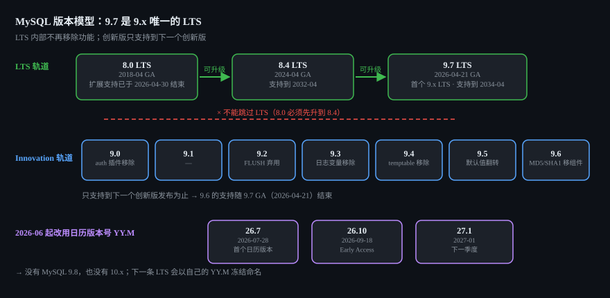
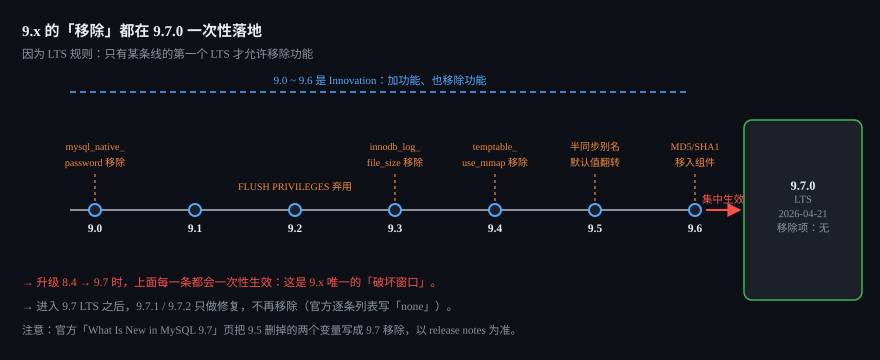
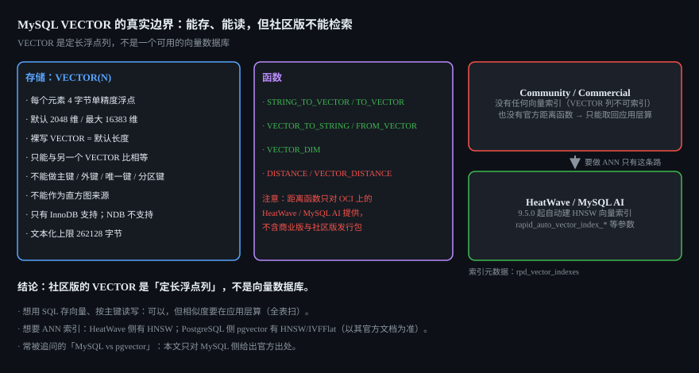

# MySQL 9.7 深度剖析：首个 9.x LTS、VECTOR 的真实边界、JS 存储程序与升级暗礁

> 面试定位：这一版的价值不在"多了什么功能"，而在**"它是一次 LTS 级别的不兼容落地"**。
> 能讲清下面三句中的任意一句，就已经超过大部分"只会用 MySQL"的候选人：
> ① 为什么 9.7 是 LTS、为什么"LTS 内部不再移除功能"意味着 9.7.0 是**唯一的破坏窗口**；
> ② 为什么 MySQL 的 `VECTOR` 类型在社区版**既不能建索引、也用不了官方的距离函数**；
> ③ 为什么从 8.0 升到 9.7 **不能跳过 8.4**。

**版本边界（先钉死，后面所有结论都在这个范围内）**：本文以 **MySQL 9.7.0（2026-04-21）** 与 9.x 创新版线（9.0~9.6）的官方 release notes 为准。
其中 9.7 是 **LTS**，9.0~9.6 是 **Innovation**。9.7 之后 Oracle 改用**日历版本号**：9.8 与 10.x 都不存在，下一条线是 `26.7.0`（2026-07-28）与 `26.10.0`（2026-09-18，Early Access）。
凡标 **[未确认]** 的，是官方文档没有明确写、本文不替你拍板的点。

---

## 1. 先把版本模型搞对：为什么"9.7 是 LTS"是全文最重要的一句话

MySQL 8.4 之后，Oracle 把发布线分成两种（官方原文见 [MySQL Releases](https://docs.oracle.com/cd/E17952_01/mysql-9.7-en/mysql-releases.html)）：

| | LTS（长期支持） | Innovation（创新版） |
|---|---|---|
| 功能集合 | 稳定，**一个 LTS 生命周期内不做移除** | 可以加功能、也可以移除功能 |
| 支持期 | 5 年 Premier + 3 年 Extended | **只支持到下一个 Innovation 发布为止** |
| 仓库轨道 | `mysql-8.4-lts-community` 等，且 **LTS 轨道默认启用** | `mysql-innovation-community` |
| 季度 CPU | 只给修复 | 修复 + 新功能 |
| 典型版本 | 8.0、8.4、**9.7** | 9.0、9.1、…、9.6 |

关键那条官方表述是：

> "There are no removals within an LTS release. Features can be removed (and added) only in the first LTS release (such as 8.4.0 LTS) but not later."

翻译成人话：**8.4.0 和 9.7.0 这样的"某条线的第一个 LTS"是唯一允许删东西的版本**，之后的 9.7.1、9.7.2 只做修复。
于是：

- 9.0 删了 `mysql_native_password`、9.3 删了 `innodb_log_file_size`、9.4 删了 `temptable_use_mmap`、9.5 删了半同步插件别名…… 这些**在创新版里是"你可能没注意"的事，到 9.7 就变成所有人升级时必踩的坑**。
- 反过来，一旦上了 9.7 LTS，**在 9.7 的补丁里不会再被删东西** —— 这是选 LTS 而不是追创新版的核心理由。



### 1.1 支持窗口（关心"还能不能拿到补丁"的看这张表）

| 版本 | 类型 | GA | Premier 结束 | Extended 结束 |
|---|---|---|---|---|
| 8.0 | LTS | 2018-04-19 | 2025-04-30 | **2026-04-30（已结束）** |
| 8.4 | LTS | 2024-04-30 | 2029-04-30 | 2032-04-30 |
| **9.7** | **LTS** | **2026-04-21** | **2031-04-30** | **2034-04-30** |
| 9.5 / 9.6 | Innovation | — | — | 已随 9.7 GA 结束（9.6 支持到 2026-04-21） |

> 8.0 的扩展支持已在 2026-04-30 结束，所以"还在跑 8.0"现在等于**没有安全补丁**。这条比任何语法变化都更该先处理。



### 1.2 版本号为什么要重写成 26.7

2026-06-16 起，Oracle 宣布改用**日历版本号 `YY.M`**（从 2026 年 7 月的创新版起生效）：

```
9.7.0   (2026-04-21, LTS, 最后一条 9.x)
26.7.0  (2026-07-28, Innovation,  = 2026 年 7 月)
26.10.0 (2026-09-18, Innovation,  = 2026 年 10 月, Early Access)
27.1.0  (2027 年 1 月)
```

规则：**LTS 把自己的 `YY.M` 前缀冻结一辈子**（例如如果 28.4 是 LTS，那它后面的补丁永远叫 28.4.x），Innovation 继续季度节奏。
所以"MySQL 9.8 / MySQL 10"这两个东西**不存在**，别再等；下次大版本应该叫 `28.x` 之类的 LTS。

### 1.3 升级路径：8.0 → 8.4 → 9.7，不能跳

官方明确：**支持相邻 LTS 之间的升级，但跳过一条 LTS 不受支持**（原文举例：不能从 8.4.x LTS 直接跳到 10.7.x LTS）。所以：

| 你现在 | 目标 9.7 的路径 | 备注 |
|---|---|---|
| 8.0 | 8.0 → 8.4 → 9.7 | 8.0 已过扩展支持，两步走 |
| 8.4 LTS | 8.4 → 9.7 | 最标准的一条 |
| 9.x Innovation（9.3/9.5 等） | 先到 9.7 LTS，再到后面的创新版 | Innovation 想换线必须先落 LTS |
| 想从 Innovation 降级 | **只能逻辑导出导入**（`mysqldump` / Shell dump） | 原地降级不支持 |

另外两条运维事实：Windows Configurator 会自动升级 8.4 LTS；**9.5 起支持 Innovation 与 LTS 并排安装**（side-by-side），临时验证新版本不用动生产实例。

---

## 2. MySQL 9.7 到底新在哪（按官方 release notes 分组）

> ⚠ 官方那页 [What Is New in MySQL 9.7](https://docs.oracle.com/cd/E17952_01/mysql-9.7-en/mysql-nutshell.html) 比 [9.7.0 release notes](https://docs.oracle.com/cd/E17952_01/mysql-9.7-relnotes-en/news-9-7-0.html) **薄得多，而且在"移除列表"上自相矛盾**：它把 `group_replication_allow_local_lower_version_join` 和 `replica_parallel_type` 列成"9.7 移除"，但这两个其实在 **9.5.0** 就被删了。以 release notes 为准。

### 2.1 优化器：Hypergraph Optimizer 进社区版（本版最"接地气"的变化）

Hypergraph 优化器在整个 9.x 创新期都是 **Enterprise 专属**，9.7 起 **Community Edition 也能用**：

```sql
-- 默认关闭，且官方仍标注为 experimental
SET optimizer_switch = 'hypergraph_optimizer=on';         -- 当前会话
SET GLOBAL optimizer_switch = 'hypergraph_optimizer=on';  -- 全局
SET PERSIST optimizer_switch = 'hypergraph_optimizer=on'; -- 持久化

-- 只对一条语句开
SELECT /*+ SET_VAR(optimizer_switch='hypergraph_optimizer=on') */ ...
FROM t1 JOIN t2 JOIN t3 ...;

-- 启动参数形式
mysqld --optimizer-switch='hypergraph_optimizer=on'
```

它解决的是老优化器（左深树 + 贪心）在多表 join 上的短板：DPhyp 风格的自底向上枚举**能出 bushy 计划**、能在"哈希连接 vs 嵌套循环"之间按代价选、能识别 interesting orders。

**但先别急着全库打开**——第三方实测（Bytebase 的分析，非官方）给了一组很值得记住的数字：约一半的 TPC-DS 查询快 ≥25%，19 条快 ≥50%，**同时有 14 条慢 ≥50%**，而且它对统计信息质量远比老优化器敏感。
结论：**拿它当"逐条 SQL 调优的开关"用，不要当全局默认**；上线前必须用你自己的慢查询集合做 A/B。

### 2.2 会让结果变化的修复：一批日期时间函数（9.7 最容易被忽略的坑）

9.7 修掉了一批"日期/时间函数算错"的 bug（WL #16895），**代价是同一句 SQL 在 9.7 上可能返回和 9.6 不同的值**：

| 函数/场景 | 变化 |
|---|---|
| `TIMEDIFF()` | `DATETIME` 与 `DATE` 混用、以及不支持的类型组合现在返回 `NULL`（以前是隐式转换后的怪结果） |
| `FROM_DAYS()` | 修正 |
| `DAYNAME()` | 参与算术运算时修正 |
| `ADDDATE()` | 年份 `0000` 的处理修正 |
| `CAST()` | 对 `YEAR` 列的转换修正 |
| `ADDTIME/SUBTIME/ADDDATE/SUBDATE` | `NULL` 传播行为修正 |
| 日期 → `INTEGER` 赋值 | 类型转换修正 |
| `ALLOW_INVALID_DATES` | 行为修正 |
| 日期算术溢出 / DECIMAL 与常量比较 / `IN` 含 `NULL` / `INTERSECT` 正确性 | 修正 |
| `find_in_set()` | **移除了那个优化** |
| 直方图 | 后台直方图"陈旧"诊断修正；BIGINT 直方图不再被截到 uint32（Bug #116611） |

自查建议：升级前把线上用到的日期函数写成对照 SQL，在 9.6 与 9.7 各跑一遍 diff。另外 `SETS` 现在可以当**不加引号的标识符**用（以前会被当关键字），解析巨大 `IN` 列表的内存占用也降低了。

### 2.3 JSON：Duality View 终于在社区版**可写**

| 版本 | 能力 |
|---|---|
| 9.6 | **表级 DML 标签**：可对每张表声明 `INSERT`/`UPDATE`/`DELETE` 以及反向的 `NO INSERT` 等，运行时校验 |
| **9.7** | **社区版支持对 JSON Duality View 做 DML**（此前社区版只有 DDL）＋ Duality View 上支持自增列 |

写法示意（视图定义本身在此不展开）：

```sql
CREATE JSON RELATIONAL DUALITY VIEW ... AS ...;

INSERT INTO my_duality_view (id, name) VALUES (1, 'a');  -- 9.7 社区版现在可以
UPDATE my_duality_view SET name = 'b' WHERE id = 1;
DELETE FROM my_duality_view WHERE id = 1;
```

要知道的语义：**一次"文档写入"会被拆成对基表的 INSERT/UPDATE**，基表上的约束（外键、唯一键、CHECK）一旦被违反，整个文档写入会回滚。所以它更像"关系模型上的 JSON 投影"，不是"独立的文档库"。

### 2.4 复制与高可用

- **新增 `replica_allow_higher_version_source`**：控制是否能从"更高版本的主库"做异步复制到一个更低版本的副本（默认值 **[未确认]**，以 `SHOW VARIABLES` 为准）。做灰度/双跑时这个开关很关键。
- **四个 Enterprise 组件下沉社区版**（这是 9.7 里 GM 最开心的一条）：Replication Applier Metrics、Group Replication **Flow Control Statistics**、Group Replication **Resource Manager**、Group Replication **Primary Election**。
  实际效果：资源管理器可以在成员不健康时自动剔除/重新加入；主选举可以倾向"数据最新的节点"而不是默认的"UUID 最小"。

### 2.5 安全与认证

- **`caching_sha2_password` 新增 PBKDF2 存储格式**（PBKDF2 + SHA512），**客户端不需要改**，X Protocol 同样支持。新增两个变量：

```sql
-- 默认格式是 CRYPT5 + SHA256；另一个可选 PBKDF2 + SHA512
SHOW VARIABLES LIKE 'caching_sha2_password_storage_format';
-- 强制要求所有账号使用指定格式（不合规的账号必须改密码）
SHOW VARIABLES LIKE 'caching_sha2_password_enforce_storage_format';
```

- **审计日志**新增按时间轮转 `audit_log.rotate_on_time`；新增 `audit_log.filter_recovery_mode` / `audit_log_filter_recovery_mode`，三档行为：
  `LOG_ALL_IF_INVALID_FILTER_DETECTED` / `LOG_NOTHING_IF_INVALID_FILTER_DETECTED` / `ABORT_IF_INVALID_FILTER_DETECTED`。
  `audit_log_prune_seconds` 现在可与 `log_offload.log_analytics_schedule`、`audit_log_rotate_on_time` 交叉校验后设置。
- **SCRAM-SHA-1（SASL LDAP）已弃用**（9.5 起，`SCRAM-SHA-256` 成为 `authentication_ldap_sasl_auth_method_name` 的默认值）。
- **动态数据脱敏（Enterprise）**是 Oracle 宣传里的另一个 9.7 亮点：新增 `CREATE MASKING POLICY` **策略对象**，再 `ALTER TABLE ... ALTER COLUMN ... SET MASKING POLICY` 绑定；相关变量 `object_policy_flush_interval_seconds`（给副本刷新对象策略缓存用）。⚠ 该语法的官方页面在镜像站缺失，本文按第三方整理转述，**具体语法请以你手上的 9.7 手册为准**；`mask_inner/mask_outer/mask_pan/mask_ssn` 这些函数本身在 9.7 之前就有。
- **9.7 没有移除任何系统变量/状态变量/命令行选项**（官方逐条列表明确写 "none"）。这符合"LTS 内部不再移除"的规则。

### 2.6 可观测性

- **Telemetry 组件进社区版**（OTLP 的 logs/metrics/traces），MySQL 由此能把慢查询日志、通用日志一起接进和你应用同一条 OTLP 管线。注意几个 `telemetry.*` 开关**默认关闭**，且三个 `telemetry.otel_exporter_otlp_*_endpoint` **没有默认值**，必须显式配置。
- 新客户端工具 **`mysqldm`（MySQL Diagnostic Monitor）**：跑预置诊断查询、输出 JSON 给 Oracle Support 用 —— **Enterprise only**。
- 从 9.6 继承来的 Performance Schema 内容：表 `TEMPORARY_ACCOUNT_LOCKS`；`HOST_CACHE` 新增 `COUNT_ACCOUNT_LOCKED_ERRORS`、`COUNT_TEMPORARY_ACCOUNT_LOCKED_ERRORS`。

### 2.7 InnoDB 与容器感知（做容量规划的人必须看）

- **`innodb_log_writer_threads` 的默认值不再是固定的 ON/OFF，而是按 CPU 数 + `log_bin` 算出来的**（WL #16999）：

| `log_bin` | 逻辑 CPU | 默认值 |
|---|---|---|
| OFF | ≤ 4 | OFF |
| OFF | > 4 | ON |
| ON | < 32 | OFF |
| ON | ≥ 32 | ON |

  **显式在 my.cnf 里配了值的不受影响**；但如果你依赖"默认就是 ON"，升到 9.7 后行为可能变。这条和 9.4 及更早的行为一致（9.5 的同一处描述有自相矛盾的句子，以 9.7 的措辞为准）。
- **服务器开始识别 cpuset cgroup 的 CPU 限制**（WL #16851）来算"逻辑 CPU 数"。
- **Clone 插件支持在 9.7.0 以上的相邻 LTS 之间克隆**（WL #16520），做物理迁移/搭副本更省事。
- **新增 `enable_cascade_triggers`**：决定外键级联由"服务器运行时"还是"InnoDB 引擎"处理 —— 这个变量**在它被加入的同一版里就被标记为弃用**（默认值 **[未确认]**）。
- 修了一串 InnoDB 的边界问题：FTS 索引构建内存、多值索引、并行读、`CREATE INDEX` 配合高 `--innodb_parallel_read_threads` 时打满磁盘、`TRUNCATE TABLE`、`--innodb-dedicated-server=ON` 下 cgroup 内存限制导致启动失败等。
- 打包侧：内置 zlib → 1.3.2、OpenSSL → **3.5.5**；SLE/openSUSE/Fedora 支持 `--define=with_pgo 1` 生成 PGO 构建。

---

## 3. VECTOR 类型的真实边界（本节是全文最"反直觉"的部分）

`VECTOR` 是 **9.0.0** 引入的类型（WL #16081），9.x 一路在补。它的**存储与函数**很清楚，但它的**能力边界**和宣传给人的印象差距很大。



### 3.1 存储格式与硬限制

| 项目 | 事实 | 出处 |
|---|---|---|
| 元素类型 | 每个元素 **4 字节单精度浮点** | [VECTOR 类型](https://docs.oracle.com/cd/E17952_01/mysql-9.7-en/vector.html) |
| 维度 | 默认 **2048**，最大 **16383**；裸写 `VECTOR` 表示默认长度，`VECTOR()` 是语法错误 | 同上 |
| 比较 | **不能与任何其他类型比较**，只能和另一个 `VECTOR` 比相等 | 同上 |
| 索引/键 | **不能做任何键**：主键、外键、唯一键、分区键都不行；也**不能作为直方图来源** | 同上 |
| 存储引擎 | **只有 InnoDB**；其他引擎不支持，**NDB Cluster 不支持** | 同上 |
| 文本化 | `VECTOR_TO_STRING()` 输出**最大 262128 字节**（= 16 × 16383，即每个元素按 `-1.78000e+01` 这种 16 字符最坏情况估算） | [向量函数](https://docs.oracle.com/cd/E17952_01/mysql-9.7-en/vector-functions.html) |

```sql
CREATE TABLE emb (
  id  BIGINT PRIMARY KEY,
  v   VECTOR(768) NOT NULL          -- 768 维
);

INSERT INTO emb VALUES (1, STRING_TO_VECTOR('[0.1, 0.2, 0.3]'));

SELECT VECTOR_DIM(v),               -- 维度
       VECTOR_TO_STRING(v)          -- 还原成字符串
FROM emb;
```

### 3.2 函数表（含别名）——注意有一条致命说明

| 函数 | 别名 | 说明 |
|---|---|---|
| `STRING_TO_VECTOR(s)` | `TO_VECTOR()` | `"[1.05, -17.8, 32]"` → 二进制（如 `0x6666863F66668EC100000042`） |
| `VECTOR_TO_STRING(v)` | `FROM_VECTOR()` | 反向，输出如 `[1.05000e+00,-1.78000e+01,3.20000e+01]` |
| `VECTOR_DIM(v)` | — | 元素个数；参数不可解析时报错 |
| `DISTANCE(v1, v2, metric)` | `VECTOR_DISTANCE()` | `metric` 取 `COSINE` / `DOT` / `EUCLIDEAN`（**必须加引号**） |

> ⚠ **`DISTANCE()` / `VECTOR_DISTANCE()` 只对 OCI 上的 MySQL HeatWave 与 MySQL AI 用户可用，不包含在 MySQL 商业版与社区版发行包里。**
> 也就是说：**社区版既不能给 VECTOR 建索引，也没有官方提供的距离函数。** 想在社区版做相似度检索，只能把向量取到应用层自己算距离（全表扫）。

### 3.3 ANN 索引在哪：在 HeatWave，不在 MySQL

- **MySQL Community / Commercial：没有任何向量索引**（VECTOR 列不可索引，且唯一能算距离的官方函数不在这两个发行版里 —— 这是把两条官方说明合起来得到的结论）。
- **HeatWave GenAI（9.5.0 起）会对频繁查询的 VECTOR 列自动建向量索引，索引结构是 HNSW**：自动索引开关 `rapid_auto_vector_index_enabled`、间隔 `rapid_auto_vector_index_interval_seconds`、内存配额 `rapid_auto_vector_index_server_memory_quota_pct`、构建超时 `rapid_auto_vector_index_build_timeout_seconds`；检索侧调优 `rapid_hnsw_ef_search`、`rapid_hnsw_use_adaptive_accuracy_estimation`；索引元数据在 `rpd_vector_indexes`。
- 常被追问的"和 pgvector 比呢"：**本文只对 MySQL 侧给官方出处**。可以确定的对比是：pgvector 提供 HNSW / IVFFlat 索引，而 **MySQL 社区版连索引都不能建** —— 所以"用 MySQL 做向量库"在当前社区版上是不成立的，能把向量放进 MySQL 的前提是你在用 HeatWave/MySQL AI。pgvector 侧细节请以其官方文档为准。
- 与 JS 的互操作：9.0 的 JavaScript 存储程序**不支持 VECTOR**，**9.1.0 起完全支持**（入参、出参、`bind()`、返回值）。
- 允许对 VECTOR 用的函数很有限：字符串类只有 `BIT_LENGTH()`、`CHAR_LENGTH()`、`HEX()`、`LENGTH()`、`TO_BASE64()`；加密类只有 `AES_ENCRYPT()`、`COMPRESS()`、`SHA2()`；可用于 `CASE`/`COALESCE()`/`IFNULL()`/`NULLIF()`/`IF()`；聚合/窗口只支持 `COUNT([DISTINCT])`；`CAST(expr AS BINARY)` 可以，但**不能 CAST 成 VECTOR**；不能用于数值/时间/全文/XML/位/JSON 函数。
- 踩坑史：9.2 修了"比较 VECTOR 时忽略长度"的问题；9.4 修了 `VECTOR_TO_STRING()` 输出的字符集/排序规则。

**一句话结论**：MySQL 的 `VECTOR` 目前是"**能被关系型引擎存下来、能被 SQL 读写的定长浮点列**"，它**不是**一个可用的向量检索方案——除非你上 HeatWave。

---

## 4. JavaScript 存储程序：能力很强，但**只有企业版**

- **版本与版本限制**：9.0.0 引入（"MySQL 9.0 Enterprise Edition now includes support for stored programs written in JavaScript"），由 **Multilingual Engine（MLE）** 组件提供，URN 为 `file://component_mle`，**必须先 `INSTALL COMPONENT`**。官方明确：**MLE 组件属于 MySQL Enterprise Edition** —— 社区版到 9.7 仍然没有。

```sql
INSTALL COMPONENT 'file://component_mle';

CREATE FUNCTION add_nos(arg1 INT, arg2 INT) RETURNS INT
LANGUAGE JAVASCRIPT
AS $$
  return arg1 + arg2;
$$;

SELECT add_nos(12, 52);   -- 64
```

- 过程用 `CALL` 调用；JS 函数可以用在任何"能放函数"的地方（`WHERE`/`HAVING`/`ORDER BY`/`JOIN`），也能写在触发器/事件体内（**这些外层仍必须是 SQL**）。
- **库（Library）**是 9.x 里演进最快的一块：

| 版本 | 能力 |
|---|---|
| 9.2 | `CREATE LIBRARY` / `DROP LIBRARY` / `SHOW CREATE LIBRARY`，`CREATE FUNCTION|PROCEDURE ... USING (lib1, lib2)`，`库名.函数名`，I_S 表 `LIBRARIES`、`ROUTINE_LIBRARIES` |
| 9.3 | `ALTER PROCEDURE|FUNCTION ... USING`、`CREATE LIBRARY ... COMMENT`、`SHOW LIBRARY STATUS` |
| 9.4 | **WebAssembly 库**：`CREATE LIBRARY x LANGUAGE WASM AS $$<base64/hex>$$;` 然后 `... LANGUAGE JAVASCRIPT USING (x)`（WASM 里可用 `WebAssembly`、`TextEncoder/Decoder`；**MySQL 的 `session`/`ml` API 与 WASI 不可用**） |

- **语言级别**一路跟着 ECMAScript 规格走：9.0 = ES2023（严格模式不可关闭）、9.4 = ES2024、**9.5 = ES2025**。
- **类型支持**：9.0 覆盖大多数 MySQL 类型（字符串必须 `utf8mb4`），9.1 加 `VECTOR`，9.2 加 `ENUM`/`SET`，9.3 加 `DECIMAL`/`NUMERIC`（默认映射成 JS `String` 保精度，可用 `decimalType = NUMBER` 换 `Number`），9.4 加 `BIT`。
- **必须知道的限制**（官方 [SRJS Limitations](https://docs.oracle.com/cd/E17952_01/mysql-9.7-en/srjs-limitations.html)）：

| 限制 | 说明 |
|---|---|
| 无文件 / 无网络 | 没有第三方模块，**不支持 `import`**，更不是 Node.js |
| `global`/`globalThis` | **每次调用独立**，不跨调用、不跨会话共享 |
| 单线程 | MLE 每个查询一个线程；`Promise`/`async` 是模拟的、时序不确定，未 await 的 Promise 直到例程结束才可能被处理 |
| 递归深度 | **1000**（超了报 `ERROR 6113 (HY000): JavaScript> Maximum frame limit of 1000 exceeded`） |
| 变长参数 | 不支持变长存储例程参数 |
| 复制 | **拓扑里每个服务器都必须装 MLE**，否则复制中断 |
| 内存 | 9.5 起自动配置 `mle.memory_max`（默认物理内存 5%，夹在 0.4GB~32GB 之间） |

> 面试点：为什么一家要做"在数据库里跑 JS"？因为**把计算下推到数据旁边**能省掉"取数—网络—应用计算"的往返。但代价同样清楚：单线程、无网络、无包管理、语义与 Node 不同 —— 所以它适合"数据密集、逻辑简单、无需外部依赖"的场景（如行级转换、复杂校验），不适合当应用服务器用。

---

## 5. 认证与安全：`mysql_native_password` 的完整死亡时间线

这是 8.0 用户升到 9.7 时**最容易直接把线上打挂**的一条。官方一句话就写完了整个链条：

> "The `mysql_native_password` authentication plugin is deprecated as of **MySQL 8.0.34**, disabled by default in **MySQL 8.4**, and removed as of **MySQL 9.0.0**."

| 阶段 | 版本 | 现象 |
|---|---|---|
| 弃用 | 8.0.34 | 还能用，但会警告 |
| 默认关闭 | 8.4 | 需要 `--mysql-native-password=ON`；账号连不上报 `ERROR 1045 (28000)`；`CREATE/ALTER USER ... IDENTIFIED WITH 'mysql_native_password'` 报 `ERROR 1524 (HY000): Plugin 'mysql_native_password' is not loaded` |
| **移除** | **9.0.0** | 插件没了，连同 `--mysql-native-password`、`--mysql-native-password-proxy-users` 和**系统变量 `default_authentication_plugin` 一起删除**；服务器开始拒绝没有 `CLIENT_PLUGIN_AUTH` 能力的老客户端。客户端侧的 `mysql_native_password` 变成可动态加载插件保留着 |

9.7 手册的现行表述：**默认认证插件是 `caching_sha2_password`，`mysql_native_password` 不再可用**；默认插件由 `authentication_policy` 决定。

**迁移时必须记住的 `caching_sha2_password` 行为**：

- 首次认证需要**安全连接或 RSA 交换**，否则报 `ERROR 2061 (HY000): Authentication plugin 'caching_sha2_password' reported error: Authentication requires secure connection.`
  绕法：客户端 `--get-server-public-key` / `--server-public-key-path`；C API 的 `MYSQL_SERVER_PUBLIC_KEY` / `MYSQL_OPT_GET_SERVER_PUBLIC_KEY`；复制通道的 `SOURCE_PUBLIC_KEY_PATH` / `GET_SOURCE_PUBLIC_KEY`、`group_replication_recovery_public_key_path` / `..._get_public_key`。
- 服务器端缓存**只在内存里**（重启即清空），并且在**建号 / 改密码 / `RENAME USER` / `FLUSH PRIVILEGES` 之后的第一次连接**必须走安全连接或 RSA。

其它 9.x 安全变化（升级自查清单）：

- **9.5**：`caching_sha2_password_digest_rounds` 默认提到 **10000**（PBKDF2 迭代次数）。
- **9.6**：**`MD5()` / `SHA1()` 被挪进 `classic_hashing` 组件** —— 不装这个组件，这两个函数就用不了（9.4 起先弃用）。
- **9.2**：`FLUSH PRIVILEGES` 整体弃用（连带 `FLUSH_PRIVILEGES` 权限、`mysqladmin flush-privileges` / `reload`）；新增 `CREATE_SPATIAL_REFERENCE_SYSTEM` 权限，SRS 用 `SUPER` "应视为已弃用"；Version Tokens 插件弃用 → **9.3 移除**。
- **9.5**：`activate_mandatory_roles` 新增且**默认启用**（与 `activate_all_roles_on_login` 的交互要看文档）；**9.1**：所有 keyring 组件移除 AES-ECB 支持。
- 插件→组件迁移（运维要改 my.cnf）：`keyring_aws`(9.1) → `component_keyring_aws`、Connection Control(9.2) → 组件、`keyring_hashicorp`(9.3)、Firewall(9.4) → 组件、`keyring_okv`→`keyring_kmip`(9.5)、**Audit Log 在 9.6 拆成组件**；**keyring 插件 API 与 `--early-plugin-load` 在 9.4 弃用**。
- 内置 OpenSSL 版本：9.5 → 3.0.17、9.6 → 3.0.18、**9.7 → 3.5.5**。

---

## 6. 复制与高可用：9.5 那批"默认值翻转"要单独拎出来讲

9.5 把一批"安全默认"直接翻了过来，**任何混合版本拓扑都会被它打到**：

| 参数 | 新默认 |
|---|---|
| `CHANGE REPLICATION SOURCE TO ... SOURCE_SSL` | **1** |
| `group_replication_ssl_mode` | **`REQUIRED`** |
| `group_replication_recovery_use_ssl` | **`ON`** |
| `gtid_mode` | **`ON`** |
| `binlog_transaction_dependency_history_size` | 25000 → **1000000**（上限 10,000,000） |

> ⚠ 官方 9.5 release notes 里 `enforce_gtid_consistency` 那句写的是"has been changed **from** `ON`"，几乎可以肯定是 **"to ON"** 的笔误。写文档/给团队交底时**别把这句原样抄走**，以 `SHOW VARIABLES` 实测为准。

其它复制相关变化：

- **9.5 移除半同步插件别名** `semisync_master` / `semisync_slave`（改用 `semisync_source` / `semisync_replica`）。
- **9.5 移除** `group_replication_allow_local_lower_version_join`、`replica_parallel_type`；**9.3 起 `replica_parallel_workers` 不能为 0**（最小 1）。
- **9.6 换了新的 GTID 集合实现**（WL #16076），并修了 `--replica-skip-errors` 造成的 GTID 空洞。
- **9.7 新增 `replica_allow_higher_version_source`**（见 2.4）。
- GR 四件套（Applier Metrics / Flow Control Statistics / Resource Manager / Primary Election）**9.7 进社区版**；其中 Primary Election 需要每个成员都开 `group_replication_elect_prefers_most_updated.enabled`。
- **9.2 起 `replica_preserve_commit_order` 在 GR 主库入站通道上不再是严格保证**（这是修死锁的代价，官方明确写出来了）。

---

## 7. InnoDB 与"容器感知默认值"：为什么你的容量规划会失效

MySQL 从 9.3 开始**按容器/主机的 CPU 与内存实际可用量推导 InnoDB 默认值**，这条对 K8s 上的实例影响最大：

| 版本 | 变化 |
|---|---|
| 9.3 | 按容器逻辑 CPU 推导 `innodb_buffer_pool_instances`、`innodb_page_cleaners`、`innodb_purge_threads`、`innodb_read_io_threads`、`innodb_parallel_read_threads`、`innodb_log_writer_threads`（以及 `--innodb-dedicated-server` 下的 `innodb_redo_log_capacity`）；按容器内存推导 `temptable_max_ram`（及 dedicated-server 下的 `innodb_buffer_pool_size`） |
| 9.4 | 新增 **`server_memory`** 用来给"算默认值时认为的物理内存"封顶；错误日志里固定打印总逻辑 CPU 与物理内存 |
| 9.6 | 新增启动选项 **`container_aware`**；**外键与级联操作从 InnoDB 引擎移到 SQL 层**（官方称完全向后兼容，用 9.6 新增的 `innodb_native_foreign_keys` 保留旧行为） |
| 9.7 | 支持 **cpuset cgroup**；新增 `enable_cascade_triggers`（见 2.7） |

**被移除的 my.cnf 变量（留着就启动失败）**：

| 变量 | 移除版本 | 替代 |
|---|---|---|
| `innodb_log_file_size` | **9.3** | `innodb_redo_log_capacity` |
| `innodb_log_files_in_group` | **9.3** | `innodb_redo_log_capacity` |
| `innodb_undo_tablespaces` | **9.3** | 无（自动管理） |
| `temptable_use_mmap` | **9.4** | 无 |

其它默认值/行为变化：`innodb_change_buffer_max_size` → **5**（9.4）、`innodb_change_buffering` → **`ALL`**（9.5）、`back_log` → **10000**（9.4）；**9.2 起对空表做 `ADD COLUMN`/`DROP COLUMN` 改用 `INPLACE` 而不是 `INSTANT`**（不再涨 row version）；**9.2 修了空间索引的损坏问题，官方建议升级前删掉空间索引、升级后重建**（降级会把 bug 带回来）。

---

## 8. 升级暗礁总表（8.0/8.4 → 9.7）

按"后果严重度"排，前四类会直接把服务打挂：

| # | 暗礁 | 后果 | 处置 |
|---|---|---|---|
| 1 | `mysql_native_password` 插件与 `default_authentication_plugin` 都没了 | **应用连不上 / my.cnf 启动失败** | 迁 `caching_sha2_password`；准备 TLS 或 `--get-server-public-key`；预期密码变更后首次连接报 `ERROR 2061` |
| 2 | `innodb_log_file_size`、`innodb_log_files_in_group`、`innodb_undo_tablespaces`、`temptable_use_mmap` 被移除 | **带着这些配置启动直接失败** | 删配置，改用 `innodb_redo_log_capacity` |
| 3 | 9.5 复制默认值翻转（`gtid_mode=ON`、`SOURCE_SSL=1`、GR TLS REQUIRED） | **混合版本/非 TLS 复制通道断** | 升级前统一拓扑版本与 TLS，预演切换 |
| 4 | `EXPLAIN` 默认格式变 `TREE`、JSON 版本变 2（9.5） | **解析 EXPLAIN 的 ORM/监控/巡检脚本全崩** | 固定 `explain_format`，或改解析逻辑 |
| 5 | `MD5()`/`SHA1()` 移入 `classic_hashing` 组件（9.6） | 依赖它们的 SQL 直接报函数不存在 | 装组件，或改用 `SHA2()` |
| 6 | 9.7 日期时间函数结果变化 | **同一条 SQL 结果与 9.6 不同** | 用对照 SQL 做 diff（见 2.2） |
| 7 | 外键/级联语义变化（9.6 移到 SQL 层、9.7 级联触发子触发器） | 触发器副作用变化 | 复测；必要时 `innodb_native_foreign_keys` / `enable_cascade_triggers` |
| 8 | `FLUSH PRIVILEGES` 弃用（9.2） | 运维脚本告警/未来失效 | 改用 `ALTER USER` 等精确操作 |
| 9 | `--check-table-functions` 默认 `ABORT`（9.3） | **升级过程中直接中止**（表里有无法再求值的约束/默认值/分区/虚拟列表达式） | 先在旧版本修好表达式，或临时设 `WARN` |
| 10 | `IGNORE` 不再吞掉 `ER_SUBQUERY_NO_1_ROW`（9.0） | 以前"能跑过"的语句开始报错 | 修 SQL，别依赖 `IGNORE` 掩盖 |
| 11 | 插件→组件迁移（keyring / connection-control / firewall / audit log） | 配置项失效、功能不可用 | 按 5 节清单逐个换组件 |
| 12 | 空间索引损坏修复（9.2） | 不重建可能仍有坏索引 | 升级前 drop、升级后 create |
| 13 | `replica_parallel_workers=0` 非法（9.3） | 启动/变更报错 | 至少设 1 |
| 14 | keyring 插件 API 与 `--early-plugin-load` 弃用（9.4） | 启动告警；未来会移除 | 迁到组件配置 |
| 15 | 容器感知默认值（9.3~9.7） | **按老默认值做的容量规划不再成立** | 显式固定关键参数（buffer pool、redo capacity） |
| 16 | `SETS` 变成可用的非引号标识符（9.7） | 同名标识符的含义变化 | 检查用到 `SETS` 的对象名 |
| 17 | 四个 DD/复制错误码在 8.4+ 重新编号（9.2） | 按数字码做告警的规则失效 | 改用符号名匹配 |

---

## 9. 面试深挖 12 问（附答题要点）

1. **为什么 9.7 是"最危险的升级"，而 9.7.1 反而不危险？** —— LTS 内部不做移除，所有 9.0~9.6 的移除集中在 9.7.0 落地；之后只有修复。
2. **VECTOR 在 MySQL 里怎么存？** —— 4 字节单精度浮点 × N，默认 2048、最大 16383 维；不可作键/直方图源；只有 InnoDB 支持，NDB 不支持。
3. **社区版能用 VECTOR 做相似度检索吗？** —— 不能：不能建索引，且官方距离函数 `DISTANCE()`/`VECTOR_DISTANCE()` 只随 HeatWave/MySQL AI 提供；ANN 是 HeatWave 的 HNSW（`rapid_*` 变量、`rpd_vector_indexes`）。
4. **`mysql_native_password` 的死亡时间线？** —— 8.0.34 弃用 → 8.4 默认关闭（需 `--mysql-native-password=ON`）→ 9.0.0 移除，连 `default_authentication_plugin` 一起删。
5. **`caching_sha2_password` 为什么第一次连接老报 2061？** —— 需要安全通道或 RSA 交换；服务器端缓存只在内存、且建号/改密/RENAME/FLUSH 后的首次连接必须安全连接。
6. **Hypergraph 优化器为什么默认关？** —— 官方仍标 experimental，且第三方实测有明显回归（14 条 TPC-DS 慢 ≥50%），对统计信息更敏感。
7. **创新版和 LTS 运维上差在哪？** —— 支持期（到下一个创新版 vs 5+3 年）、仓库轨道不同且 LTS 默认、9.5 起可并排安装。
8. **没有 9.8 和 10.x，为什么？** —— 2026-06 起改日历版本号 `YY.M`：26.7 → 26.10 → 27.1；LTS 冻结自己的 `YY.M` 前缀。
9. **JS 存储程序能不能当应用服务器？** —— 不能：企业版专属 MLE、单线程、无文件/网络/`import`、`global` 每次调用独立、递归上限 1000、复制拓扑每台都要装。
10. **9.7 有哪些企业版功能下沉社区版？** —— Hypergraph 优化器、Telemetry（OTLP）、Replication Applier Metrics、GR Flow Control Statistics / Resource Manager / Primary Election、JSON Duality View 的 DML；而 Dynamic Data Masking 仍是企业版。
11. **为什么 K8s 上的默认参数会变？** —— 9.3 起按容器 CPU/内存推导 InnoDB 默认值，9.4 加 `server_memory`、9.6 加 `container_aware`、9.7 认 cpuset。
12. **升级 9.5 之后复制为什么"突然"要求 TLS 和 GTID？** —— 默认值翻转：`gtid_mode=ON`、`SOURCE_SSL=1`、`group_replication_ssl_mode=REQUIRED`、`group_replication_recovery_use_ssl=ON`。

---

## 10. 一页速查

```
版本模型   LTS（8.0 / 8.4 / 9.7，5+3 年，内部不移除）
           Innovation（9.0~9.6，只活到下一个创新版）
           日历版本号：9.7 之后是 26.7 → 26.10 → 27.1（没有 9.8 / 10.x）
升级路径   8.0 → 8.4 → 9.7（不能跳 LTS）；Innovation 想换线先落 LTS
9.7 新增   Hypergraph 优化器进社区版（默认关，experimental）
           JSON Duality View 社区版可写 DML
           PBKDF2 存储格式 + caching_sha2_password 两个新变量
           审计日志按时间轮转 / 过滤器恢复模式
           replica_allow_higher_version_source
           innodb_log_writer_threads 默认值改按 CPU + log_bin 计算
           cpuset cgroup 感知；四个 GR 组件与 Telemetry 进社区版
9.7 移除   无（LTS 规则）；弃用 SCRAM-SHA-1、enable_cascade_triggers
VECTOR     4 字节 float，默认 2048 / 最大 16383 维，不可建键
           社区版：无索引 + 无官方距离函数 → 不是向量库
           HeatWave：9.5 起自动 HNSW
JS 存储程序 企业版 MLE，ES2023→2025，9.4 起支持 WASM 库，递归上限 1000
认证       mysql_native_password：8.0.34 弃用 → 8.4 关闭 → 9.0 移除
           默认 caching_sha2_password，需 TLS/RSA，否则 ERROR 2061
```

---

## 参考来源（全部为官方文档，2026-10 核对）

- [MySQL 9.7.0 Release Notes（2026-04-21）](https://docs.oracle.com/cd/E17952_01/mysql-9.7-relnotes-en/news-9-7-0.html)
- [What Is New in MySQL 9.7](https://docs.oracle.com/cd/E17952_01/mysql-9.7-en/mysql-nutshell.html)（注意其"移除列表"与 9.5 release notes 矛盾）
- [MySQL Releases：LTS 与 Innovation 的定义、支持期、升级路径](https://docs.oracle.com/cd/E17952_01/mysql-9.7-en/mysql-releases.html)
- [VECTOR 类型](https://docs.oracle.com/cd/E17952_01/mysql-9.7-en/vector.html) ｜ [向量函数](https://docs.oracle.com/cd/E17952_01/mysql-9.7-en/vector-functions.html)
- [caching_sha2_password 可插拔认证](https://docs.oracle.com/cd/E17952_01/mysql-9.7-en/caching-sha2-pluggable-authentication.html)
- [9.0 起移除 mysql_native_password 的官方表述（8.4 手册）](https://docs.oracle.com/cd/E17952_01/mysql-8.4-en/native-pluggable-authentication.html)
- [JS 存储程序](https://docs.oracle.com/cd/E17952_01/mysql-9.7-en/stored-routines-js.html) ｜ [SRJS 限制](https://docs.oracle.com/cd/E17952_01/mysql-9.7-en/srjs-limitations.html) ｜ [MLE 组件（企业版）](https://docs.oracle.com/cd/E17952_01/mysql-9.7-en/mle-component.html)
- [已加入/已弃用/已移除（9.7）](https://docs.oracle.com/cd/E17952_01/mysql-9.7-en/added-deprecated-removed.html)
- [HeatWave GenAI 自动向量索引（HNSW）](https://docs.oracle.com/cd/E17952_01/heatwave-en/mys-hw-genai-vector-index-creation.html)
- 9.x 各版 release notes：`news-9-0-0` ~ `news-9-7-0`（同一 release notes 书内各章）

> 第三方来源（已标注、非官方）：Bytebase 对 9.7 的分析（Hypergraph 的 TPC-DS 数字、Dynamic Data Masking 语法、GR 组件下沉的实际效果）；endoflife.date 的支持窗口日期；Oracle 公告"日历版本号"经日文技术媒体报道转述。
