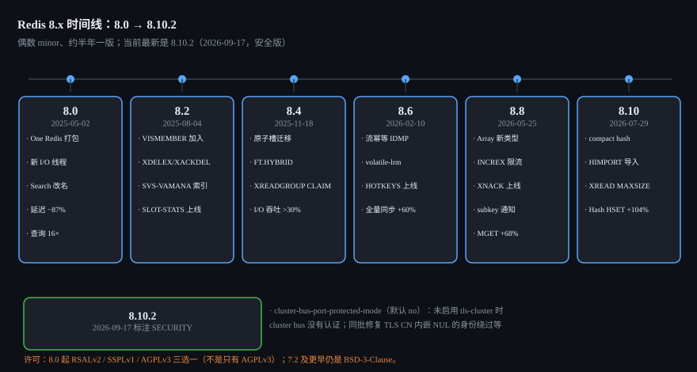
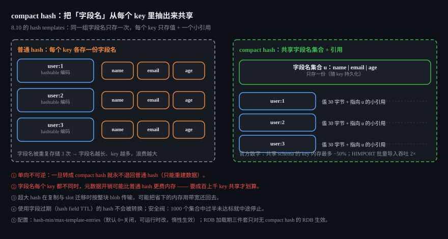
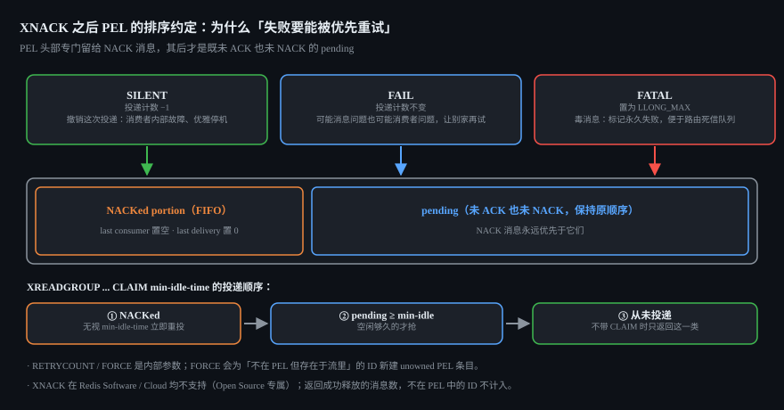
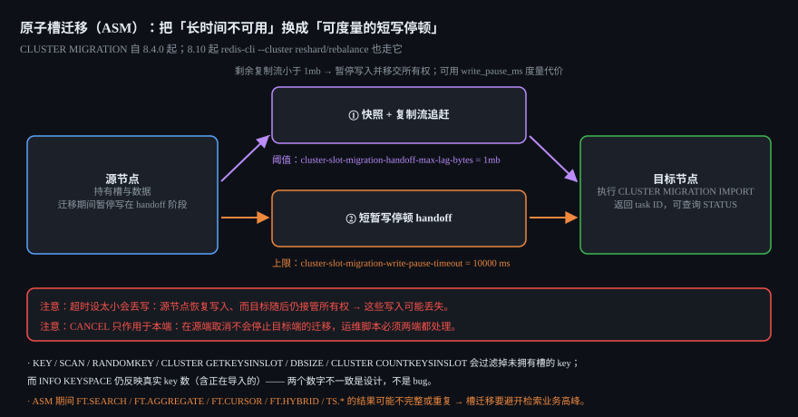

# Redis 8.10 深度剖析：从 8.0 到 8.10 的演进主线、紧凑哈希、流幂等与原子槽迁移

> 面试定位：8.x 这条线最容易被问倒的地方不是"多了几个命令"，而是**几个被重新设计的内部约定**：
> ① 为什么 `HSET` 会把字段 TTL 抹掉，而 `HINCRBY` 不会；
> ② compact hash 为什么"一旦转换就永不退回"，以及它为什么会改变复制与槽迁移的成本；
> ③ `XNACK` 为什么必须改造 PEL 的**排序**才能让 NACK 消息优先重投；
> ④ 原子槽迁移到底把"不可用窗口"换成了什么代价。
> 这四题答得出来，说明你不是在背命令表。

**版本边界**：本文以 **Redis Open Source 8.10.2（2026-09-17，安全版）** 为最新版，覆盖 8.0 → 8.10 全线。
凡标 **[未确认]** 的，是官方文档没有明确写、或官方两处说法冲突的点，本文不替你拍板。
两个常见的过时说法先纠正掉：**最新版不是 8.0/8.2**；**许可不是"只有 AGPLv3"**（见 1.2）。

---

## 1. 版本地图：8.x 已经走了六个 minor



### 1.1 GA 时间线（日期取自各 tag 的 GitHub Releases 与 `00-RELEASENOTES`）

| 版本 | GA 日期 | 这一版的主线 |
|---|---|---|
| 8.0.0 | 2025-05-02 | **One Redis**：9 个组件并入发行包；新 I/O 线程；Search 配置全面改名 |
| 8.2.0 | 2025-08-04 | Vector Sets 补全（`VISMEMBER`）+ 过滤；`XDELEX`/`XACKDEL`；SVS-VAMANA 索引；`CLUSTER SLOT-STATS` |
| 8.4.0 | 2025-11-18 | **原子槽迁移 `CLUSTER MIGRATION`**；`FT.HYBRID`；`XREADGROUP ... CLAIM`；`lookahead` 预取 |
| 8.6.0 | 2026-02-10 | **流幂等 `IDMP`/`IDMPAUTO`**；`volatile-lrm`/`allkeys-lrm` 淘汰；`HOTKEYS`；TLS 证书 CN 认证 |
| 8.8.0 | 2026-05-25 | **Array 新类型**；`INCREX` 限流；`XNACK`；hash 字段级 subkey 通知；`Z*` 的 `COUNT` 聚合器 |
| 8.10.0 | 2026-07-29 | **compact hash + `HIMPORT`**；`BACKUP` 家族；`LMOVEM`；`XREAD` 的 `MAXCOUNT`/`MAXSIZE`；JSONPath 扩展 |
| 8.10.1 | 2026-08-17 | 修复 |
| **8.10.2** | **2026-09-17** | **SECURITY**：`cluster-bus-port-protected-mode`、多个 CVE 修复 |

节奏是"偶数 minor、约半年一版"（据上表日期推算；官方没有正式公布 cadence 声明）。
**Redis 有没有 LTS / Innovation 之分：[未确认]** —— redis.io 的 whats-new、发行说明、GitHub Releases 里都没有官方划分或支持周期表，本文不做这个断言（对比 MySQL 那种明确的 LTS 制度，这是两家公司的产品策略差异）。

### 1.2 许可：从 BSD-3 变成"三选一"，但不是只有 AGPLv3

`LICENSE.txt`（8.10.0）原文：

> "Starting with Redis 8, Redis Open Source is moving to a tri-licensing model… contributions are subject to your choice of: (a) the Redis Source Available License v2 (RSALv2); or (b) the Server Side Public License v1 (SSPLv1); or (c) the GNU Affero General Public License v3 (AGPLv3). Redis Open Source 7.2 and prior releases remain subject to the BSDv3 clause license."

两句话记住：**8.0 起三选一（RSALv2 / SSPLv1 / AGPLv3）**，RSALv2 与 SSPLv1 **没有消失**；**7.2 及更早仍是 BSD-3-Clause**。
所以"Redis 8 又开源了"这种说法只对了一半 —— AGPLv3 是新增选项，不是唯一选项；从 BSD-3 升到 8.x 对**再分发**和**把 Redis 当托管服务卖**都有实质约束。

### 1.3 One Redis：以前要单独装的模块都进包了

8.0 发行说明的措辞很直接：

> "Name change: Redis Community Edition is now Redis Open Source"；"Stand alone RediSearch, RedisJSON, RedisTimeSeries, and RedisBloom are no longer needed as they are now part of Redis"

9 个内置组件：`1` Query Engine、`2` JSON、`3` Time series、`4`~`8` 五种概率结构（Bloom / Cuckoo / Count-min sketch / Top-k / t-digest）、`9` **Vector set**（8.0 时是 beta）。
配套改动：新增 `redis-full.conf`，ACL 多了 `@search`、`@json`、`@timeseries`、`@bloom`、`@cuckoo`、`@cms`、`@topk`、`@tdigest` 等类别 —— **这一点在 8.0 是破坏性变更**（见第 10 节第 2 条）。
8.6 起官方统一表述为 "unified distribution approach… without separate modules"。

---

## 2. 新数据类型一：Vector Sets（8.0 beta → 8.2 补全）

### 2.1 `VADD`：把向量塞进 HNSW 图

```
VADD key [REDUCE dim] (FP32 | VALUES num) vector element [CAS] [NOQUANT | Q8 | BIN]
  [EF build-exploration-factor] [SETATTR attributes] [M numlinks]
```

复杂度 `O(log(N))`（每个新增元素），N 为集合元素数。逐项拆开讲，因为每一条都有人问：

| 参数 | 语义与默认值 |
|---|---|
| `REDUCE dim` | **随机投影降维**；投影矩阵**随 key 持久化**（所以重启/复制后还能一致地降维），且**必须紧跟在 vector 之前** |
| `CAS` | 把"收集邻居候选"这段**最慢的工作放到后台线程**，命令本身仍在主线程执行 |
| 量化 | 默认 **`Q8`（int8）**；`NOQUANT` 关闭；`BIN` 二值化（更快更省内存，召回下降）。三者**互斥** |
| `EF` | 构建期探索因子，**默认 200** |
| `M` | 每层连接数，**默认 16**（layer 0 是 `M*2` 条连接） |

返回：RESP2 是整数 `1/0`，RESP3 是布尔 `true/false` —— 这就是"同一个命令两种协议两种类型"的典型，客户端升级 RESP3 时要对一遍（见第 10 节第 13 条）。

### 2.2 `VSIM`：查询、过滤与"真值基准"

```
VSIM key (ELE | FP32 | VALUES num) (vector | element) [WITHSCORES] [WITHATTRIBS]
  [COUNT num] [EPSILON delta] [EF search-exploration-factor]
  [FILTER expression] [FILTER-EF max-filtering-effort] [TRUTH] [NOTHREAD]
```

- 分数区间是 **1 → 0**（1 = 完全相同），越小越远。
- `EF` / `EPSILON`：**查询期**的探索因子与容差（与 `VADD` 的构建期 `EF` 不是一回事，最容易混）。
- `FILTER` / `FILTER-EF`：8.2 起的过滤表达式（8.2 为 `FILTER` 增加了 `IN` 运算符），`FILTER-EF` 控制"愿意为过滤花多少额外探索"。
- **`TRUTH`**：强制退化成**全量线性扫描**（复杂度 `O(N)`）。它的用途不是"更准的生产查询"，而是**拿它当标准答案去量 recall** —— 这是官方设计意图里最值得学的一招。
- **`NOTHREAD`**：在主线程执行（会阻塞服务端），排查/压测时才用。
- `WITHATTRIBS` 为 **8.2.0 新增**；RESP3 下 `WITHSCORES` 返回 **map**（成员 → double）。

### 2.3 命令清单与一个"并发 + 内存安全"的真实案例

已确认存在的：`VCARD`、`VDIM`、`VEMB`、`VGETATTR`、`VINFO`、`VLINKS`（返回元素在 HNSW 各层的邻居）、`VREM`、`VSETATTR`、`VRANDMEMBER`（8.0.0），`VISMEMBER`（8.2.0）。
数据类型摘要页写"共 13 条命令"，但页面被导航栏截断，**13 条的完整清单 [未确认]**。

> **深挖点**：`VREM` 在后台 `VSIM` 线程正在遍历 HNSW 图时修改图结构，曾经触发过 **use-after-free**，在 8.10.1 作为安全修复处理（`#15478`）。这是一个极好的"并发 + 内存安全"案例：
> 只要数据结构允许"后台线程读、主线程写"，就必须有与之匹配的同步策略 —— 和 `DICT`、`RAX` 那套"单线程 + 惰性 rehash"的经典假设已经不一样了。

---

## 3. 新数据类型二：Array（8.8，preview）

定位：**稀疏、可按索引寻址**的字符串集合，索引范围 **0 ~ 2⁶⁴−1**。它和 List 的关键区别是：List 是"顺序线性结构"，Array 是"带巨大索引空间的稀疏数组" —— 你可以只在索引 `10^12` 上放一个元素。

| 类别 | 命令 | 复杂度 |
|---|---|---|
| 单点读写 | `ARSET`、`ARGET`、`ARMSET`、`ARMGET`、`ARDEL`、`ARINSERT`、`ARNEXT`、`ARSEEK`、`ARLEN`、`ARCOUNT` | **O(1)** |
| 区间/扫描 | `ARGETRANGE`、`ARSCAN`、`ARDELRANGE`、`ARLASTITEMS`、`AROP` | O(N) |
| 专用 | `ARRING`（环形缓冲）、`ARGREP`（谓词替换/查找）、`ARINFO` | 视操作 |

- `ARLEN` 是**逻辑长度** = 最高已设索引 + 1；`ARCOUNT` 才是**非空元素数** —— 稀疏场景下这两个数字可以差十几个数量级。
- `AROP` 聚合：`SUM` / `MIN` / `MAX` / `AND` / `OR` / `XOR` / `MATCH value` / `USED`。
- `ARGREP` 谓词：`EXACT` / `MATCH` / `GLOB` / `RE`；默认 OR（可用 `AND`），支持 `NOCASE`、`WITHVALUES`、`LIMIT`；`-`/`+` 表示首/末索引。
- 配置：`array-slice-size`、`array-sparse-kmax`、`array-sparse-kmin`。
- 限制：`ARGETRANGE` 单次硬上限 **1,000,000** 个元素；**删掉最后一个元素会删掉整个 key**（和其它类型一致）。

> 文档明确标注 Array "currently in preview" —— 生产使用前请自己压测，并关注后续 minor 的兼容性说明。

---

## 4. 8.10 的主角：compact hash（hash templates）与 `HIMPORT`

这是 8.10 唯一一个"改内存布局"的变化，也是最需要想清楚再开的功能。



### 4.1 它解决什么问题

典型场景：**几十万上百万个 key，每个都是同一套字段名的 hash**（`user:1`、`user:2`… 都是 `name/email/age`）。
普通 hashtable 编码下，每个 key 都要各自存一份"字段名字符串 + 哈希表 + 值"。compact hash 的做法是：**同一组字段名只存一次**，每个 key 只存值 + 一个指向该字段名集合的小引用。

所以收益直接和"字段名有多长、共享的 key 有多少"挂钩：官方给的是**内存最多降 50%**。

### 4.2 三种写入方式

**（1）自动转换（写路径）** —— 默认关闭，可运行时 `CONFIG SET`：

| 参数 | 含义 |
|---|---|
| `hash-min-template-entries` | 一个字段名集合至少被多少个 key 共享才值得转（**默认 `0` = 关闭**） |
| `hash-max-template-entries` | 字段数上限；`0` 表示无上界 |

两个都是**惰性生效**：像 `hash-max-listpack-entries` 一样，在"下次写入该 key"时才应用，不会立刻扫全库。

**（2）RDB 加载期转换（升级时一次性回收内存）**：

| 参数 | 含义 |
|---|---|
| `hash-rdb-load-min-template-entries` / `hash-rdb-load-max-template-entries` | 同上的加载期版本 |
| `hash-rdb-load-template-disassembly-threshold` | 一个转换后的字段名集合**至少要被多少个 key 共享才保留**；`0` = 全部保留 |

⚠ 这套只对**不含 compact hash 的 RDB** 生效 —— 一旦 RDB 里已经有 compact hash，这几项**完全无效**。所以它是"升级窗口里的一次性动作"，不是常驻开关。

**（3）`HIMPORT`：为批量导入设计的容器命令**（since 8.10.0）

```
HIMPORT PREPARE u name email age      # 声明一个 fieldset（名字 u + 3 个字段名）
HIMPORT SET user:1 u alice a@example.com 30
HIMPORT SET user:2 u bob   b@example.com 25
HIMPORT DISCARD u                     # 或 DISCARDALL
```

关键语义：**fieldset 是"连接作用域"的** —— 其他客户端看不到，连接关闭或客户端执行 `RESET` 时丢弃；同一个连接可以准备多个不同内容的 fieldset（即使同名）。官方给 `HIMPORT` 批量导入的收益是**加载吞吐最多 2×**。

### 4.3 三条必须知道的代价与限制

1. **单向不可逆**：一旦某个 key 变成 compact hash，就**终身是 compact hash**（只会随字段变化在不同字段名集合之间迁移），**永不退回普通 hash**。所以 `hash-min-template-entries` 设小了、后来发现不划算，也只能靠重建数据来纠正。
2. **它不总是省内存**：字段名**每个 key 都不同**时，元数据开销可能**比普通 hash 更费内存** —— 官方明说要"成百上千个 key 共享同一组字段名"才划算；字段名频繁增删也会让 key 不断脱离共享集合，稀释收益。
3. **超大 hash 会放大复制与槽迁移成本**：compact hash 在**复制与 slot 迁移时按整块 blob 传输**，单个超大 key 可能把省下的内存用带宽还回去。这和下面第 6 节的原子槽迁移是联动的。

另外两条硬规则：**使用了字段过期（hash field TTL）的 hash 不会被转成 compact hash**（官方 compact hash 文档原文："A hash is not converted if it uses field expiration"）；还有一个**安全阀** —— Redis 会跟踪"仍低于阈值的已转换集合数"，一旦达到 **1000 个且其中过半仍低于阈值**，就判定该数据集不适合 compact hash 并**中途停止创建新集合**。

### 4.4 观测指标

| 位置 | 指标 |
|---|---|
| `INFO STATS` | `hash_templates`、`hash_template_keys` |
| `INFO MEMORY` | `used_memory_hash_templates` |
| `MEMORY STATS` | `hash.templates` |
| `MEMORY USAGE <key>` | 现在报告"该 key 自身 + 它在模板成本中的分摊份额" |

性能侧官方数字：**宽而全新的 hash 上 `HSET`/`HMSET` 吞吐最多 +104%**（宽 hash 的写入被合并成单次 listpack 追加）；共享字段名 schema 的 key **内存最多 −50%**。

---

## 5. 命令语义的"补课"：hash 字段 TTL（7.4 引入，8.0/8.8 补齐）

> ⚠ 先纠正一个常见误解：**hash 字段过期是 Redis 7.4 的特性，不是 8.x 的**。8.x 做的是"补工具"和"补通知"。

### 5.1 命令与版本

| 版本 | 命令 |
|---|---|
| **7.4** | `HEXPIRE`、`HPEXPIRE`、`HEXPIREAT`、`HPEXPIREAT`、`HTTL`、`HPTTL`、`HEXPIRETIME`、`HPEXPIRETIME`、`HPERSIST` |
| **8.0** | `HGETEX`、`HSETEX`、`HGETDEL` |

> 顺带确认：**`HSCANNOVALUES` 这个命令不存在**（Redis 8.10 的命令索引里 hash 段只有 `HSCAN`）。网上若见到它，是杜撰。

### 5.2 语法与"四态返回码"

```
HEXPIRE key seconds [NX | XX | GT | LT] FIELDS numfields field [field ...]
HTTL    key FIELDS numfields field [field ...]
HGETEX  key [EX s | PX ms | EXAT ts | PXAT ts | PERSIST] FIELDS numfields field [field ...]
```

`HEXPIRE` 的返回码是理解它的钥匙：

| 返回 | 含义 |
|---|---|
| `-2` | 字段不存在（或 key 不存在） |
| `0` | `NX`/`XX`/`GT`/`LT` 条件未满足 |
| `1` | 已设置/更新 TTL |
| `2` | **以 0 秒（或过去时间）调用，字段已被删除** |

`HTTL`：`-2` 字段/key 不存在、`-1` 字段存在但无 TTL、否则剩余秒数。

### 5.3 四个最容易踩的语义点

1. **`HSET` 覆盖已存在字段会清除该字段的 TTL**。官方原文：TTL 只会被"删除或覆盖字段内容"的命令清除，**明确点名 `HDEL` 和 `HSET`**；而"概念上修改值但不替换为新值"的操作（如 `HINCRBY`）**保留 TTL**。
   这就是"为什么 `HSET` 会抹掉 TTL、`HINCRBY` 不会"的答案 —— **不是实现细节，是写在文档里的约定**。
2. **`HEXPIRE key 0 FIELDS ...` 等于删除字段**（返回 `2`），不是"设为立即过期然后惰性删除"。
3. **`GT`/`LT` 把"无 TTL 的字段"视为无限 TTL**（`GT` 想延长、`LT` 想缩短时的边界行为因此不同）。
4. **`HGETEX` 是写命令**：它改 TTL，所以 key-spec 是 `RW + update`，**需要写权限** —— 只读账号跑它会被 ACL 拒掉。同理 `HGETDEL` 会因"惰性过期字段"发出 `hdel`/`hexpired` 事件。

### 5.4 subkey 通知（8.8）：四种频道 + 四个新开关字符

普通 keyspace 通知是"key 级"，但字段过期需要"字段级"。8.8 加了专门的一套：

| 频道格式 | 载荷 |
|---|---|
| `__subkeyspace@<db>__:<key>` | `<event>\|<len>:<subkey>[,...]` |
| `__subkeyevent@<db>__:<event>` | `<key_len>:<key>\|<len>:<subkey>[,...]` |
| `__subkeyspaceitem@<db>__:<key>\n<subkey>` | `<event>` |
| `__subkeyspaceevent@<db>__:<event>\|<key>` | `<len>:<subkey>[,...]` |

开关**不是新配置项**，而是在既有 `notify-keyspace-events` 字符串里加字符：`S`（subkeyspace）、`T`（subkeyevent）、`I`（subkeyspaceitem）、`V`（subkeyspaceevent），例如 `CONFIG SET notify-keyspace-events STIV`。
三个必须记住的设计点：

- **与 `K`/`E` 完全独立**："Enabling subkey notifications does not implicitly enable standard keyspace notifications, and vice versa"。
- **子键用 `<len>:<subkey>` 长度前缀编码** —— 为了二进制安全的字段名；含 `|` 的事件名在 `__subkeyspace`/`__subkeyspaceevent` 上会被**跳过**，含 `\n` 的 key 在 `__subkeyspaceitem` 上会被**跳过**，无子键时不发通知。
- **目前只支持 hash 命令**（官方："support for additional data types is planned"）。
  字段真正过期（主动或惰性）都会发 `hexpired`，且**所有过期字段会被批到单条通知**里 —— 这点对消费端很重要：别假设"一个字段一条消息"。

### 5.5 与 Query Engine（Search）的过期语义在 8.0 变了

| 维度 | 8.0 之前 | **8.0 及以后** |
|---|---|---|
| key 过期 | 过期时间不参与结果集计算 | **只返回查询/游标读开始时刻仍然有效的文档**；被动过期的 key 不再以 `nil` 文档名出现 |
| 字段过期 | 字段过期时间不参与结果集计算 | **只返回字段未过期的文档**；被动过期字段的处理统一化（不再依赖 `SORTABLE`） |

另外：**主动过期会减少实际返回条数**（8.0 前后都是）。排查"为什么搜出来条数比预期少"时，这三条要一起看。

### 5.6 [未确认] 的两处，别写进结论

- **Redis 8.10 里"字段 TTL 是否强制 hash 变成 hashtable 编码"**：[未确认]。能确认的是"用字段过期的 hash **不会**被转成 compact hash"；而 Valkey 9.2 发行说明里有一句"Small hashes with field expiration now use the memory-efficient listpack encoding instead of always converting to a hashtable"，**反证"以前会转"**，但那是 Valkey 的说明，不能直接当 Redis 的结论。
- **`HEXPIRE` 与 `COPY`/`RENAME`/`RESTORE` 的字段 TTL 传播规则**：[未确认]。
- 可确认的历史 bug（可以写）：**8.2 修过"副本上 `HINCRBYFLOAT` 会抹掉字段 TTL"**（`#14224`）；**8.6 修过 `HEXPIRE` 字段计数溢出**（`#15021`）。

---

## 6. Streams：从"能删"到"能幂等、能拒收"

8.x 对 Streams 的改造是四步递进，每一步都在解决一个真实痛点：

| 版本 | 新增 | 解决的痛点 |
|---|---|---|
| 8.2 | `XDELEX` / `XACKDEL` + `KEEPREF`/`DELREF`/`ACKED` | "删了消息，PEL 里的悬挂引用怎么办" |
| 8.4 | `XREADGROUP ... CLAIM min-idle-time` | "取新消息"和"抢空闲 pending"要两次往返 |
| 8.6 | `IDMP` / `IDMPAUTO` + `XCFGSET` | 生产者重试导致的**重复投递** |
| 8.8 | `XNACK` | 消费者要"把消息退回去"却不想假装没收到 |
| 8.10 | `XREAD`/`XREADGROUP` 的 `MAXCOUNT`/`MAXSIZE` | 多流读取时**回复体积不可控** |

### 6.1 `XDELEX` / `XACKDEL`：三种引用模式

```
XDELEX key [KEEPREF | DELREF | ACKED] IDS numids id [id ...]
XACKDEL key group [KEEPREF | DELREF | ACKED] IDS numids id [id ...]
```

复杂度都是 **O(1) per item/ID**（与流长度无关）。三种模式必须分清：

| 模式 | 行为 |
|---|---|
| `KEEPREF`（**默认**） | 删除条目但**保留所有消费组 PEL 中的引用**（行为同 `XDEL`） |
| `DELREF` | 删除条目**并清除所有消费组 PEL 中的引用**（即使条目已不在流中，悬挂引用也会被清掉） |
| `ACKED` | 只删除**被所有消费组读取并确认**的条目 |

返回码：key 不存在时每个 ID 返回 `-1`；否则 `-1` 无此 ID、`1` 已删除、`2` 未删除（`ACKED` 下仍有引用，**或无消费组时也返回 2**）。
`XADD`/`XTRIM` 同样支持这三个选项，例如 `XADD mystream KEEPREF MAXLEN 1000 * f v`、`XTRIM mystream ACKED MAXLEN 1000`。
`XACKDEL` 则是"确认 + 条件删除"合一，省掉一次往返。

### 6.2 `IDMP` / `IDMPAUTO`：流幂等生产（8.6）

```
XADD mystream IDMP producer-1 iid-1 * field value   # 手工给 pid + iid，更快
XADD mystream IDMPAUTO producer-2 * field value      # 只给 pid，iid 由消息内容哈希得出
```

- `IDMPAUTO`：**内容相同 → iid 相同**（Redis 从 field-value 对算哈希），代价是略慢。
- 两者都要求**生产者重启后仍用同一个 `pid`**；`IDMP` 下重发必须复用同一 `(pid, iid)`。
- 每流配置：`XCFGSET mystream IDMP-DURATION 300 IDMP-MAXSIZE 1000`

| 参数 | 范围 | 默认 | 语义 |
|---|---|---|---|
| `IDMP-DURATION` | 1–86400 秒 | **100** | iid 保留时长 |
| `IDMP-MAXSIZE` | 1–10000 | **100** | 每个 pid 追踪的 iid 上限（**比 DURATION 更强**，先到先淘汰） |

⚠ **执行 `XCFGSET` 且这两个值与原值不同，会清空该 key 的 IDMP map** —— 改配置等于"忘记去重历史"，务必在维护窗口做。
监控：`XINFO STREAM` 新增 `idmp-duration`、`idmp-maxsize`、`pids-tracked`、`iids-tracked`、`iids-added`、`iids-duplicates`。
代价（官方数字）：**吞吐下降 2–5%，额外内存 <1.5%**，延迟影响可忽略；幂等追踪随 RDB/AOF 持久化并在重启后生效。
**已知限制**：`appendonly yes` 且 `aof-use-rdb-preamble no`（非默认）时避免使用 `IDMP`/`IDMPAUTO`；8.6 文档当时说"will be removed in the next patch"，**该限制在 8.10 是否已解除 [未确认]**。



### 6.3 `XNACK`（8.8）：一次必须改 PEL 排序的设计

```
XNACK key group <SILENT | FAIL | FATAL> IDS numids id [id ...] [RETRYCOUNT count] [FORCE]
```

三种模式的语义与适用场景：

| 模式 | 投递计数 | 适用场景 |
|---|---|---|
| `SILENT` | **−1**（"撤销这次投递"） | 消费者内部故障、优雅停机 |
| `FAIL` | 不变 | 可能是消息问题也可能是消费者问题，让别的消费者再试 |
| `FATAL` | 置为 `LLONG_MAX`（≈9.22×10¹⁸） | **毒消息**，永久失败，便于路由到死信队列 |

成功后的条目状态：**last consumer 置空、last delivery time 置 0**，并被放到 PEL 的 **"NACKed portion" 末尾**，因此可以被 `XREADGROUP CLAIM` / `XCLAIM` / `XAUTOCLAIM` **立即**重投（**无视 `min-idle-time`**）。

> **深挖点**：为什么非要动 PEL 的**顺序**？官方约定是 —— PEL 头部专门留给**所有 NACK 消息**（彼此 FIFO），其后才是"既未 ACK 也未 NACK"的 pending 消息，且**NACK 消息永远优先于空闲 pending 消息**。
> 于是 `XREADGROUP` 带 `CLAIM` 时的投递顺序是：**NACKed → pending ≥ min-idle-time → 从未投递**；不带 `CLAIM` 时行为不变（只返回从未投递的）。
> 一句话：**"失败要能被优先重试"这件事，最终是靠一个数据结构里的排序约定实现的** —— 这就是面试里"你怎么设计重试优先级"的标准答案模板。

兼容性提醒：`XNACK` 在 Redis Software / Cloud **均不支持**（Open Source 专属）。

### 6.4 `XREAD` 的 `MAXCOUNT` / `MAXSIZE`（8.10）

```
XREAD [COUNT count] [MAXCOUNT maxcount] [MAXSIZE maxsize] [BLOCK ms] STREAMS key [key ...] id [id ...]
```

| 选项 | 作用域 |
|---|---|
| `COUNT` | **每流**上限（所以 N 个流 × C 条 = 回复可能很大） |
| `MAXCOUNT` | **整条命令跨所有流**的累计条数上限；给出 `COUNT` 时必须 ≥ `COUNT`；省略 `COUNT` 时单独生效（从第一个流开始填） |
| `MAXSIZE` | **整条回复的字节上限** |

官方给的两个反直觉规则：
1. **至少返回一个条目** —— 字节预算在"整条回复发出至少一个条目"之前不生效，所以**单个超大条目即使超过 `MAXSIZE` 仍会返回**（官方示例：5000 字节的 value + `MAXSIZE 50` 照样返回它）。
2. 两者同时给出时，**先触发的界限获胜**。

官方示例很清楚：3 个流各 100 条 → `XREAD COUNT 50` 返回 150 条；`COUNT 50 MAXCOUNT 80` 返回 80；`MAXCOUNT 7` 返回 7 且全来自 s1。

> 顺带纠正一个常被算错的点：**消费组 lag 追踪是 Redis 7.0 的特性**（`XINFO` 报告 lag、`XGROUP CREATE/SETID` 的 `ENTRIESREAD`、`XSETID` 的 `ENTRIESADDED`/`MAXDELETEDID`），**不是 8.x 的**。8.0 只是修过"因 trim 导致 lag 计算错误"的 bug。

---

## 7. 集群：原子槽迁移（ASM）把"不可用窗口"换成了什么



### 7.1 命令（since 8.4.0）

```
CLUSTER MIGRATION IMPORT start-slot end-slot [start-slot end-slot ...]
CLUSTER MIGRATION CANCEL <ID task-id | ALL>
CLUSTER MIGRATION STATUS <[ID task-id] | [ALL]>
```

- 复杂度 O(N)（N = 槽区间总数）；ACL 类别 `@admin @slow @dangerous`。
- **`IMPORT` 在目标主节点上执行**，返回 task ID；可一次给多个区间。
- **`CANCEL` 的坑**：在**源节点**取消**不会停止目标节点的迁移** —— 目标会继续重试，直到你也在目标端取消。这是分布式任务"双端状态机"的典型不对称，运维脚本必须两端都处理。
- `STATUS` 返回：`id`、`slots`、`source`、`dest`、`operation`（`import`/`migrate`）、`state`（成功为 `completed`）、`last_error`、`retries`、`create_time`、`start_time`、`end_time`、**`write_pause_ms`**（这就是本文说的"代价"的度量）。

### 7.2 两个决定成败的参数

| 参数 | 默认 | 语义与风险 |
|---|---|---|
| `cluster-slot-migration-handoff-max-lag-bytes` | **`1mb`** | 槽快照完成后，若剩余复制流小于该阈值，源节点**暂停写入并移交槽所有权**。值越大越早 handoff，但**写停顿可能更长**；越小停顿越短但越难达到 |
| `cluster-slot-migration-write-pause-timeout` | **`10000`（ms）** | 源节点在 handoff 期间暂停写的**最大时长**；目标未在超时内接管则源认为失败并**恢复写入** |

> ⚠ **设太小会丢写**：官方 redis.conf 注释明确警告 —— 若源节点过早恢复写入、而目标随后仍接管了所有权，**这些写入可能丢失**。这组参数是"可用性 vs 一致性"的直接旋钮，别为了"更短的停顿"把它调到很小。

### 7.3 迁移期间"看得见什么"（这节最容易被追问）

- **正在导入/trimming 时，未拥有槽中的 key 会被这些命令过滤掉**：`KEYS`、`SCAN`、`RANDOMKEY`、`CLUSTER GETKEYSINSLOT`、`DBSIZE`、`CLUSTER COUNTKEYSINSLOT`。
- **但 `INFO KEYSPACE` 仍反映真实 key 数（含正在导入的）** —— 所以巡检脚本用 `DBSIZE` 和用 `INFO KEYSPACE` 会看到不同的数字，**这不是 bug**。
- **ASM 期间的功能降级（官方 known limitations）**：执行 `FT.SEARCH`、`FT.AGGREGATE`、`FT.CURSOR`、`FT.HYBRID`、`TS.MGET`、`TS.MRANGE`、`TS.MREVRANGE`、`TS.QUERYINDEX` 时**结果可能不完整或重复**；8.6 又补充"Search 在负载再均衡期间**游标可能漏结果**"。
  → 反过来说：**把槽迁移安排在检索类业务低峰期**，这不是运维习惯问题，是文档写明的技术限制。

### 7.4 与"经典流程"的本质区别

经典做法是逐 key `MIGRATE` + `CLUSTER SETSLOT IMPORTING/MIGRATING` + 客户端 `ASK`/`MOVED` 重定向；ASM 官方描述是：

> "moves slots and their associated data in a single atomic operation, eliminating the brief unavailability window that previously occurred during slot migrations"

结合两个参数可以推出它的机制：**快照 + 复制流追赶 + 短暂写停顿的 handoff**。所以它换来的不是"零代价"，而是把"长时间不可用"换成"**可度量的短写停顿**（`write_pause_ms`）"。
（权威的逐步协议说明 **[未确认]** —— 官方没有公开 ASM 的完整状态机文档。）

**8.10 的变化**：`redis-cli --cluster reshard` 与 `--cluster rebalance` **现在使用服务端原子槽迁移**来移动槽（`#15338`）—— 也就是说你平时用的那两条命令，底层已经换了实现。

### 7.5 其它集群/安全相关

```
CLUSTER SLOT-STATS <SLOTSRANGE start-slot end-slot | ORDERBY metric [LIMIT limit] [ASC | DESC]>
```

- （8.2 起）`ORDERBY` 支持 `KEY-COUNT`、`CPU-USEC`、`MEMORY-BYTES`、`NETWORK-BYTES-IN`、`NETWORK-BYTES-OUT`；相同值以槽号升序打破平局。
- **除 `KEY-COUNT` 外，其它指标都要求 `cluster-slot-stats-enabled` 打开**；而它的取值是空格分隔列表 `cpu` / `net` / `mem` / `yes`（=`cpu net mem`）/ `no`（**默认**）。**`mem` 只能在启动时启用**（运行期 `CONFIG SET` 打开会失败），可以先在运行期关闭，但关了不重启就开不回来。
- **`cluster-bus-port-protected-mode`（8.10.2 新增，默认 `no`）**：cluster bus 协议在未启用 `tls-cluster` 时**没有认证** —— 任何能访问 bus 端口的主机都能加入集群。该项设为 `yes` 表示**显式要求**节点只在 `tls-cluster` 能认证 bus 时才启动。8.10.2 同时修了 TLS 客户端证书 CN 中嵌入 NUL 导致的**身份绕过**等问题。
- 8.10 增加了 **`tls-expected-peer-name`**（默认未设置）：用于服务端间 TLS 的**对端证书身份校验**（检查 SAN、CN 作回退），既管出站连接也管入站 cluster-bus；支持完整 label 通配符 `*.example.com`，**不支持部分 label 通配符** `f*.example.com`。

---

## 8. 性能与内核：官方数字与它背后的实现

### 8.1 各版本官方性能数字

| 版本 | 官方数字 |
|---|---|
| **8.0** | 30+ 项优化；**命令延迟最多 −87%**、**复制最多快 18%**、**副本内存 −35%**、**查询处理能力 16×** |
| **8.4** | I/O 线程带来**缓存类场景（10% SET / 90% GET，4 核）吞吐 >30%**；`FT.*` 也吃到 I/O 线程加速；**JSON 同构数组内存最多 −92%** |
| **8.6** | hashtable 编码 hash 与 skiplist 编码 zset 的**大幅内存下降**；**持久化与全量同步最多快 60%** |
| **8.8** | `MGET` 流水线 **+68%**（开 I/O 线程）/ **+50%**（单线程）、`MSET` **+8%**、`HGETALL`（1K+ 字段）**+25%**、`XREADGROUP`（COUNT 100）**+83%**、`ZADD`/`ZINCRBY`/`ZRANGEBYSCORE` **+74%**、位图 **+28%**、`PFCOUNT` **+18%**、`*SCAN` **+40%** |
| **8.10** | 宽而全新 hash 的 `HSET`/`HMSET` **+104%**、共享 schema 的 key **内存 −50%**、`HIMPORT` 加载 **2×**、`XREADGROUP`（COUNT 100）**+28%**、深流**内存 −26%** |

> 用法提醒：这些是 Redis 官方在自家基准里给出的数字，**不是你的业务数字**。它们的价值在于"知道该往哪个方向压测"，而不是直接抄进容量规划。

### 8.2 这些数字是怎么来的（值得单独记的六条）

1. **`io-threads`**：8.0 起的新 I/O 线程实现，8.4 把它扩展到 `FT.*`；8.10.1 还修过 "I/O thread busy looping for replica clients"。⚠ **`io-threads` 的默认值 [未确认]** —— redis.conf 里只有注释示例 `# io-threads 4`，没有显式默认行，**别断言默认是几**。
2. **预取与批量处理**：8.4 加 `lookahead`（命令预取深度，**默认 16**）；8.8 给 `MGET`/`MSET` 与 hashtable 编码 hash 的 `HGETALL` 做批量预取。
3. **分配器层面**：8.8 起**向 jemalloc 传 size hint 加速释放**，并在编译期做 jemalloc 调优降低分配器与记账开销；8.10 减少"每 cron tick 重复计算分配器碎片"、裁剪内联命令解析的多余 SDS 分配。
4. **数据结构细节**：8.10 的 `rax` **叶内联**（针对定长 key 树）与 `lpSeek()` 按需校验，是"深流内存 −26%"的主要来源。
5. **Search 侧去虚化**：8.8 把 HNSW 与暴力检索热路径**去虚化（devirtualized）**、迭代器**移植到 Rust** 降低 FFI 开销、AArch64 启用 inline LSE 原子、x86_64 release 开 **LTO**；8.10 给 **HNSW 索引改成每节点 1 字节锁**以降内存，并修掉"写操作被向量 range 查询结果收集的长读锁阻塞"。
6. **持久化**：8.6 起在 diskless replication 期间**关闭 RDB 压缩**以提升传输速度，`repl-diskless-load` 新增 `flushdb` 选项。

---

## 9. Query Engine（Search）：几个必须知道的能力边界

### 9.1 配置项在 8.0 全面改名（升级要改配置）

`FT.CONFIG` 的旧名映射到标准 `CONFIG` 名（部分）：`TIMEOUT`→`search-timeout`、`ON_TIMEOUT`→`search-on-timeout`、`MAXSEARCHRESULTS`→`search-max-search-results`、`MAXAGGREGATERESULTS`→`search-max-aggregate-results`、`MINPREFIX`→`search-min-prefix`、`DEFAULT_DIALECT`→`search-default-dialect`、`WORKERS`→`search-workers`、`SEARCH_THREADS`→`search-threads`、`VSS_MAX_RESIZE`→`search-vss-max-resize`、`TIERED_HNSW_BUFFER_LIMIT`→`search-tiered-hnsw-buffer-limit`、`NOGC`→`search-no-gc`、`RAW_DOCID_ENCODING`→`search-raw-docid-encoding` …
8.0 起这些参数**可以被 `CONFIG REWRITE` 持久化**；`FT.CONFIG SET/GET` 自 Redis 8 起弃用（`FT.CONFIG SET` 的值重启后不保留）。
已弃用（仍接受）：`OSS_GLOBAL_PASSWORD`（改 `masterauth`）、`MT_MODE`（改 `search-workers`）、`WORKER_THREADS`、`PRIVILEGED_THREADS_NUM`。已移除：`CONCURRENT_WRITE_MODE`、`INDEX_THREADS`、`SAFEMODE`。
⚠ **`search-workers` 的默认值有来源冲突**：配置参数文档写 **0**，而 whats-new 8-10 写着 "With `search-workers > 0` (**the default**)"。本文不选边，只描述"取决于它是否大于 0"的两条路径（见 9.3）。

### 9.2 向量索引：类型、默认值与"开源版会降级"

```
FT.CREATE <index> ON <HASH|JSON> PREFIX 1 <prefix>
  SCHEMA <field> VECTOR <FLAT|HNSW|SVS-VAMANA> <attr_count> <attr> <value> [...]
```

| 项目 | 事实 |
|---|---|
| 索引类型 | `FLAT`、`HNSW`、**`SVS-VAMANA`（8.2 加入，只支持 `FLOAT16`/`FLOAT32`）** |
| 向量类型 `TYPE` | `BFLOAT16`、`FLOAT16`（需 Query Engine v2.10+）、`FLOAT32`、`FLOAT64`、`INT8`、`UINT8`（后两者需 8.0+） |
| 距离 | 仅 `L2`、`IP`、`COSINE` |
| HNSW 默认值 | `M`=16、`EF_CONSTRUCTION`=200、`EF_RUNTIME`=10、`EPSILON`=0.01 |
| SVS-VAMANA 默认值 | `CONSTRUCTION_WINDOW_SIZE`=200、`GRAPH_MAX_DEGREE`=32、`SEARCH_WINDOW_SIZE`=10、`EPSILON`=0.01、`TRAINING_THRESHOLD`=10×1024、`REDUCE`=DIM/2 |

> ⚠ **最容易误读成 bug 的一条**：官方原文 —— *"Intel's proprietary LVQ and LeanVec optimizations are not available in Redis Open Source. On non-Intel platforms and Redis Open Source platforms, SVS-VAMANA with COMPRESSION will fall back to basic, 8-bit scalar quantization"*（全局 min/max 缩放后每维量化到 256 级）。
> 也就是说：**开源版上指定 `COMPRESSION` 不会报错，只是"悄悄降级"** —— 这是"开源版 vs 商业版能力差异"的绝佳案例，调优前必须先确认版本。

### 9.3 `FT.HYBRID`（8.4）与超时三态

```
FT.HYBRID index
  SEARCH query [SCORER scorer] [YIELD_SCORE_AS name]
  VSIM vector_field $vector_param
    [KNN count K k [EF_RUNTIME ef_runtime]] [SHARD_K_RATIO shard_k_ratio]]
    [RANGE count RADIUS radius [EPSILON epsilon]]
    [YIELD_SCORE_AS name]
    [FILTER] count filter-expression [POLICY [ADHOC/BATCHES] BATCH_SIZE batch-size-value]
  [COMBINE RRF count [CONSTANT constant] [WINDOW window] [YIELD_SCORE_AS name]]
  [COMBINE LINEAR count [[ALPHA alpha] [BETA beta]] [WINDOW window] [YIELD_SCORE_AS name]]
  [LIMIT offset num] [SORTBY count sortby [ASC | DESC]] [NOSORT]
  [LOAD count field [field ...]] | [LOAD *]
  [GROUPBY ...] [APPLY ...] [FILTER filter]
  PARAMS nargs vector_param vector_blob [name value ...] [TIMEOUT timeout]
```

要点（都是官方给的字面值）：

- 默认值：`LIMIT` **10**、文本 `SCORER` **BM25STD**、KNN `K` **10**、RRF `WINDOW` **20**、RRF `CONSTANT` **60**、`EF_RUNTIME` **10**、`EPSILON` **0.01**。
- 保留字段：`@__key`、`@__score`、`@vector_distance`、`@__combined_score`。
- **参数计数约定**：所有多参数选项的 count **包含其后所有 token**（`KNN 4 K 10 EF_RUNTIME 100` 是 2 个 key-value）；**唯一例外是 `AS`，不计入 count** —— 这是最容易写错的语法陷阱。
- **默认只返回调用者有读权限的文档 ID（`keyid`）与分数**；要拿整个文档必须 `LOAD *` 或 `LOAD <count> field...`（权限相关设计）。
- 版本差异：**8.4 时** `EXPLAINSCORE`、`SHARD_K_RATIO`、`YIELD_DISTANCE_AS`、`WITHCURSOR` **不支持**，`COMBINE` 之后也不支持 `FILTER` 后置过滤；**8.8** 让 `FT.PROFILE` 支持 `HYBRID` 并允许 KNN 子句"每分片取更少候选"；**8.10** 才补上 `EXPLAINSCORE`（暴露融合方法 `RRF` 或 `LINEAR`）。
- 超时三态（`search-on-timeout`）：`FAIL`（拒绝超时查询；`search-workers > 0` 时抢占式执行超时）、`RETURN`（**默认**，尽力返回部分结果）、**`RETURN_STRICT`（8.10 新增：把超时当硬截止贯穿后处理管线，要求 `search-workers > 0`）**。
  另外 **`search-_max-foreground-timeout-limit`**（**默认 60000 ms**，仅 `search-workers = 0` 时生效，设 `0` 关闭）会给主线程查询设硬上限，RESP3 客户端会收到 `MaxTimeoutCapped` 警告 —— 连 `TIMEOUT 0`（语义上的"无限"）也会被截断。
- 8.10 新增 **`FT.ALIASLIST index`**（O(N)，RESP2 返回 array、**RESP3 返回 set**）；新增 **Malay / Tagalog** 词干支持；`FT.AGGREGATE` 的 `COLLECT` reducer 增强为"单条查询里做整文档取回 + 组内 SORTBY/LIMIT + 去重"，⚠ 其**精确文法 [未确认]**，要写死在文档里请再核对 `FT.AGGREGATE` 命令页。
- 8.2 的 `$SHARD_K_RATIO`（官方标注 unstable）：`shard_results = top_k × ratio`，**取值 0.1–1.0、默认 1.0**；每分片至少取 `max(top_k / #shards, ceil(top_k × ratio))`，低于下限会被忽略改用下限；**不均衡分片可能返回少于 `top_k` 的结果**。注意 8.4 的 known limitations 曾把 `SHARD_K_RATIO` 列为 `FT.HYBRID` **不支持**，8.8 起才在 KNN 子句里支持 —— **引用时要标版本**。

---

## 10. 与 Valkey 的分叉：别把"共同祖先的遗产"说成 Redis 独有

这一节的做法值得学：**逐个命令去 valkey.io 探 404**，而不是凭印象。

| 判断 | 证据 |
|---|---|
| **Redis 独有（Valkey 侧 404）** | **Vector Sets**（`vadd`）、**Array**（`arset`）、**compact hash / `HIMPORT`**、**`XNACK`** |
| **Valkey 已有等价物（别宣称 Redis 独有）** | hash 字段 TTL `HEXPIRE`（Valkey **9.0.0** 起，返回码 −2/0/1/2 与 Redis 一致）、`XDELEX`/`XACKDEL` 的三种引用模式（**9.2.0**）、`INCREX`（**9.2.0**，但**语法不同**：带 `NX`/`XX` 条件，没有 `LBOUND`/`UBOUND`/`SATURATE`/`ENX`）、`DELEX`（9.2.0）、`HOTKEYS`（9.2.0）、原子槽迁移（`CLUSTER MIGRATESLOTS` 等） |
| **Valkey 有而 Redis 没有** | Path Hash（`PH*` 前缀树新类型）、forkless RDB 快照、ACL roles、`EXEC IFEQ/IFNE/NX/XX`、`SET IFNE`、大型有序集合改用 **B+ 树**（`OBJECT ENCODING` 报 `btree` 而非 `skiplist`）、`maxmemory-scripts`、复制限流 `repl-throttling-enabled`、`rdbcompression lz4`、RDMA（据其 9.2.0-rc1 发行说明） |

治理与版本：Valkey 是 Linux Foundation 项目、Redis 7.2.4 的分支，采用 **BSD-3-Clause**；版本号已分叉 —— Redis 在 **8.10.2**（2026-09-17），Valkey 在 **9.1.2**（2026-09-01，9.2.0-rc1 为预发布）。
另外：Valkey 的全文/向量检索由**独立模块** `valkey-search` 提供（不是内置进服务器）；**Valkey 9.x 是否也内置 JSON/TimeSeries/Bloom [未确认]**（其命令参考里确实有 `BF.*` 与 `FT.*`，说明生态里存在，但形态是模块还是内置未确认）。

---

## 11. 升级陷阱清单（从 7.x / 早期 8.x 升到最新）

| # | 陷阱 | 后果 |
|---|---|---|
| 1 | 许可从 BSD-3 变三选一 | 对再分发、"作为服务提供"有实质约束 |
| 2 | **ACL：模块命令并入标准类别（8.0）** | `+@all -@write` 的用户**不再**能执行 `JSON.SET`（以前可以）；必须显式加 `@json`/`@search` 等 |
| 3 | **Search 破坏性变更（8.0）** | 默认打分 **TF-IDF → BM25**（相关性排序会变）；`LIMIT` 校验加强；`APPLY` 幂运算必须加括号；非法输入从"空结果"变"报错" |
| 4 | **`HSET` 会清除字段 TTL** | 用字段 TTL 做"会话字段过期"的逻辑会被 `HSET` 静默破坏 |
| 5 | Search 与过期的语义变化（8.0） | 结果开始考虑 key/字段过期；被动过期 key 不再以 `nil` 文档名出现 |
| 6 | 流幂等在 `appendonly yes` + `aof-use-rdb-preamble no` 下不可用（8.6） | 非默认 AOF 配置下会踩雷；**是否已在后续 patch 修掉 [未确认]** |
| 7 | **compact hash 单向不可逆** | 阈值设错只能重建数据；字段名每 key 唯一时反而更耗内存；超大 hash 在复制/迁移时按整块 blob 传输 |
| 8 | **ASM 期间检索类命令结果可能不完整或重复** | `FT.*` / `TS.*` 与负载再均衡不能并行；游标可能漏结果 |
| 9 | **ASM 的写停顿超时设太小会丢写** | `cluster-slot-migration-write-pause-timeout`（默认 10000ms）过小 → 源恢复写入而目标随后接管 |
| 10 | `CANCEL` 只作用于本端 | 源端取消不会停止目标端迁移 |
| 11 | `cluster-slot-stats-enabled` 的 `mem` 只能启动时开 | 运行期 `CONFIG SET` 打开会失败；关了不重启开不回来 |
| 12 | `FT.HYBRID` 在 8.4 的选项缺口 | `EXPLAINSCORE`/`SHARD_K_RATIO`/`YIELD_DISTANCE_AS`/`WITHCURSOR` 不支持；`COMBINE` 后不支持后置 `FILTER` |
| 13 | **RESP2/RESP3 回复形状差异** | `VADD`（整数 vs 布尔）、`VSIM`（数组 vs map）、`XREAD`（array vs map）、`FT.ALIASLIST`（array vs **set**）、`FT.HYBRID`（array vs map）、`INCREX BYFLOAT`（bulk string vs double）—— 客户端升级协议要逐一核对 |
| 14 | `SET` 的互斥选项到 **8.10 才被强制** | 之前允许同时给 `NX`/`XX` 与 `IF*`，8.10 起报错 |
| 15 | 8.10.2 的安全项 | cluster bus 未启用 `tls-cluster` 时**无认证**（`cluster-bus-port-protected-mode` 默认 `no`）；同批还修了 TLS CN 内嵌 NUL 的身份绕过、`CMSketch` RDB 加载堆越界、`SLOT_INFO` 槽号越界 RCE、Vector Sets 的 RDB 校验/UAF、`SET`/`GEORADIUS`/`XREAD` 的 ACL 绕过 |

---

## 12. 面试深挖 12 问

1. **为什么 `HSET` 抹掉字段 TTL，`HINCRBY` 不抹？** —— 文档级约定：TTL 只被"删除或覆盖字段内容"的命令清除（点名 `HDEL`/`HSET`）；"概念上修改值但不替换"的操作保留 TTL。
2. **`HEXPIRE` 的 `-2/0/1/2` 分别是什么？** —— 字段不存在 / 条件未满足 / 已设置 / 以 0 秒或过去时间调用导致字段被删。
3. **compact hash 为什么不可逆？它什么时候反而更费内存？** —— 字段名集合共享与引用计数是**持久化在数据结构里**的编码决策；字段名每 key 唯一时元数据开销更大，官方要求"成百上千 key 共享同一组字段名"才划算；还有"1000 个集合过半未达标就中途放弃"的安全阀。
4. **compact hash 对复制和槽迁移有什么额外代价？** —— 按**整块 blob** 传输，超大 hash 可能把省下的内存用带宽还回去。
5. **`XDELEX` 的三种引用模式区别？** —— `KEEPREF` 保留 PEL 引用（同 `XDEL`）、`DELREF` 清除所有消费组引用、`ACKED` 只删被所有组确认的；`ACKED` 在**无消费组**时返回 `2`。
6. **`XNACK` 为什么必须改 PEL 排序？三种模式对应什么故障？** —— 让 NACK 消息置于 PEL 头部并**优先于空闲 pending**；`SILENT`=撤销投递（优雅停机）、`FAIL`=让别家重试、`FATAL`=置 `LLONG_MAX` 标记毒消息进死信。
7. **`XREAD` 的多流回复为什么可能超过 `MAXSIZE`？** —— "至少返回一个条目"优先于字节预算；`COUNT` 是每流上限而 `MAXCOUNT` 是全局上限。
8. **`IDMPAUTO` 和 `IDMP` 差在哪？代价多少？** —— iid 由内容哈希 vs 生产者提供；吞吐 −2~5%、内存 +<1.5%；`IDMP-MAXSIZE` 比 `IDMP-DURATION` 更强；`XCFGSET` 改值会清空 IDMP map。
9. **原子槽迁移把不可用窗口换成了什么？** —— 快照 + 复制流追赶 + **短暂写停顿 handoff**，代价可通过 `write_pause_ms` 度量；`handoff-max-lag-bytes`（默认 1mb）与 `write-pause-timeout`（默认 10s）共同决定"停顿 vs 丢写"。
10. **为什么迁移期间 `DBSIZE` 和 `INFO KEYSPACE` 数字不一样？** —— 未拥有槽的 key 会被 `DBSIZE`/`SCAN`/`KEYS` 等过滤，而 `INFO KEYSPACE` 反映真实数量（含正在导入的）。
11. **SVS-VAMANA 的 `COMPRESSION` 在开源版发生了什么？** —— Intel 专有 LVQ/LeanVec 不在开源版，会**静默降级**为 8-bit 标量量化（全局 min/max 缩放，每维 256 级）。
12. **`VSIM ... TRUTH` 是干嘛的？** —— 退化为全量线性扫描，用来给 ANN 结果算 **recall** 的"标准答案"，不是生产查询路径。

---

## 13. 一页速查

```
最新版     8.10.2（2026-09-17，安全版）；功能版 8.10.0（2026-07-29）
时间线     8.0(2025-05) → 8.2 → 8.4 → 8.6 → 8.8 → 8.10，偶数 minor、约半年一版
许可       8.0 起 RSALv2 / SSPLv1 / AGPLv3 三选一；7.2 及更早 BSD-3
打包       8.0 起 One Redis：Query Engine/JSON/TimeSeries/五种概率结构/Vector set
新类型     Vector Sets（8.0β，VADD/VSIM、默认 Q8 量化、EF 200、M 16）
           Array（8.8 preview，AR* 稀疏索引，ARGETRANGE 上限 100 万）
           compact hash（8.10，HIMPORT、内存 −50%、单向不可逆）
hash TTL   7.4 引入；8.0 补 HGETEX/HSETEX/HGETDEL；HSET 覆盖会清 TTL
           8.8 subkey 通知：4 种频道 + notify-keyspace-events 加 S/T/I/V
Streams    XDELEX/XACKDEL(8.2) → XREADGROUP CLAIM(8.4) → IDMP(8.6)
           → XNACK(8.8，三态 + PEL 头部优先) → XREAD MAXCOUNT/MAXSIZE(8.10)
集群       CLUSTER MIGRATION(8.4) 原子槽迁移；handoff 1mb / write-pause 10s
           CLUSTER SLOT-STATS(8.2)；cluster-bus-port-protected-mode(8.10.2)
性能       8.0 延迟 −87%、查询 16× ｜ 8.4 I/O 线程 >30%、JSON −92%
           8.8 MGET +68%、XREADGROUP +83%、持久化 +60%
           8.10 HSET +104%、hash 内存 −50%、深流 −26%
Search     FT.CONFIG → search-* 改名；默认 BM25；向量 FLAT/HNSW/SVS-VAMANA
           SVS-VAMANA 压缩在开源版静默降级为 8-bit 标量量化
           FT.HYBRID(8.4)，参数 count 含全部 token（AS 除外）
Redis 独有 Vector Sets / Array / compact hash+HIMPORT / XNACK
```

---

## 参考来源（官方为主，2026-10 核对）

- 各版发行说明与 tag：`https://github.com/redis/redis/releases`（8.10.2 / 8.10.0 / 8.8.0 / 8.6.0 / 8.4.0 / 8.2.0 / 8.0.0）与各 tag 下的 `00-RELEASENOTES`
- [What's new（各版本索引）](https://redis.io/docs/latest/develop/whats-new/)
- 命令文档：`VADD` / `VSIM` / `HEXPIRE` / `HTTL` / `HGETEX` / `XDELEX` / `XACKDEL` / `XNACK` / `XREAD` / `CLUSTER MIGRATION` / `CLUSTER SLOT-STATS` / `FT.HYBRID` / `FT.ALIASLIST` / `INCREX`（`https://redis.io/docs/latest/commands/<命令>/`）
- [Vector sets 数据类型](https://redis.io/docs/latest/develop/data-types/vector-sets/) ｜ [Arrays 数据类型](https://redis.io/docs/latest/develop/data-types/arrays/) ｜ [Hashes（compact hash）](https://redis.io/docs/latest/develop/data-types/hashes/) ｜ [Streams 幂等](https://redis.io/docs/latest/develop/data-types/streams/idempotency/)
- [Subkey 通知](https://redis.io/docs/latest/develop/pubsub/subkeyspace-notifications/) ｜ [Keyspace 通知](https://redis.io/docs/latest/develop/pubsub/keyspace-notifications/)
- [Search 与过期](https://redis.io/docs/latest/develop/ai/search-and-query/advanced-concepts/expiration/) ｜ [向量索引](https://redis.io/docs/latest/develop/ai/search-and-query/vectors/) ｜ [Search 配置参数与改名表](https://redis.io/docs/latest/develop/ai/search-and-query/administration/configuration/)
- `redis.conf`（8.10.0 tag）用于核对默认值：`io-threads`、`cluster-slot-migration-*`、`cluster-slot-stats-enabled`、`tls-expected-peer-name`、`hash-*template*`、`slowlog-entry-max-*`
- Valkey 侧对照：`https://valkey.io/commands/`（逐个命令 404 探测）与 valkey 9.2.0-rc1 发行说明

> **[未确认] 清单（本文刻意没有下结论的点）**：Redis 是否有 LTS/innovation 之分；"重新开源"官方博客 URL；Vector Sets 全部 13 条命令；`DELEX`/`MSETEX` 精确语法；`FT.AGGREGATE COLLECT` 精确文法；字段 TTL 是否强制 hashtable 编码（8.10 是否已改）；`io-threads` 默认值；`search-workers` 默认值（官方两处冲突）；8.6 流幂等 AOF 限制是否已解除；8.x RDB 兼容策略；`HEXPIRE` 与 `COPY`/`RENAME`/`RESTORE` 的 TTL 传播；8.x 多 key 槽约束是否放宽；Valkey 9.x 是否内置 JSON/TimeSeries/Bloom。
